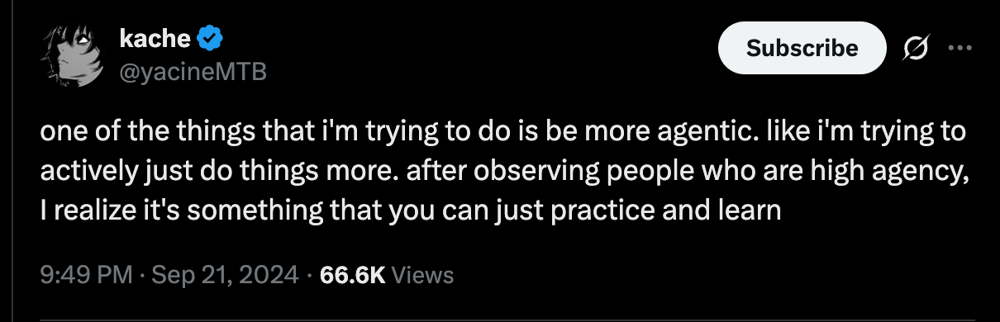
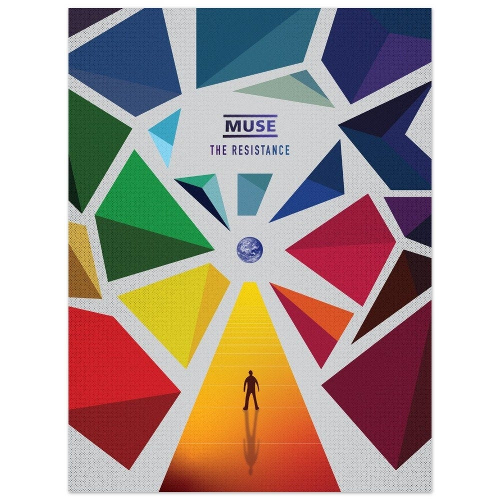

I’ve seen a read of discourse about agency. Talking about how we can all “just do things.” But what does agency mean, exactly? It’s a heavily clustered concept: difficult to untangle, meaning different things to different people. Is it a bias towards action? Self-efficacy? Ownership? Maybe to you it’s all of the above or something else entirely.

In this piece, I go through a few of my favorite posts about agency and create my own mental model of agency, and how to practice it. Here goes:

**Agency (n.) — the art of being yourself. Seeing beyond where you are today and journeying toward who you can become.**

Practicing agency involves a four-part loop:

1.  Seeing yourself
    
2.  Exploring all possible options
    
3.  Overcoming resistance
    
4.  Taking action
    

I’ll go through these step-by-step. Also, I’ve sprinkled in some self-reflection questions throughout the piece you can use to pause and reflect if you like. Marked with 🤔

## 1 - Seeing yourself

> 🤔 What is the most capable version of me that I can imagine?

That’s the question by ‘Autotranslucence’ in [Becoming a magician](https://autotranslucence.wordpress.com/2018/03/30/becoming-a-magician/). They talk about “magicians:” people who are operating at a level that they cannot fathom. At first they were boggled by these people’s existence, then they realize they could become more like them. Someone different. That is, if they were willing to make the change.

It sounds like an empowering question. But if you’re like me, it also sounds frightening. Becoming someone else means, in some sense, the death of the current you. Habits, stories we tell ourselves, even relationships might disappear when we accomplish a metamorphosis. Butterflies have to leave their caterpillar form behind. There are new stories and friends on the other side. The butterflies are okay. But it’s hard to see that far ahead.

> 🤔 What emotional needs are not being met by your current life?

### Being yourself is hard work

When I was a middle school outcast, I incessantly heard the refrain “just be myself.”

Terrible advice.

The implication was that I was perfectly fine as I was, and if people didn’t like it, that was their problem. “Myself” was the default state. Why should I have to put in effort to “fit in?” It was told with good intentions, but all I internalized is “why do I have to be myself if I hate how that feels?”

Later I discovered that “Being yourself” is hard work. It requires asking yourself hard questions. Curating your taste. Shaping your voice. Learning to enjoy your company. Living in accordance with your values. To be yourself you have to *build* yourself. Being yourself is a choice, a chore, a burden, a gift.

Understanding who you could be and who you are today are the same question. It’s Current You who wants to be New You. Why do you want it?

I feel slightly sorry for people who have never had the opportunity of a mental health crisis. Depression teaches that you are not your thoughts. Addiction teaches that you are not your desires. There’s no better way to learn that you can change who you are than by being in a situation where not doing so means your untimely death.

But once you’ve decided you want to move in a new direction, how are you going to take the next step?

## 2 - Exploring all possible options

I’ve really been enjoying Cate Hall’s recent work about agency on her Substack [Useful Fictions](https://usefulfictions.substack.com/). It started with her first post, [How to be More Agentic](https://usefulfictions.substack.com/p/how-to-be-more-agentic), but the one I found most useful, and her top post, is [Maybe you’re not actually trying](https://usefulfictions.substack.com/p/maybe-youre-not-actually-trying).

Cate posits that we bring unequal amounts of rigor to different parts of our lives. Imagine a staff engineer who has a robust issue tracking system at work, but then when they go home to cook dinner, it’s chaos. They get hungry and have to make yet another DoorDash order, because after three trips to the store they still lack all the ingredients to make dinner. What if you applied maximum resourcefulness to every aspect of your life?

**Think deeply about every option you have available**. Ask yourself and others questions.

Making change means expanding our collection of all possible options. Expanding our possible options means expanding our definition of our own capability.

I’ll use myself as an example: I have written online since 2008. I have *never* managed to maintain a consistent content calendar. I could say it’s because I have a 9-to-5, a family, and an aging body to take care of. But have I explored every option? I could schedule and stick to more writing blocks. I could write and maintain a backlog. I could offer to donate $50 to a cause I hate if I don’t have at least one new post a week. I could lock myself in a cabin and not leave until I had a three-month backlog. I could schedule a draft post to go out and then it’ll ship whether I’m done or not. There are more strategies I’m sure. I could ask other writers how they do it. I could do more research on strategies that have worked for others.

Truth is, either consciously or not, I don’t want to.

If you don’t know what to do next, then you have to take a step back and realize that you can do something about *that.* Start anywhere, or do some light strategizing.

> 🤔 Have you spent a five-minute timer generating options?

I guarantee whatever problem you’re facing, you have more options than you realize. Is it possible you committed to one option too early and wrote off other options? [Things you’re allowed to do](https://milan.cvitkovic.net/writing/things_youre_allowed_to_do/) is a fun list to scroll through for inspo. Sometimes we need a reminder that we’re allowed to ask for help or throw money at the problem.

> 🤔 Who do you know who you could ask for help from?

## 3 - Overcoming resistance

In *[The War of Art](https://stevenpressfield.com/books/the-war-of-art/)*, Steven Pressfield describes the internal battle taking place inside all creatives between the Muse and the Resistance. The Muse pushes you to create, to grow, to venture into new frontiers. But the Resistance tries to stop, scare, over analyze,distract,deflect, and demoralize.

The more you take on, the more Resistance you find. This is the challenge of agency. It’s often less about “taking more intentional action” and more about “getting out of your own way.”

The trick is to learn to fight through the resistance, no matter how difficult it feels. Like a video game, the fights get harder the further you progress. I try tp develop a taste for battling Resistance. It’s a sign I’m moving in the right direction.

If you’re not careful, you can fall prey to Resistance Psychosis and start confusing Resistance’s words for your internal monologue.

These aren’t your thoughts and they are not valid.

If you hear any of these in your head, attack them and question their validity. Resistance dies in daylight.

-   I can’t do this.
    
-   I *shouldn’t* do this.
    
-   I don’t have permission to do this.
    
-   I don’t deserve to do this.
    
-   I’m not the kind of person who does this.
    
-   This is too risky.
    
-   This isn’t my fault.
    
-   This isn’t my responsibility.
    
-   I have to do something else instead.
    
-   I don’t have the {time, money, energy} for this.
    
-   I’m not {good, smart, rich} enough for this.
    
-   I’m scared I’ll never achieve this.
    
-   I’m scared of what would happen if I *did* achieve this.
    

Obviously, You cannot and should not do *anything.* There are physical limitations and moral codes. But when you run into a limiting belief, it’s worth examining. What’s stopping you here?

One way to tackle these objections is to act as if the opposite were true. Looking at the problem differently can unstick you.

-   What if you can do this?
    
-   What if you are the kind of person that does this?
    
-   What if you did have the time, the money, the resources?
    
-   What if you made time for this?
    
-   What if it’s worth the risk?
    
-   What if you got started right now?
    
-   What if it’s actually easy?
    
-   What if it was your responsibility?
    
-   What if you’re already enough?
    

But sometimes it doesn’t feel like a fight. Instead it feels like being stuck in a bog. In [So you wanna de-bog yourself](https://www.experimental-history.com/p/so-you-wanna-de-bog-yourself), Adam Mastroianni lists out several anti-patterns of feeling “stuck.” A quick summary:

You shouldn’t have to work on this problem anyways. It’s not your fault. Or it’s too big to handle. And even if you want to tackle the problem...

You can’t get started because you haven’t found the perfect solution. Or you don’t understand the problem enough yet. You’re waiting for the day you tap into that magical well of discipline you’re sure you’ve stowed away somewhere. And even if you did know what to do...

You have enough obligations on your plate already. Or you’re too concerned with the state of the world. (Solutions, in this economy?) Or it’s too scary to get started.

> 🤔 How am I the problem?

All of this comes from your ego’s survival instincts. If you change, it dies. Resistance is that lesser part of you, having an extinction burst. It’s doing everything it can to prevent you from acting different and becoming someone else. Resistance is the part of us that would rather stay as we are than be who we want.

> 🤔 What am I afraid of doing, and what would my life be like if I wasn’t afraid of doing those things?

## 4 - Taking action

Introspection is fun, but useless if you don’t put it into action.

There’s a distinction between exercising agency and biasing towards action. Agency is about effecting *change*, which means taking actions that *get results*. “You can just do things” does not mean “go do anything.”

It’s not a bias towards action, it’s a bias towards results.

### Agency compounds

Action is key. Action produces information. Pay close attention while you’re doing the work. The work will teach you about yourself, about who you want to be. It’ll open more options, build your confidence, and help you get unstuck.

> The only way to learn is by playing. The only way to begin is by beginning. - Sam Reich

The more you do this, the stronger you become, and the easier it gets. You will gain more capabilities, more self-knowledge, and more confidence, and move closer to the next iteration of you.

## And now, a moment of Zen

Text within this block will maintain its original spacing when published

<pre>Just beyond yourself
It’s where you need to be
Half a step into self-forgetting and the rest restored by what you’ll meet
There is a road always beckoning
When you see the two sides of it closing together at that far horizon and deep in the foundations of your own heart at exactly the same time,
That’s how you know it’s the road you have to follow
That’s how you know it’s where you have to go
That’s how you know you have to go
That’s how you know
Just beyond yourself, it’s where you need to be
— David Whyte</pre>

## Bibliography

-   [Becoming a Magician - Autotranslucence](https://autotranslucence.wordpress.com/2018/03/30/becoming-a-magician/)
    
-   [Stanford encyclopedia of Philosophy entry on agency](https://plato.stanford.edu/entries/agency/)
    
-   [Musings on teaching agency - Chana Messinger](https://chanamessinger.com/blog/musings-on-teaching-agency)
    
-   [Thread: High Agency Questions - Chana Messinger](https://x.com/ChanaMessinger/status/1463160594941554696)
    
-   [How to be more Agentic - Cate Hall](https://usefulfictions.substack.com/p/how-to-be-more-agentic)
    
-   [Are you even really trying? - Cate Hall](https://usefulfictions.substack.com/p/maybe-youre-not-actually-trying)
    
-   [Things you’re allowed to do - Milan Cvitkovic](https://milan.cvitkovic.net/writing/things_youre_allowed_to_do/)
    
-   [So you Wanna De-Bog Yourself - Adam Mastroianni](https://www.experimental-history.com/p/so-you-wanna-de-bog-yourself)
