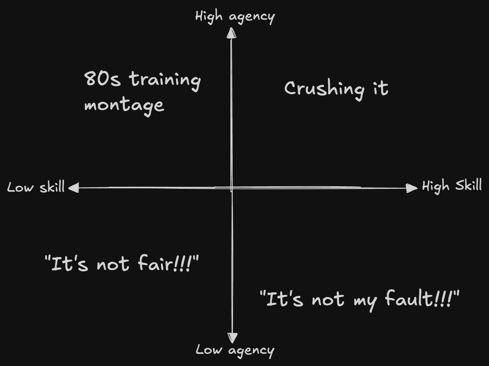
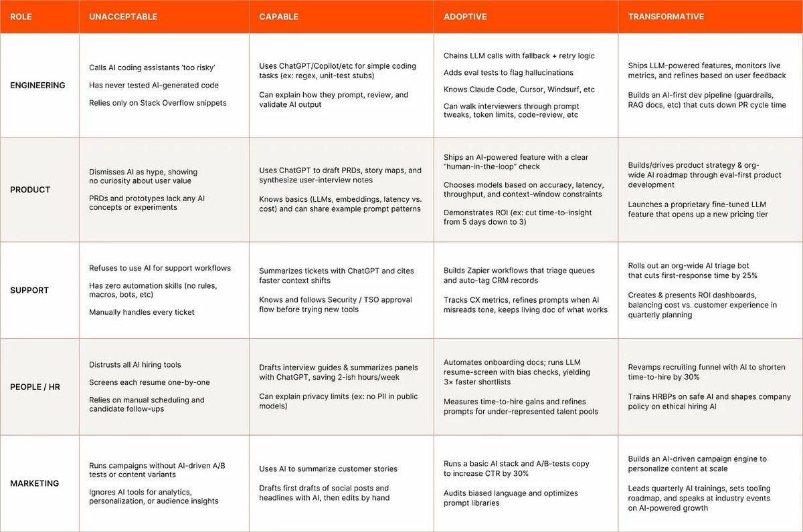
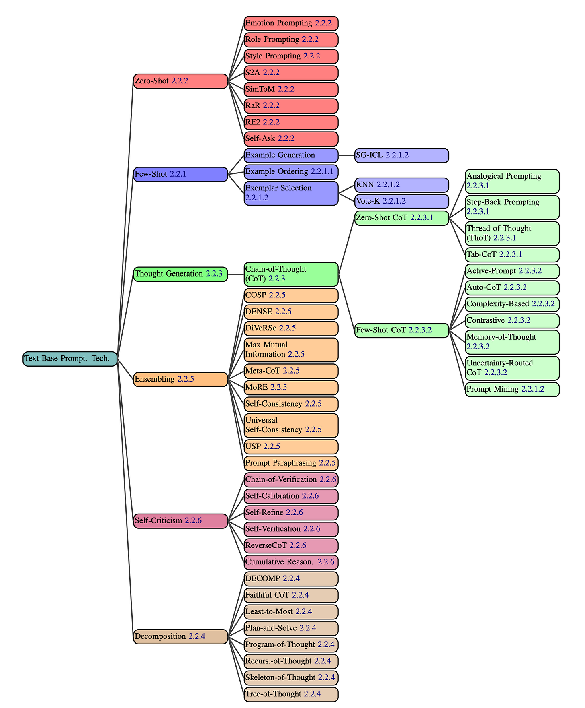

I've been thinking a lot this about how people perceive LLMs, and how those perceptions shape the results they get. Why do some see massive productivity gains, while others see only hype? Why do some people treat them like personal assistants, others therapists, and still others soulmates[^1]?

## AI and skill issues

*Elden Ring* introduced many players to the Soulslike genre, a notoriously difficult type of video game. When newcomers complain about unfair bosses and punishing mechanics, they may be told to 'git gud.' or simply 'skill issue.' - gamer slang meaning "the problem isn't the game, it's you."

The first boss lampshades this, reminding the player after defeat they aren't yet ready for what lies ahead. New players, myself included, heard this phrase over and over and over again.

At least, they aren't ready yet.

Some people take offense at being told "skill issue." But truth is, its empowering. You can't change the game, only l how you play.

Same with LLMs.  People say they don’t get the same results others rave about, and think its baseless hype.\[^1\] Unlike Elden Ring, it's harder to tell what is skill and what isn't. Elden Ring is difficult, predictable, and fair. LLMs are a non-deterministic blackbox. The same prompt can give different answers, and it can be unclear why. I still don't know how to tell the difference between user error and model strangeness.

Skill issue on my part I suppose.

## Defining AI fluency

If some people are better at using LLMs, what skills set them apart? What does it mean to be “good at AI”?

This internal AI fluency framework from Zapier has been making the rounds. I don’t know if I agree with all of it, but it’s a decent starting point.

Part of fluency is knowing what’s available, what tools can and can’t do, and matching the right model to the right task. Skilled operators write stronger prompts, and they also pick the best model for the problem. That’s the difference between someone typing two sentences into a free ChatGPT window, and someone who [studies the different elements](https://sanderschulhoff.com/Prompt_Survey_Site/) of what goes into a prompt. See intimidating chart:

But ultimately, I think the deeper skill is being able to *figure it out.* By the time the charts are made they’re already outdated. Instead of diving into byzatine documents, you have to have to [just push buttons](/blog/just-push-buttons/), evaluate the results, and adjust your approach.

## Many AI adoption strategies fail, but not for the reason you think

I’ve seen this headline thrown around a lot: "[MIT report: 95% of generative AI pilots at companies are failing](https://fortune.com/2025/08/18/mit-report-95-percent-generative-ai-pilots-at-companies-failing-cfo/)"

Some people read that as “don’t run a GenAI pilot.”(AI is hype!) Others see it as “figure out how to be in the 5%.”(I gotta git gud!)

Pro tip: When people cite a "studies show X" headline, go find the study and read it your self. In today's infinite content environment, this is a superpower.

Go ahead, give it a shot: [The GenAI Divide: State of AI in Business in 2025](https://mlq.ai/media/quarterly_decks/v0.1_State_of_AI_in_Business_2025_Report.pdf), tell me your biggest takeaway after reading it.

My take: it’s more "enterprise companies struggle to adapt to new technologies" and less "AI fails to deliver."

### Losing companies are:

-   Overspend on sales & marketing, underinvest in back of house automation.
    
-   Buying expensive, tailored, inflexible GPT over generics like ChatGPT and Cursor
    
-   Try to roll their own internal AI systems.
    
-   Have complex enterprise processes and refuse to change them.
    

### Winning companies are:

-   Solving for learning, memory, and workflow adaptation.
    
-   Build systems that learn from feedback and retain context/
    
-   Invent new, high-leverage processes that leverage AI's strengths.
    

What stuck with me: the big wins aren’t coming from making current workflows faster, but instead **creating entirely new ones.**

A better question than "how can we go faster?" is "What can we do with LLMs that wasn't possible before? "

[^1]: If you want to play Black Mirror IRL, go have a gander at [/r/AISoulmates](http://reddit.com/r/aisoulmates)
