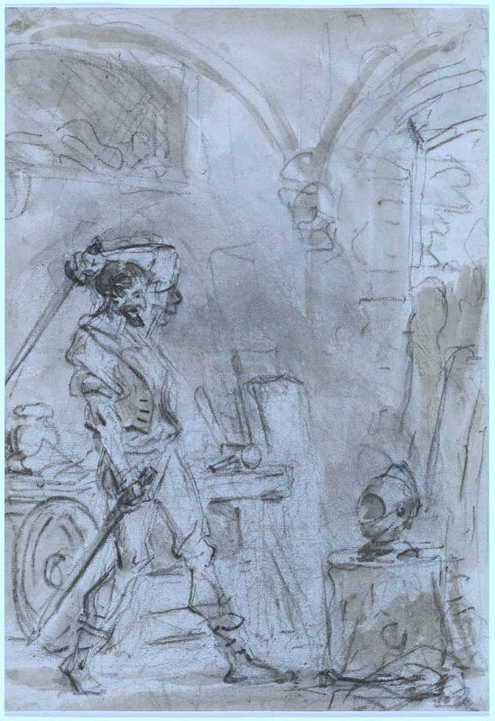
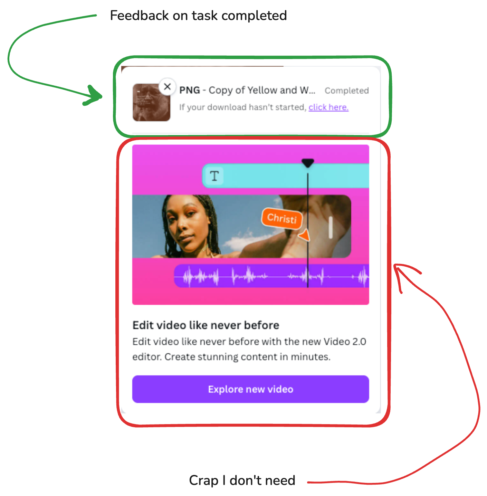
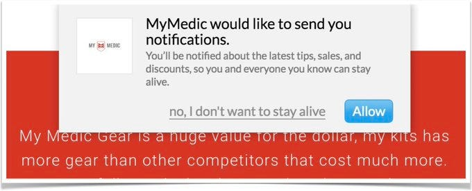
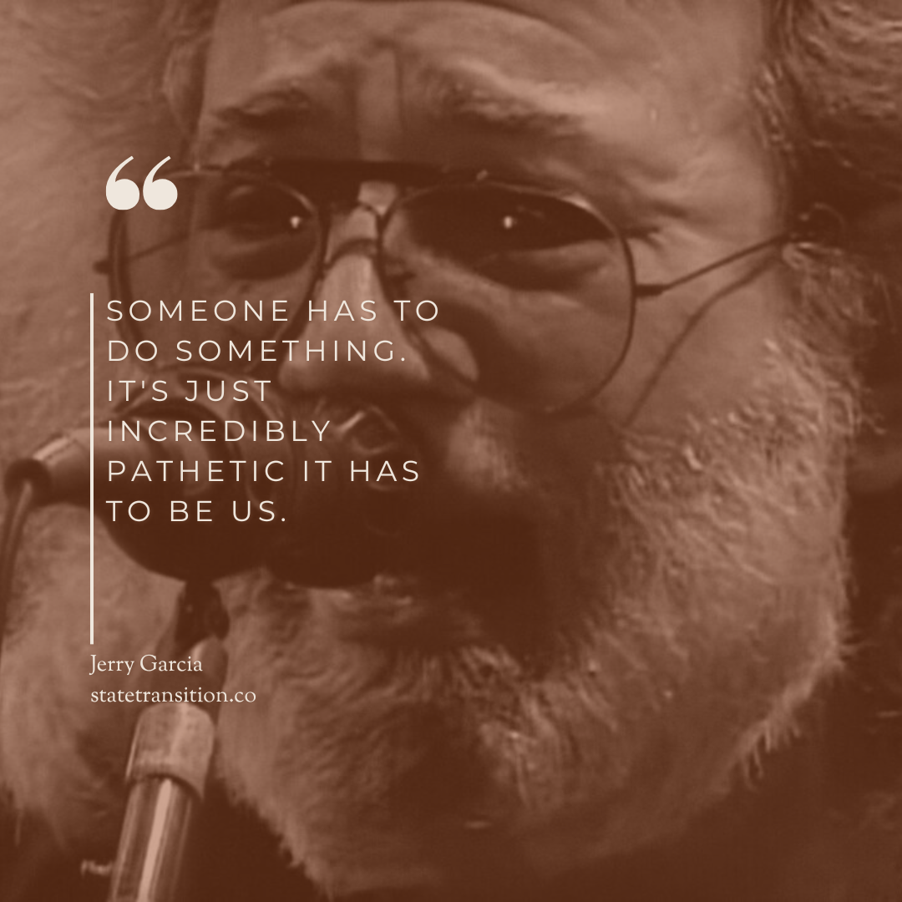

In part one, I took a look at patterns of software design that help enable your user's agency. In this piece, I'm examining the patterns that are used to strip away agency. In the pattern language of product design, these are the swear words.

[Building software that amplifies agency](/blog/building-software-that-amplifies/)

## 1 - Needy programs

There has been a shift in how technology interacts with users. I sensed this for a long time, but couldn’t articulate it. That is, until Niki Tonsky captured it with the term “[needy programs](https://tonsky.me/blog/needy-programs/).”

> Older programs were all about what you need: you can do this, that, whatever you want, just let me know. You were in control, you were giving orders, and programs obeyed. - Niki Tonsky

Need programs get in the user’s way, and put the wants of the software provider over the needs of the person using it.

### Accounts

I hate it when I buy something from an online store, a niche gift from a place I don’t plan on returning to, and now I have an account with them. To paraphrase Mitch Hedberg, I give you money, you send me a package. There is no need to bring email subscriptions into this. I not 15% off of my next purchase, I want you to get off of my back about a next purchase.

### Updates

A man shopping for a washing machine sees on the label that it has Wi-Fi capabilities. He approaches a floor person. “Why does a washing machine need internet access?”

“So the manufacturer can install security updates,” responds the employee.

“Why does a washing machine need security updates?”

“Because it’s connected to the internet!”

I once sat down to play a game on my Playstation 5 and was greeted with a barrage of pop-ups. The game needed updates. The console needed updates. The freaking *television*? Updates.\[1\]. I’m showing my age, but I miss when you could plug a cartridge into a system, turn it on, and it would just *go.*

### Notifications

We are bombarded by notifications. Product teams know we cannot resist the siren’s call of the red numbered dot. We sit there popping these pimples on our smartphones, hoping they don’t come back. Notifying the user is fine in some cases but should be used sparingly. Notifications are a to-do list the user didn’t sign up for.

### Login Modal Ambushes

I don’t need to know about your new feature the moment I log in. I logged in to do a task, and these in-app advertisements are getting in my way.

### Bloat

I purchased a smart TV and, to my surprise, the home screen lagged the first time I turned it on. Response time was slow and the interface was difficult to use. The home screen had ads, pre-installed garbage apps, home connect features, and background processes running for speech control, AI features, and metrics collection. I had to find a tutorial online and spend 20 minutes in the settings getting the television to a usable state. I considered setting up an LG developer account so I could enable developer mode and disable *even more stuff.*, I should not have to do this level of tech support on a brand new product. Lord help me if my in-laws ever buy an LG TV.

## 2 - Removing decisions

You should make decisions as easy as possible for users. But be wary, simpler isn’t always better.

We want software to be easy. Ideally, it makes decisions as easy as possible for us. But at times, this can go to far: simplification can steal choice away from the user. It’s the difference between a Prix Fixe menu and an airline that doesn’t let you choose your seat.

### Overly simplifying interfaces

Consider touch screens in modern cars. It’s a cleaner look, replacing a swath of dials and buttons with a sleek screen. When I was growing up, we didn’t have radio buttons in forms, only buttons on the car stereo.

This simplicity comes with a cost. You no longer get the satisfying *thonk* sound when you switch stations. And a [study by a Swedish car magazine](https://cosmobc.com/touchscreens-in-cars-safety-warning/) shows that drivers take four times longer to complete a task on a touch screen compared to analog controls. This isn’t an inconvenience, it’s dangerous. The simplified design removed affordances. Drivers can no longer feel their way around the controls. drivers have to navigate menus to find the settings they’re looking for.

### Greedy defaults

Smart defaults make selections for the user to reduce cognitive load. Greedy defaults exploit the shortcuts the user’s brain takes to get them to act against their own self-interest. A common example: a checkbox for “subscribe for updates” in a store checkout page that’s already set to yes. Many applications have tracking and other behaviors that benefit only the company turned on by default.

### Hijacking the user’s machine

Only steal the user’s focus when it’s helpful to them, not to force their hand. Users own their machines and should decide what to do with them.

Respect the machine’s default behavior. Don’t override basic functionality within your application, or behaviors expected within an element. Examples: removing the ability to right-click on items, disabling the esc key, or having a video with no way to stop or scrub playback.

### Holding the user hostage

Some applications force users to stay within a process, or worse, in a subscription, without their consent. If they can quit, they make it difficult. Give users opportunities to cancel out of any process. Let them stop a process and come back to it later. Users should be free to come and go as they please. It’s an app, not a cult.

This goes for their data too. Your application should let users export their data and take it elsewhere. Part of the genius of the Unix philosophy is that every program takes plain text as input and returns plain text as output. Use common file formats and sensible structures. Be more like Unix.

Don’t implement cancellation flows that are intentionally confusing, long-winded, or hidden. If someone can sign up for a product online, they should be able to cancel online, without picking up the telephone.

### Case study: Algorithmic feeds

This is a whole other article, but I believe Google killing their Reader product contributed to the global rise of far-right fascist movements. Between 2013-2016, the way users consumed information via the internet changed. All major social media applications switched to algorithmic feeds. At the same time, Google killed their RSS reader to push people toward their own algorithmic feed product, Google+. Creators started making content for the algorithm instead of building more natural ways of connecting and sharing information. It wasn’t apparent at the time, but in retrospect it was a foundational shift from people searching out content to having content pushed at them. From pull to push.

Researchers have defined what they call **attentional agency**. Imagine a tug-of-war with the *agent* (user) on one side, the *advocate* (person controlling the algorithms) on the other, and the *platform* as the battlefield. Advocates give you options to select from based on what they think will increase engagement, not what best matches what you asked for. Chronological feeds contain [50% less hateful content and 3x the amount of links to news sources](https://arxiv.org/html/2406.17097v1) on average. Algorithmic feeds have more tabloids and mainstream news; chronological feeds have more local sources.

Users spend [73% more time on and engage nearly 20x as much](https://www.npr.org/2023/07/27/1190383104/new-study-shows-just-how-facebooks-algorithm-shapes-conservative-and-liberal-bub) with an algorithmic feed vs. a chronological one. Users also experience a [palpable increase in anger (0.47 SD), anxiety (0.23 SD), sadness (0.22 SD), and a 21% increase in hostility toward out-groups](https://knightcolumbia.org/content/engagement-user-satisfaction-and-the-amplification-of-divisive-content-on-social-media).

The metrics the business cares about went up, with a real cost for the user. We feel worse, we have less control, and the platforms profit.

## 3 - Defrauding the user

Sometimes using the internet, it feels like everything is a little bit of a grift. If it isn’t in your face, it’s behind your back.

### Deceptive pricing practices

As of 2023, Google Workspace offered two pricing tiers: Business Plus and the more expensive Business Starter. Starter was not available during signup. The only way to get it was to sign up for the more expensive plan, then downgrade. Users should be informed about how much they will pay, what they will receive, and whether it’s one-time or recurring.

### Fake Urgency & Social Proof

Every time I see a store with “only 2 left!” there always seem to be only 2 left. Like the general store in *O Brother Where Art Thou*, these places are a goddamn anomaly. Authentic urgency is fine, but creating imaginary scarcity is fraud.

### Public by default

Applications with a social component tend to default to everything being public. While this is useful for catching senators with questionable Venmo transactions, it’s harmful to users at scale. Users should opt-in to behavior that could pose a risk, and sharing things online poses a risk.

### Pricing page traps

Ever click on a feature and instead of getting it, you get an upsell to the paid option? Actions should do what the user expects.

## 4 - Emotional Manipulation

This is the big one. Many “growth hackers” and product people don’t understand the difference between persuasion and manipulation. There’s nothing wrong with being aware of emotion in design (if you want to explore that topic, I recommend Aaron Walter’s *[Designing for Emotion](https://www.aarronwalter.com/book)*). The problem arises when you use these techniques to make people act out of fear instead of from a place of agency.

### Confirmshaming

Opt-out buttons worded in a belittling or derogatory manner, making users feel bad about declining. A chilling example, care of [Deceptive Design](https://www.deceptive.design/types/confirmshaming) (who coined the term):

The eCommerce website mimedic.com sells first aid packs and medical supplies. They used the following pop-up when asking for permission to send website notifications:

The copy "no, I don't want to stay alive" is troubling, given the context of serving people who have been exposed to trauma and death in their work.

### Gamification & Gambling Mechanics

Gamification adds game mechanics to systems with the element of play stripped away. Leaderboards, quests, achievements, unlocks, and XP to drive behavior. It is psychologically manipulative. Uber rolled out a “quest” feature for drivers, offering bonus cash for hitting milestones. But as drivers got close to their goal, Uber fed them lower-paying rides, keeping them behind the wheel longer. They’re out driving, eyes burning, concentration fraying. Uber isn’t helping drivers have fun; it’s putting them and others at risk to increase profits.

Gamification can have positive effects too. I used to go to a CrossFit gym, fully aware that CrossFit is just gamified workouts. But it worked: it kept me coming back and got me in better shape.

Duolingo exemplifies the duality of gamification. On the paid plan, they use it to encourage language learning. On the free plan, they use it to encourage upgrading to the paid plan.

When you see gamified systems, ask: What behaviors is the system pushing? Who benefits most?

### Engagement at any cost

The state of social media makes sense once you see how the numbers work. The algorithms are not trying to show you what you want to see; they’re trying to show you what will keep you engaged. Engagement can come from interest and curiosity, but it can also come from outrage, hatred, shock, anxiety, and fear. The latter is much easier and more effective.

## You are the last line of defense

As software engineers, we are responsible for the work we put out into the world. Technology is powerful and has real impacts on society. I am reminded of [an interview with Bo Burnham](https://www.youtube.com/watch?v=UmUm7oBqCVw) on the attention economy:

[Watch on YouTube](https://www.youtube.com/watch?v=UmUm7oBqCVw)

> We used to colonize land. Now, it’s human attention. These companies—tech companies, social platforms—they’re coming for every second of your life. At first, they were trying to capture your free time, but now, every single moment you are alive is a moment you could be looking at your phone, gathering data, and being targeted with advertising.
> 
> And it’s not like there’s some evil mastermind. It’s just capitalism, and it keeps growing. These companies have to report to shareholders, so they can’t stay stagnant. Every year, platforms like Twitter or YouTube need their growth numbers up. The whole model is, ‘How do we get more of you, more of your attention?’
> 
> After we’ve colonized the entire earth, the only space left was the human mind and every minute of our time. Now, they’re trying to colonize every minute of your life. If you’re not online, that’s time they aren’t gathering data, targeting ads, or monetizing you. That’s what’s really happening.

I understand that pushing back against these asks is not easy. But I am reminded of another quote, this time from Jerry Garcia:

> This is an excerpt from my upcoming book on product thinking for engineers. **[Sign up to be notified](https://engineering-product.kit.com/0d5f0028f8)** when it is available for purchase.
