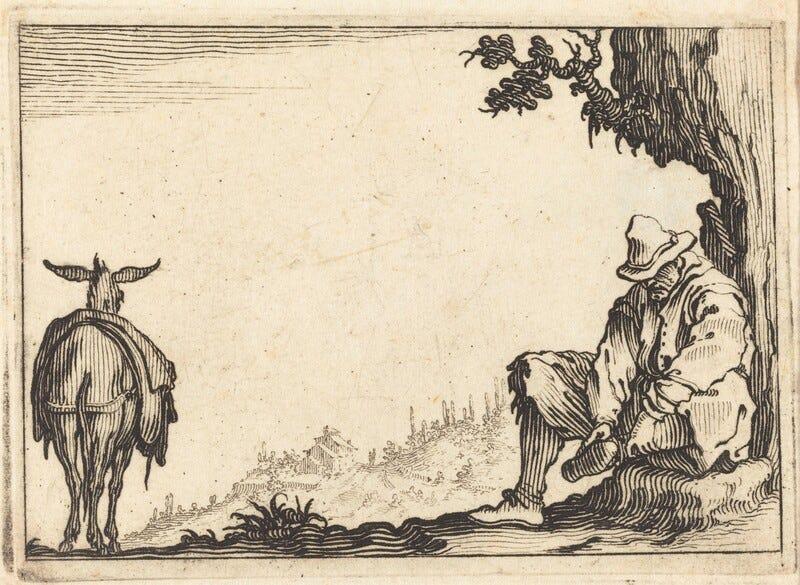

Making cuts is easy when you’re removing the noise, fixing the bugs, and polishing the edges. It’s much harder to say no to a good idea. Or maybe that should be, a “good enough” idea. But the ability to do so is an essential skill if you want to do good work. It’s asking “why” instead of “why not?” when it comes to product decisions. There’s an old Stephen King quote:

> Kill your darlings, kill your darlings, even when it breaks your egocentric little scribbler’s heart, kill your darlings.
> 
> — Stephen King, On Writing: A Memoir of the Craft

Deciding to get rid of something \*hurts.\* Taste requires leaning into that pain, seeking it out. Relishing it.

When working through the draft for my product engineering book, I wasn’t just removing clunky word choices and fixing run-on sentences. I cut \*chapters\*. Thousands of words representing days of my time. If the chapters were bad, this would be easy. But they were good points, and useful information to people. But they were incoherent with the central idea and goal of this book. A good chapter can make a good book worse if it doesn’t fit. Even if they were useful, they would take up more of the reader’s time, and risk distracting, you or much worse, boring them.

For an anti-example, see enterprise software. Checklist-based design that is built not for the people who use it, but for the procurement departments who purchase it. It’s a maximalist model: More features = more boxes checked = more potential sales.

Making cuts is often difficult and never popular. No one sits down at their performance review and gets high marks for the features they \*didn’t\* build in the last six months It’s one thing to kill your darlings, it’s something else entirely to kill someone else’s.. Sometimes the best you can do is ‘yes and...’ the direction somewhere else. If it’s about killing product feature, explain the costs of keeping it around, and what it’s keeping you from.

Humans are naturally biased against subtraction. We think in more. It can help to think of creation through subtraction: You are making space for what matters; You are gathering more resources to put towards other work. What does removing this get us?

This is an excerpt from my upcoming book on product thinking for engineers. **[Sign up to be notified](https://engineering-product.kit.com/0d5f0028f8)** when it is available for purchase.
