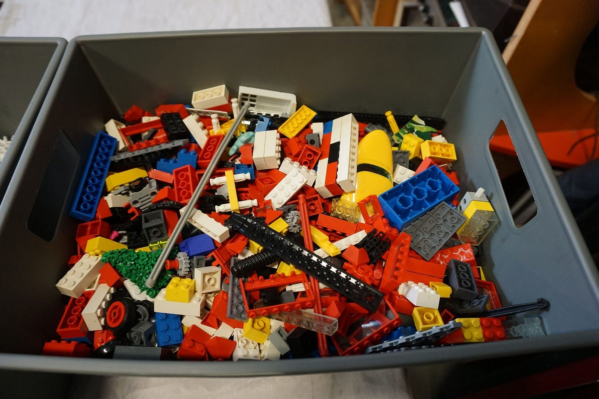
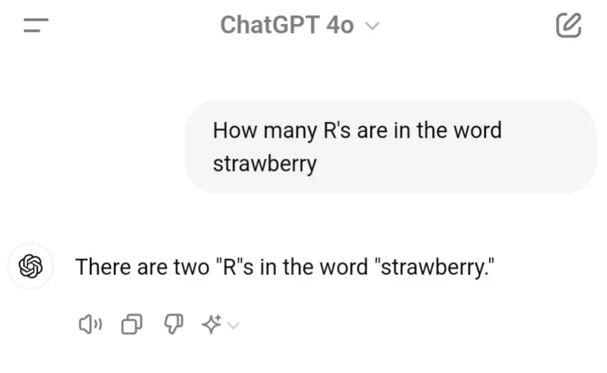
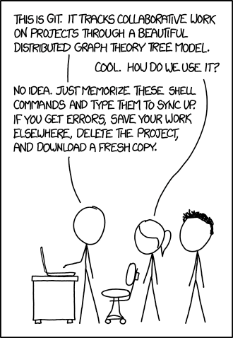
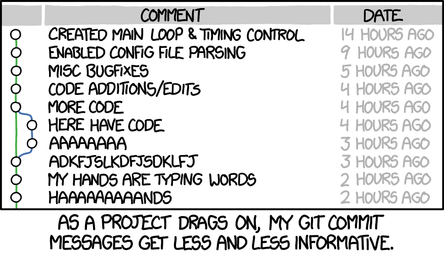

This is part 2 in my series on building agentic assistants. I’ve been iterating on one that helps me do my job as an engineering manager. In part 1, I looked at this emerging pattern. It usually involves combining [Claude Code](https://code.claude.com/) with the Opus 4.5 model and [Obsidian](https://obsidian.md/) .

Read part 1 here:

[Claudatouillie](/blog/claudatouillie/)

## A bin of building blocks

When I was a kid, I loved Lego. What kid didn't? Most of the time, I had a bin, a menagerie of simple colors and cubic pieces. Christmas was the only time I got a set, with themed pieces and instructions. A medieval castle is a medieval castle set, but a bin? It can be anything! It could even be a castle!


The joy of personalized software is that it can be anything, built by you, for you. Instead of giving you instrcutions, I’m giving you a bin. You can study the list, and think about how you can connect these together to build not just any system, but your system.



## An example

I have projects and tasks stored in **Obsidian** files. Then I added a `prioritizer` **agent** with a rubric for prioritizing tasks, and a `/plan-day` command that fetches my agenda from Google Calendar via the `gog` **skill** and uses that to rough out a plan for the day. Then it creates a daily journal note for me, with the agenda at the top.

Each bolded word is one Lego in the system. Now to break down what each Lego looks like and how they fit together.

* * *

## 1 - Basic Tools

## Claude

[Claude](https://claude.ai/), built by Anthropic, is the tool I’m most bullish on. I have a theory that the first follower into a market ends up winning. The Sega Saturn crashed, the Sony Playstation thrived. N\*Sync had bigger hits than the Backstreet Boys. ChatGPT is the default, but I find Anthropic’s tooling more useful, so I’ll focus on it.

Four ways to interact with Claude:

1.  **Standard** - I’m lumping the web browser and mobile apps together here. It’s fine if you just want to ask a question, but there is little room to systemize.
    
2.  **Installed app** - the chat, but a little more featured. You can manage integrations and connect to your file system.
    
3.  **Cowork** - a research preview behind the paywall, [Claude Cowork](https://www.anthropic.com/cowork) is Anthropic’s response to latent demand for agentic personal assistants. I haven’t tried this one yet because my preferred method is...
    
4.  **Claude Code** - a command-line tool that leverages Anthropic’s LLMs. My personal favorite. The command line is the most powerful way to use the computer and the one I’m most used to as a programmer. The terminal can be intimidating, but if you’re moving your work towards text files and automation, it’s a useful skill to have, and not as hard as it looks.
    

Think of the command line like cooking: it’s as complicated and skill-based as you want it to be. Some people are master chefs who know a litany of techniques. Some, like me, are more utilitarian. I can roast a vegetable, fry an egg, pop a tart. You don’t have to be an expert. A few skills go a long way.

A demo of cowork:

[Watch on YouTube](https://www.youtube.com/watch?v=WBNZpAWhw5E)

## Obsidian

Obsidian is a note-taking tool. The perfect mix of simplicity, utility, and power. You write notes stored as plain-text files. You can link files with wikilinks like `[[this]]`. Thousands of plugins are available to extend functionality. You can add graphs ([Excalidraw](https://obsidian.md/plugins?id=obsidian-excalidraw-plugin)), queries ([Dataview](https://obsidian.md/plugins?id=dataview)), or task management ([Tasks](https://obsidian.md/plugins?id=obsidian-tasks-plugin)). If you're interested in an Obsidian + Claude Code setup, there's a plugin that brings a terminal directly into your notes. Plain text is the easiest way to feed an LLM. It gives you permanent storage that is readable and writable by man and machine alike.

### Optional: IDE (Cursor or VSCode)

If you’re getting into managing code as part of this exercise, you may want a tool for editing it. These super-powered text editors are called IDEs (Integrated Development Environments). The two best options: [VSCode](https://code.visualstudio.com/), Microsoft’s editor and the standard choice in the biz, and [Cursor](https://cursor.sh/), an AI-powered fork. You can use AI via Cursor directly, but if you’re using Claude Code it may not be necessary[^1].

## Extending Claude Code

Assume any LLM-based tool is 60% ready-to-go out of the box. You have to put in some effort to get it working how you want. It doesn’t know you, your goals, or your processes. The better you are at getting context out of your head and into [Markdown](https://www.markdownguide.org/) files, the more effective you’ll be. Claude offers a variety of structures to customize and amplify its abilities:

### Claude.md

If you’re getting started, put your rules and general logic into [Claude.md](https://code.claude.com/docs/en/configuration#claudemd). Think of this as an initial prompt Claude has at the start of every conversation. You can tell it how you want it to behave, your goals, boundaries, and constraints. Here’s an example (credit to Alex Hillman for this one) to set a communication style:

```
## Communication Style
- Never end sentences with ellipses (...) - it comes across as passive aggressive
- Ask questions one at a time
- Acknowledge requests neutrally without enthusiasm inflation
- Skip validation language ("great idea!", "perfect!", "excellent!", "amazing!", "kick ass!")
- Skip affirmations ("you're right!", "exactly!", "absolutely!")
- Use neutral confirmations: "Got it", "On it", "Understood", "Starting now"
- Focus on execution over commentary
```

💡 **Pro-tip**: Claude loves structured information. Headers and bulleted lists are easier for it to parse.

### Slash commands

[Slash commands](https://code.claude.com/docs/en/interactive-mode#built-in-commands) are reusable commands you call while typing into the terminal. Claude has many built in by default, like `/clear` to empty its memory and `/model` to select the model. You can also write custom commands for repeatable processes.

If you aren’t sure how to write a slash command (and this will be a recurring theme), ask Claude to write one for you. LLMs are adept at writing text that LLMs can read. You can ask Claude to make modifications later, or go in and make more surgical edits yourself.

**Example:** have a `/fetch-calendar` command that gets your daily agenda, or a `/line-edit` command that does an editing pass on your article.

### Agents

If you do this for a while, your Claude.md file will get large. You’ll realize a lot of the rules only matter in certain contexts. When that happens, break it down into [agent files](https://code.claude.com/docs/en/sub-agents). Claude has a slash command, `/agents`, to help you write them.

**Example:** I have a `frontend-engineer` agent that knows how to write code according to my guidelines and style. I have an `appointment-maker` that knows my meeting preferences and how it integrates with Google Calendar (more on integrations in a bit).

## MCPs

[MCPs](https://code.claude.com/docs/en/mcp), short for Model Context Protocol, bridge Claude and third-party systems. Think: wrapper for an API. Claude has a list of common MCPs people integrate with.

**Example:** Two that I find useful, that you can install with a single command, are **Notion** and **[Playwright](https://playwright.dev/).** If you use Notion for work, this gives your system an easy way to read and write files. Playwright, and this is a fun one, gives Claude the ability to open and use a web browser. You can add it with a single command:

```
claude mcp add playwright npx ‘@playwright/mcp@latest’
```

In theory, Playwright is the only MCP you need to integrate with every website on the planet. It’s slower and less reliable than direct integrations, though. If you’re worried about handling credentials, what I do is say: “If you run into a login or account verification page, show it to me and I’ll log in.” Then the system won’t have access to your credentials.

Unlike agents and slash commands, I never write custom MCPs. Some are useful, but I find skills and scripted integrations more effective. Still, I can’t deny a one-line command for web access is powerful. If you want to dive deeper on why MCPs may not be the best choice, highly recommend: [Your MCP doesn’t need 30 tools, it needs code.](https://lucumr.pocoo.org/2025/8/18/code-mcps/)

## Skills

[Skills](https://code.claude.com/docs/en/skills) add extended capabilities to Claude’s toolkit. They contain three key parts: a `SKILL.md` file explaining what it is, what it does, and how; **scripts**, code the skill can execute; and **examples**, which the skill uses to inform its work. Skills can be used by you, or by an agent.

*(As a rule, Claude loves patterns and examples. Show, don’t tell, if you want consistency).*

When starting with skills, shop the shelf. Anthropic offers skills you can download: [Anthropic skills library](https://github.com/anthropics/skills). A few that might interest you:

-   `skill-creator` - always install this one. You’ll want it when you start creating custom skills.
    
-   The ones that allow Claude to read and write other file types: `pdf`, `pptx`, `docx`, `xlsx`.
    

Another source worth checking: [Clawdbot](https://github.com/clawdbot/clawdbot). Clawdbot is an open-source, out-of-the-box agent framework. You could start using it as a base, but be warned, it can get expensive. Anthropic has two billing models: Monthly (a set amount of usage each month) and API billing (charges per use). Clawdbot runs exclusively on API billing, which can get pricey. I have run up $25 bills in a couple hours of usage.

BUT, Clawdbot is open source, which means you can browse its internal skill library and copy some into your project. Here are a few I’ve been experimenting with:

-   `gog` - integration with Google Drive and Google Calendar.
    
-   `obsidian` - for creating Obsidian bases.
    
-   `things-mac` - integrate with my personal todo list app.
    
-   `apple-reminders` - programmatically set reminders for myself.
    

There are many ways to manage context in Claude Code. For a deeper dive, I recommend [Understanding Skills, Agents, Subagents, and MCP in Claude Code: When to Use What](https://colinmcnamara.com/blog/understanding-skills-agents-and-mcp-in-claude-code)

* * *

## 2 - Data structures

How will you store and manage the data you’re working with? As stated earlier, plain text is king. Plain text integrates with everything. Free forever. Lasts forever. Start with plain text files. Two syntaxes in particular:

### Markdown

Markdown is the lingua franca of plain-text formatting. You can apply simple syntax: bolding, headers, links, lists. No, you cannot change the font or colors. Yes, this is a feature. Everything I write, I draft in Markdown first.

Example

```
# Markdown

This is a paragraph in markdown. Some text is *bold* and some is _italic_. You can have a

## Hierarchy

### Of Headings

#### To give your document structure

You can even
* make
* a
* list.
```

-   **Frontmatter** - [Frontmatter](https://www.markdownlang.com/advanced/frontmatter.html) is a flavor of YAML (which stands for “YAML Ain’t a Markup Language”... yes, it’s a corny recursive acronym). All you need to know: it lets you add structured data to a Markdown file. In Obsidian, these are called “properties.”
    

Example:

```
---
title: Building blocks of agentic systems
publish_date: 2026-01-26
section: Root Nodes
blogchain: Prompt Protocols
---
```

### JSON

The next step up: JSON files, which stands for “JavaScript Object Notation.” JSON is a file of nested structured objects. Common use case: config files. Once you start a Claude project, you’ll see `./claude/settings.json` as an example.

```
{
  title: "Building blocks of agentic systems",
  publishDate: "2026-01-26",
  section: "Root Nodes",
  blogchain: "Prompt Protocols"
}
```

## SQLite

[SQLite](https://sqlite.org/) is a dead simple database that lives in a single file. Useful when you have several types of data and want to map relationships between them. SQLite helps when you need to aggregate records or create relations between them. If you’re an accountant who’s put 600 transactions in Markdown files, it might be time to consider SQLite.

* * *

## 3 - Computing

LLMs are cool and advanced, but as we’ve seen with plain text, the most powerful tooling combines them with simple computing practices that have been around for decades.

You may have seen the GPT ‘gotcha’ where many LLMs could not correctly count the number of ‘R’s in the word ‘Strawberry’



A brief explanation of why this happens (hat tip to [Zhu Liang](https://prompt.16x.engineer/blog/why-chatgpt-cant-count-rs-in-strawberry)):

LLMs break text into smaller chunks for processing through a process called **tokenization.** Then they catalog them with **token IDs.** When an LLM “sees” the word “strawberry,” what it gets is a series of token IDs {496, 675, 15717} that map to certain tokens {”str”,”aw”,”berry”}. It sees 2 tokens with an ‘R’, so it thinks there are two ‘R’s.

Now, let’s compare that to Python code that does the same thing.

```
word = "Strawberry"
word.count('r')
```

None of that tokenizing and indexing. Your computer doesn’t have to send a prompt to a model in a data center and wait for a response. It just. Counts. the. letters.

What I’m saying: there’s a lot of work that doesn’t require intelligence. If a process is repeatable and doesn’t require judgment or abstract reasoning, you’re better off having code do the job than an LLM.

### Scripts

But hasn’t this always been possible? Code to automate tasks is nothing new. What’s new is how easy it is to have an LLM write simple scripts for you and run them. This is what made the command line interface such a powerful pattern: LLMs run on text. Command lines are built on a philosophy of text in, text out. Combine them and you can build powerful systems.

A script is a single-file, single-purpose computer program. Typically written in Bash, Python, or JavaScript. Sometimes the model writes, executes, and deletes a script behind the scenes.

### Web based UIs

Some tasks are arduous to work in via text. Maybe you want to add some pizazz to your work. One option: ask Claude to build a small web page or app that runs on your local computer.

It will *not* get it right the first time. There will be bugs. You’ll need to iterate.

Be wary: this is an easy rabbit hole. If you aren’t careful, iterating and maintaining your UI system becomes a job of its own and a distraction from your original goals.

I prefer Next.js for these. You also don’t need great design skills: several free off-the-shelf design systems exist. Here’s a list. Pick one that matches your vibe:

-   [Retro UI](https://www.retroui.dev/)
    
-   [AI SDK Agents](https://www.aisdkagents.com/)
    
-   [Cult UI](https://www.cult-ui.com/)
    
-   [Tailark](https://tailark.com/)
    
-   [Kokonut UI](https://kokonutui.com/)
    
-   [Magic UI](https://magicui.design/)
    
-   [Eldora UI](https://www.eldoraui.site/)
    
-   [Aceternity UI](https://ui.aceternity.com/)
    
-   [shadcn/ui](https://ui.shadcn.com/)
    
-   [Kibo UI](https://kiboui.com/)
    
-   [Mantine](https://mantine.dev/)
    
-   [Naive UI](https://www.naiveui.com/)
    
-   [Ionic Framework](https://ionicframework.com/)
    
-   [Shoelace](https://shoelace.style/)
    
-   [daisyUI](https://daisyui.com/)
    
-   [Paper CSS](https://www.getpapercss.com/)
    

### Cron

[Cron](https://en.wikipedia.org/wiki/Cron) jobs let you run scripts or commands at regular intervals. Maybe you wrote a “check-inbox” command that you run manually to sync with your inbox. With a cron, you could have it run every hour. Crons let you trigger scripts at different parts of the day.

### Version control (Git)

I don’t know how other document-based knowledge workers survive without a version control system like [Git](https://git-scm.com/). Git lets you keep a changelog of all committed changesets to your pile of files. Typically it’s used for code, but nothing stops you from using it for Markdown files. You can also create branches, like a temporary copy, and try something. If it works, you merge changes into your main copy. If it doesn’t, throw the branch away, no harm done, no permanent changes made.



Version control lets you iterate fearlessly. You can also use tools like [GitHub](https://github.com/) to back up your work online, and even share it publicly.

A good rule of thumb: add a directive to your Claude.md to make a git commit when it finishes a unit of work.



* * *

## 4 - Integrations

Lastly, think about what tools you use in your day-to-day work. Apps your job provides, or tools you use personally to be more productive. Common culprits: Email, Google Drive, Notion, Slack, task trackers, and calendar apps.

Can you think of ways you might want your system to interact with them? To fetch data, write to them, or take actions? See if they have a publicly available MCP or API. Maybe you can find a Claude Code skill on GitHub or another marketplace. Between all of this, there are ways to create new slash commands, skills, or documents that help you do your job more effectively.

## What comes next

Building these systems takes time and several rounds of iteration. In the next and final part, I’ll go through my notes and process for building my agentic assistant over the past few weeks.

#### **Update:** Part 3 is live:

[Mistakes I Made Building My AI Assistant (And What I Learned)](/blog/mistakes-i-made-building-my-ai-assistant/)

[^1]: For further reading, check out [The Complete Guide: Setting up Claude Code with WSL and Cursor on Windows](https://medium.com/@404officenotfound/the-complete-guide-setting-up-claude-code-with-wsl-and-cursor-on-windows-f8be35b8d04b)
