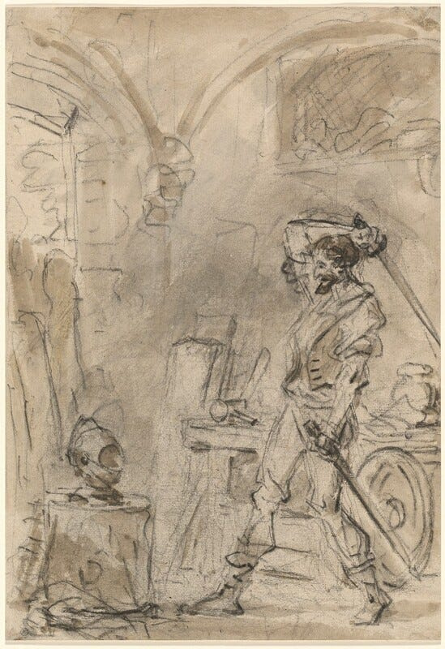
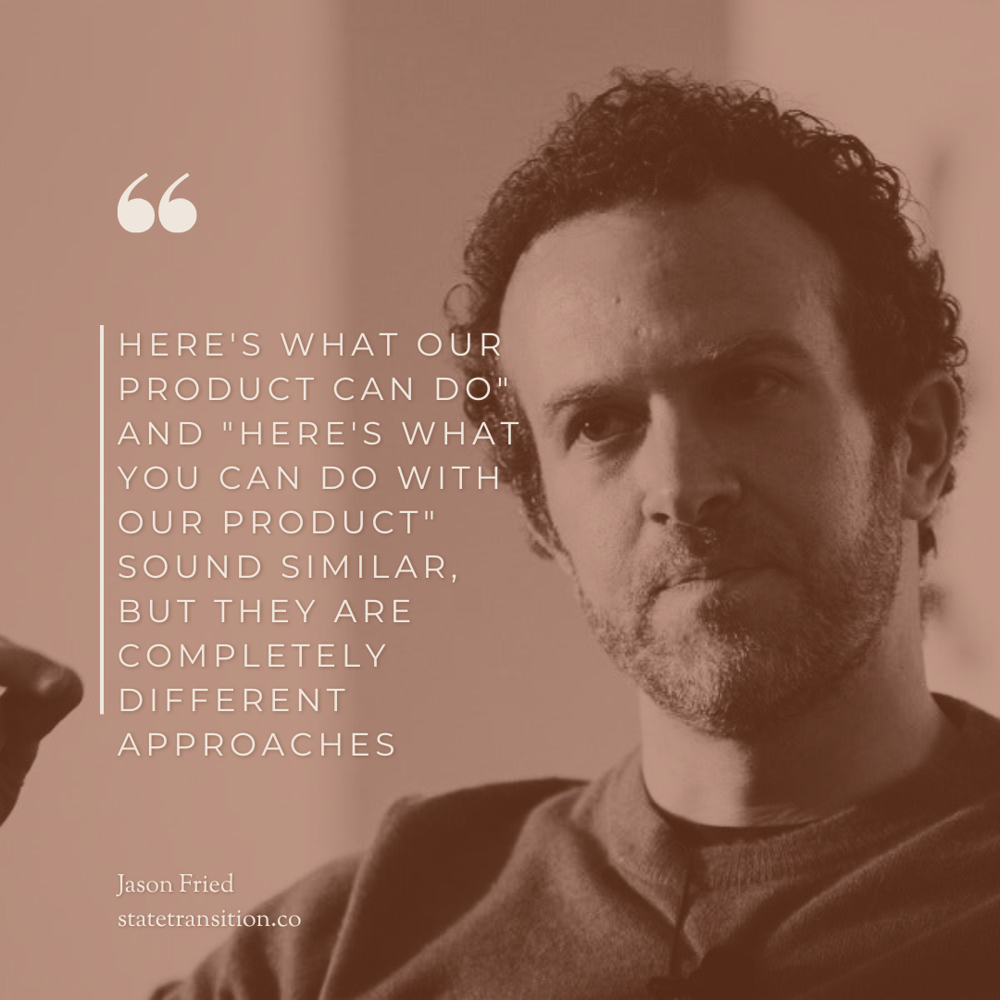
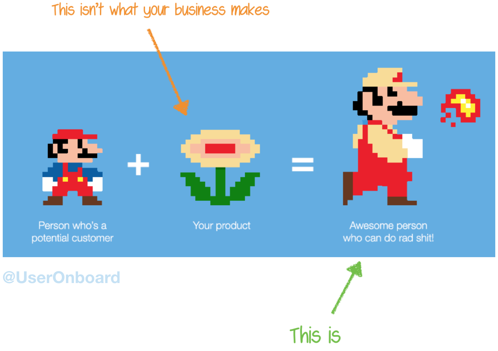

*(This post is an excerpt from my upcoming book on product thinking for engineers. **[Sign up to be notified](https://engineering-product.kit.com/0d5f0028f8)** when it is available for purchase.)*

* * *

Software feels more abusive each day, as if its annoyed it has to interact with you to get your money. Every time we log in, we accept cookies, dismiss a pop-up for the latest feature, watch an ad, hand over our phone numbers for “verification,” watch another ad, and then discover the free thing we used is now behind a paywall. Enshittification abounds. Software used to be a tool. Now products stay in control, stripping users of agency.

How can we do better? How do we design software that creates a more **agentic user**? A user who feels empowered to make decisions. Who takes action by choice, not coercion. Who sets a goal, believes it is achievable, and takes steps to accomplish it. Who can figure out the parts of the system that are unknown or unclear. Who trusts the tool will behave as expected, without unforeseen consequences, and provides a clear sense of where they are and where they’re going next. They approach tasks from a place of calm and control.

## Case study: Unix Core Library

The Unix core library epitomizes many elements of agentic user design. A suite of 100ish single-purpose command-line tools, built at the foundational level of the OS, empowers the user to do whatever they want with text files. `find` to look for files, `grep` to search their contents, `awk` to process them, `rm` to remove them.

In the 1970s, Bell Labs had a tool-based culture. Engineers were encouraged to build tooling to solve their own problems. If others found them useful, they would roll the tools up into the Unix operating system. These tools were built around the three-pronged Unix design philosophy:

1.  Do one thing and do it well.
    
2.  Write programs that work together.
    
3.  Everything is a file.
    

This way, instead of building products to solve every problem, they could build utilities people could apply to single fixes. They were building screwdrivers and gears so that other people could build specialized machinery. This philosophy led to the creation of agency-friendly software:

**Setting and achieving goals:** Users can compose tools together with pipes to create complex workflows for any text-based goal. If everything is a file, then anything is achievable.

**Doing tasks because you decide to:** The tool never suggests or manipulates. No “recommended workflows,” no attempts to influence your choices. It sits idle until you give it explicit commands.

**Figureoutable:** I won’t pretend using the Unix tooling is easy. It requires skill to wield. But the tools follow consistent conventions: flags with `-` or `--`, stdin/stdout patterns, and exit codes. Every tool has man pages and `--help` flags. Documentation is comprehensive and built in. Users can discover capabilities and see examples. Learn one tool’s patterns, and you’ve learned them all.

**Empowered to make decisions:** Tools don’t make hidden decisions on your behalf. You choose verbosity levels, output formats, error handling, and behavior. Every option is exposed as a flag. The tool does what you tell it.

**No surprises:** Every tool does its one job, no more, no less. `grep` always searches, `sort` always sorts. Tools are deterministic and transparent.

**Useful feedback:** Clear separation of stdout (results) and stderr (errors). Exit codes signal success (0) or failure (non-zero). Feedback is a file (everything is a file), parseable, so you can build on it.

The Unix CLI embodies “here’s what you can do” rather than “here’s what the product does.”

What lessons can we take from this and apply to building products?

## Build software that is both simple and powerful

Products should be simple enough for novices and powerful for experts. Examples of power user features:

1.  **Hotkeys:** I hope to one day be the kind of person who never touches the mouse. Hotkeys help people move faster when they’re willing to learn them.
    
2.  **Command palettes:** A cousin of hotkeys, command palettes let users complete tasks via text instead of clicking and dragging.
    
3.  **Macros:** Excel lets users script macros in VBA.
    
4.  **Advanced configuration:** Give users more customization for those who want it. (Warning: these can create maintenance debt if you’re not careful.)
    

## Anticipate the user getting stuck, and toss them a rope

Users will get stuck. Anticipate what bogs them down and be there when they need you most:

1.  **Confused.** Make first-time use as simple as possible. Affordances and consistency clarify what to do next.
    
2.  **Stuck.** Offer help, tips, or support docs to help them figure out the next step.
    
3.  **Unmotivated.** Show progress, offer wins along the way, and connect the current task to their ultimate goal.
    
4.  **Distracted.** Remove irrelevant elements from the view.
    
5.  **The task is hard and there’s nothing you can do about it.** Acknowledge it. As Jake the Dog said in *Adventure Time*: “Dude, suckin’ at something is the first step to being sorta good at something.”
    

## Robots & Iron Man Suits

> People don’t buy products. They buy better versions of themselves — Samuel Hulick, Onboarding consultant

There are two patterns technology can take when doing a task: It does it for you, or it makes you better. I call these **robots** and **Iron Man suits.** A **robot** handles something for the user. An **Iron Man suit** amplifies their abilities. GitHub Actions are robots. VSCode is an Iron Man suit. Everyone thinks ChatGPT is a robot, but it’s an Iron Man suit. Both can either enhance or take away agency.

### Robots

With robots, the user hands off the task. For example, autopay for bills, CI/CD pipelines, and email filters. These patterns work best when:

-   The task is repetitive and boring
    
-   Success criteria are clear and measurable
    
-   It’s recurring and predictable
    

Robots increase agency when they let you complete a task you otherwise couldn’t, or remove a task you don’t want to do from your plate entirely. Automated bill pay means you never have to think about when to pay your bill.

If you’ve watched any Sci-fi, you can imagine how this type of automation could start working against the user’s best interest. When software starts making decisions, it may do so against the user’s interests. Pod bay doors are all well and good until they won’t open. A bed that warms to the perfect temperature is nice until an [AWS outage contorts it into an unusable position](http://arstechnica.com/gadgets/2025/10/smart-beds-leave-sleepers-hot-and-bothered-during-aws-outage/). They can become a black box that removes a user’s understanding and ability to decide. They can be difficult or impossible to modify.

Aim to take work off the user’s plate only when you can preserve their ability to decide and receive feedback.

### Iron Man suits

Iron Man suits enhance the user’s abilities. Examples: feature-rich IDEs and design tools like Figma. Consider this approach when:

-   The task requires subjective judgment and creativity
    
-   The user needs to understand what’s happening
    
-   The user is practicing a skill they can improve
    

Iron Man suits increase agency by giving you more power to complete tasks. I’m no designer, but tools like Figma and Canva enable me to communicate more visually. They enable me to complete a task I otherwise couldn’t.

The opposite happens when the Iron Man suit becomes a burden, adding to your workload instead of lightening it. Salesforce is configurable, but it’s *so* configurable that configuring it becomes a full-time job. Ticket trackers like Jira can streamline project management, but can also become a job unto themselves. Digital notebooks like Obsidian and OneNote can help you manage knowledge better, but can also become a [burden instead of fuel for creative work](/blog/couples-therapy-for-you-and-your/).

## Simplify decisions

Decision fatigue is real. If users feel it in your product, they may leave and never return. Make decisions few and easy, while preserving agency.

**Keep choices to a minimum.** Hick’s law: the time to make a decision increases with the number of choices. If you can’t reduce the number of choices, group them or give users ways to sort and filter (autocomplete, for example).

**Give them smart defaults.** A smart default is a choice that’s right most of the time. Make the right thing easy and the wrong thing hard.

**Defer choices.** If a choice doesn’t need to be made now, let the user make it later.

## Agentic User Patterns

From looking at what agency is, how people attack it, and how others have put it into practice, we can form some patterns to guide us: We give users as few decisions as they need, but no fewer. We offer all the information and feedback they need to decide, but no more. We build products that do what they promise, when they promise, and nothing else.

## Remember your place

Software is a tool for the user. The user is not a tool for your product. Design for agency: empower users to decide, feel confident, feel safe, and get shit done.

* * *

Thank you for reading. This post is part 1 of a 2-part series. The following post will explore this one’s shadow, anti-agentic dark patterns.
