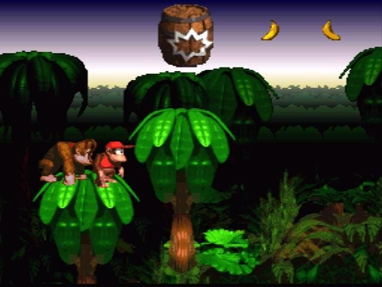
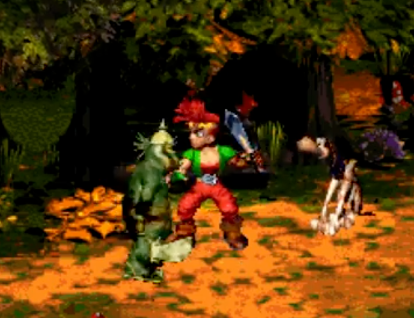
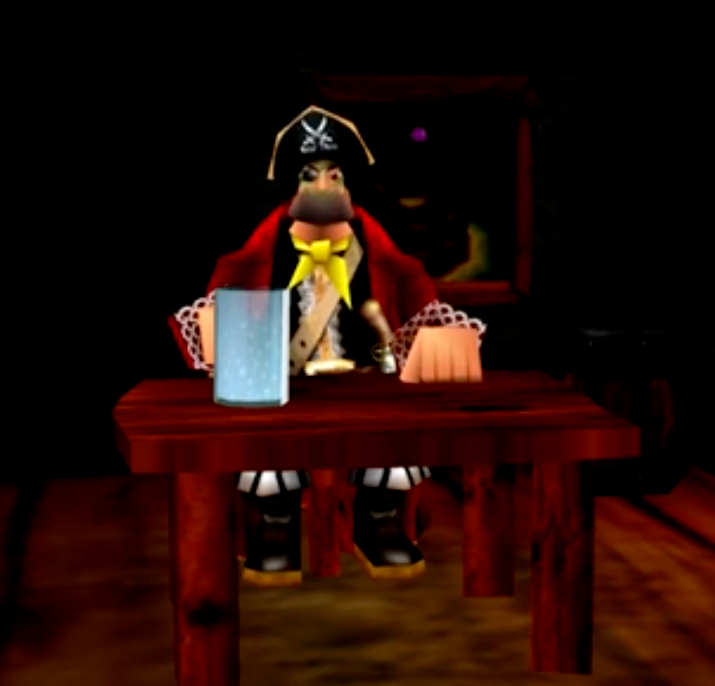
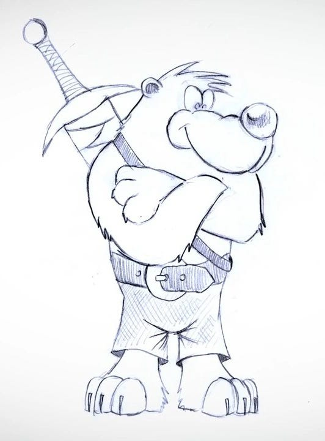
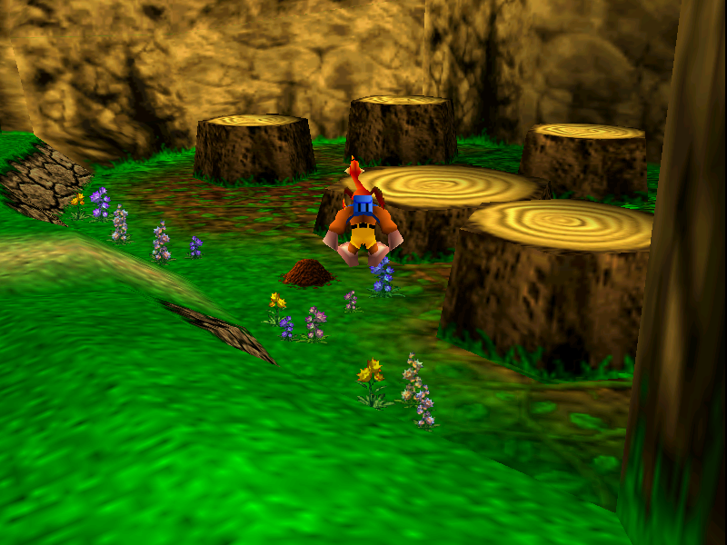

In 1995, riding high on *Donkey Kong Country*, Rare kicked off a new project titled *Dream: Land of Giants[^1]*, a fantasy adventure game. Donkey Kong Country had been a revelation the year before. Rare put a fresh spin on the platforming genre with new environments, a two-player tag system where each character had distinct strengths and weaknesses, and pre-rendered graphics: 3D models captured as 2D sprites. It looked and played like nothing anyone had seen. It felt like the next step in evolution for platformers after *Super Mario World*.

If Donkey Kong Country could stand toe to toe with Super Mario World, Rare figured they could build another masterpiece on the scale of *Legend of Zelda*.

Project Dream did spawn another hit, but it looked nothing like the original vision. Here’s how Rare iterated and pivoted their way to the final product.

## Initial feedback was tepid

In the initial beta, players explored a fantasy/fairytale setting. You played as Edson, assisted by his pet dog Dinger. This two-character system expanded on the Donkey/Diddy duality of DKC.

Then, Project Dream ran into two problems that forced a pivot. First, the technological landscape shifted. The SNES was riding into the sunset to make way for the *Nintendo 64*. The game became a 3D project, as was the style at the time. They built a new rendering system for the new hardware.

Second, playtests delivered bad news. The setting was too cliche, too bland, and didn't engage players. They moved to a "harder-edged piratey theme." But changing the environment wasn't enough. The game still felt generic and lacked a hook. So they started experimenting with character designs. One of them: a sword-wielding bear named Banjo.

They pressed on, and got some good news and some bad news. The bad news? Their new rendering system was so deep and complex that the game would take far too long to finish. The good news? Everybody **loves** the bear.

The project got scrapped. Started again. Now the bear is the main character, his sidekick a bird named Kazooie who lives in his backpack. It wasn’t until the fourth restart of the project that Rare struck gold again.

## The final result

Then *Mario 64* launched and redefined the platforming genre, dragging it into the 3D era. Banjo felt archaic. The game evolved into a 3D platformer, closer to Mario again. *Banjo Kazooie* went on to be a smash success, and ranks among the best 3D platformers of its era[^2].

If you've ever wondered how game companies come up with ideas like "Bear and his bird friend rescue his sister from a wicked witch," now you know. Banjo-Kazooie could have never started as Banjo-Kazooie. Traces of the original iterations survived. The main villain, Gruntilda “Grunty” the Witch, is a wicked witch fairy tale trope. Levels like Treasure Trove Cove harken back to the project’s pirate era. The end result required its circuitous journey.

## What we can learn from this

Here's the thing about Rare: they cared about the core idea, and were willing to torch *everything else* to chase it. They dropped characters, settings, themes, rendering engines, and entire prototypes. It was never about fantasy, or pirates, or bears. It's about friends exploring a fascinating world.

[Watch on YouTube](https://www.youtube.com/watch?v=w72kj20YNA0)

This is an excerpt from my upcoming book on product thinking for engineers, *Own the Outcome*. **[Sign up to be notified](https://engineering-product.kit.com/0d5f0028f8)** when it is available for purchase.

[^1]: [Project Dream fan wiki](https://banjokazooie.fandom.com/wiki/Project_Dream)

[^2]: no.2 on [Metacritic for pre-2000 3D platformers](https://www.metacritic.com/browse/game/all/3d-platformer/all-time/metascore/?releaseYearMin=1958&releaseYearMax=2000&genre=3d-platformer&page=1)
