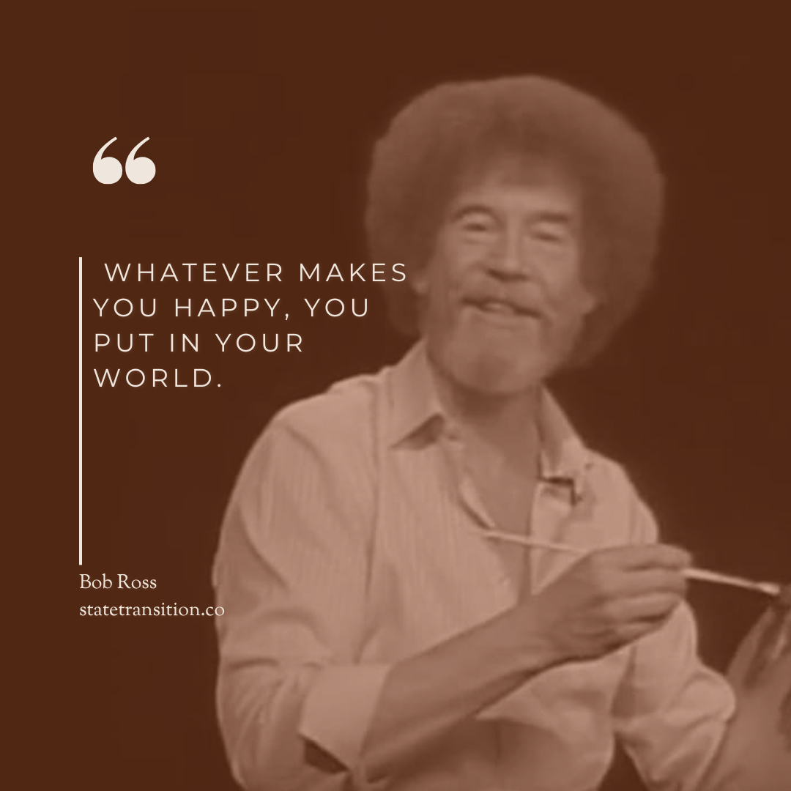

My feeds have been overrun with [take](https://www.lennysnewsletter.com/p/how-to-build-your-pm-second-brain) after [take](https://thezvi.substack.com/p/claude-coworks) after [take](https://www.bensbites.com/p/claude-code-for-everybod) after [take](https://hannahstulberg.substack.com/p/claude-code-for-everything-finally) after [take](https://www.lennysnewsletter.com/p/everyone-should-be-using-claude-code) about how "Claude Code isn't just for code anymore." Everyone seems to be supercharging their "second brains" and building "LifeOSes" and "Agentic Assistants." So, of course I had to try it. And I was surprised how quickly I was willing to let it run a small part of my life.

[Opus 4.5](https://www.anthropic.com/news/claude-opus-4-5) was a step-level change. Anthropic's model hit a point where it's smart, fast, and reliable enough that people, myself included, can hand off tasks to it with a good amount of confidence. Then [Clawdbot](https://clawd.bot/) got people's heads turning. The "Claude Code for everyone" era begins. I am become Linguini, Opus, my rat.

[Post by Chris Beiser (@ctbeiser)](https://x.com/ctbeiser/status/2011301974491480256)

I was already keeping an engineering manager notebook, inspired by [the CTO's hidden notebook](https://7ctos.com/the-ctos-hidden-notebook-by-etienne-de-bruin/). I've long believed in the [file over app](https://stephango.com/file-over-app) philosophy. I was already using Claude Code for note cleanup and line editing. Then, my step-level change came when I watched Alex Hillman's video demonstrating his "JFDI system":

[Watch on YouTube](https://www.youtube.com/watch?v=yjO9UHIunSE)

After watching, I started building new tooling around my day-to-day work. I went from manually tracking meetings in Obsidian to having an agent fetch my calendar, book my meetings, and pull in AI transcriptions and synthesizing them into status updates and task lists.

## A different kind of unicorn…

Alex hit on something in his video: no project management system or CRM ever fits quite right. Work is idiosyncratic. Everyone has unique contexts, motivations, strengths, and foibles. [Ashe Magalhaes](https://x.com/ashebytes/status/2008180483658579991) has a wholesome system with a compliments workflow, birthday reminders, a custom friend social feed, and gratitude journaling.

Vaughn Tan hits on this in [Boring Tiny Tools](https://vaughntan.org/boringtinytools): “Generative AI coding tools now enable high-utility, highly customised, but narrowly scoped software.”

A new genre of software is emerging. Maybe “Unicorn” will no longer refer to a billion-dollar company, but to rare, one-of-a-kind precision software, tailor-made just for you.

## …if you can build them

But don’t expect a magic silver bullet. Despite what people selling AI courses tell you, I don’t know that Claude Code is for “everyone.” I’m not gatekeeping or acting superior, only setting expectations for what raising your rat looks like.

Do you have systems? Can you get them out of your head, breaking them into components with clear instructions, constraints, and success criteria? Sure, you can get a system up in a couple of hours, but larger gains take many, many rounds of iteration. Alex keeps a [dev log](https://github.com/alexknowshtml/andy-timeline?) of his assistant (or at least he did; this [prompt](https://github.com/alexknowshtml/andy-timeline/blob/main/timeline-curator.md) implies his agent is now self-blogging). He’s at 96 days and counting.

I was already taking notes to a near-unhealthy degree and tracking tasks in markdown files. It helps that I have 15 years of experience as an engineer. Turning fuzzy business requirements into code is kinda my jam.

Could this eventually be a job I have? Acting as a translator and transcriber for people who can’t cross the brain-to-LLM bridge? Vaughn Tan thinks so. Again from Boring Tiny Tools:

> What's missing is someone to bridge that gap. Someone who can help articulate workflow needs in ways that can be rapidly prototyped, who can evaluate where a Boring Tiny Tool would make sense, and who can help grow an internal organisational culture for doing this systemically.  
>   
> This requires an unusual combination: understanding of product strategy, enough technical fluency to evaluate what's feasible, and deep appreciation for how work actually happens versus how organisations think it happens. It also requires not having a vested interest in any particular technical solution.

Could I build a system like this for someone else? Technically, yes, but I’m not convinced it would be good. It would be better to teach or collaborate with people and let them figure out what to build and how to get there. You have to cook with your rat.

This piece [attempts to teach Claude Code for the non-engineer](https://hannahstulberg.substack.com/p/claude-code-for-everything-finally). If you’re the target reader, I’d love to hear if you found it valuable, or if it’s all still mind-boggling.

If you want someone to riff with on this stuff, shoot me an email or DM.

But for now, I’m off to do another few rounds of iteration on my agentic agent, whom I’ve christened Agentic Agent, because I hate anthropomorphizing AI. Next week, I’ll go into more detail about how I built my initial prototype.

#### **Update:** Read parts 2 and 3 here:

[Building Blocks of Agentic Agents](/blog/building-blocks-of-agentic-agents/)

[Mistakes I Made Building My AI Assistant (And What I Learned)](/blog/mistakes-i-made-building-my-ai-assistant/)
