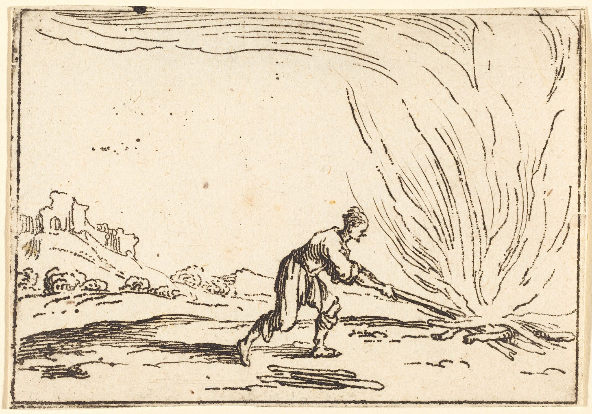

“Fire is a good servant, but a bad master” - old English proverb

The old proverb was about physical fire, but it also applies to striving for financial independence.

I had a lot of interesting conversations after posting last week’s piece about [financial independence as financial suicide.](/blog/financial-independence-as-philosophical/) Micheal Convington shared his post, exploring the same ideas: [Why I’m not on F.I.R.E.](https://www.covingtoninnovations.com/michael/blog/2310/index.html#x231028)

This excerpt nails it:

> Well... I'm in favor of frugality and saving within reason, but there are some aspects of it that leave me wary. In fact, looking at the movement so far, I've found a sharp split between:  
>   
> \* People who want to use early frugality to equip themselves to do someting creative, charitable, or philanthropic in later life, especially if they recognize they have unusual wealth or opportunity early in life and want to make the most of it;  
>   
> \* People whose goal is appreciably less noble, just to "retire early;" for some, F.I.R.E. is almost like a get-rich-quick scheme; and these seem to be a large part of the movement.

There are two types of financial independence: people who want to use their money creatively and people who want to live uninspired and low-effort lives. Just like actual fire, financial independence can be used as a spark or tool for something creative. But it has to be your servant. If you let it become your master, it can burn you alive.

## Two quick anecdotes

I’ll leave you with two little stories, each exemplifying fire as master and fire as servant.

1.  I talked to one friend who was a prolific writer online, typically in service of the products he’s selling. I asked him if we would still write if he had fuck you money. “I would write SO MUCH MORE if I were truly FIRE,” he exclaimed.
    
2.  Someone mentioned they had a friend who achieved FIRE. A few after he announced that, his friends invited him to dinner at a Mexican restaurant. “I’m not paying for restaurants anymore,” he responded.
