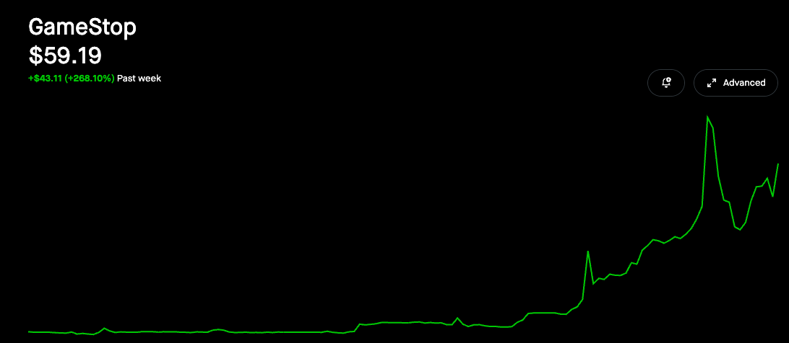
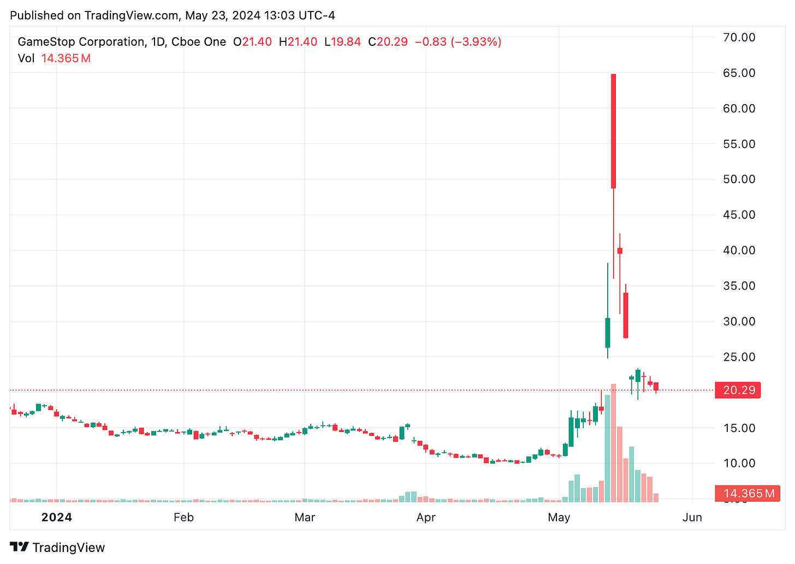
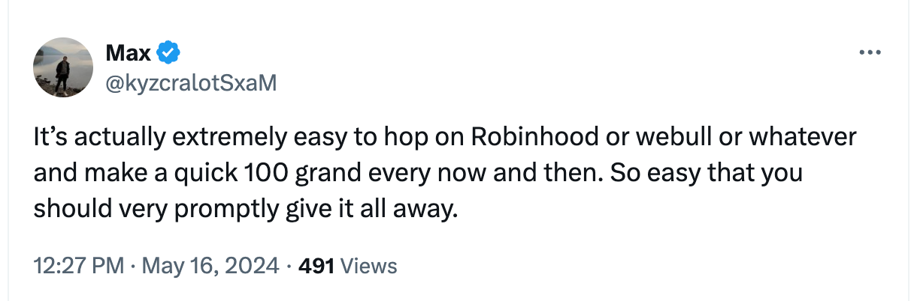

I’ve read about the efficient market hypothesis, which makes sense to me. You can’t outsmart the market, and you can’t time the market. All information is priced in. The only things you can control are how much you invest and your asset allocation[^1]. It would be arrogant of me to think that I would know better.

**BUT**

Gamestop became a *thing* again. Meme stocks are back on the menu. How can a market be “efficient” and allow for such shenanigans? If we’re really doing this again, we don’t deserve interest rate cuts from Jerome Powell this year.

  

How do we square these two ideas in our heads? The market is efficient, except when it isn’t.

Also, it always felt a little suspicious to me that all of the advice about “put all of your money into index funds and don’t think about it.” Comes from a [book](https://www.amazon.com/Bogleheads-Guide-Investing-Taylor-Larimore/dp/0470067365) written a [man](https://en.wikipedia.org/wiki/John_C._Bogle) who stands to make a lot of money if you put all of your money into [index funds](https://investor.vanguard.com/investment-products/mutual-funds/profile/vtsax) and not think about it.

Before we go further, allow me to knock out the disclaimer. *inhales*

> *The content provided on State Transition is for entertainment and informative purposes only, and even calling it informative is a \*stretch.\* It does not constitute financial, investment, or other types of advice. While the information is provided in good faith, it is not intended as a substitute for professional advice.  
>   
> Please conduct your own research and due diligence before making any financial decisions; lord knows I don’t.*

*Anyhoo*

## Falsehoods investors believe about the efficient market hypotheses

There are two big false assumptions from the “VSTAX and relax” crowd about investing in the stock market for the long term, and those are:

1.  You have to invest in the stock market
    
2.  It has to be long-term.
    

There are other places to put money to work, and it doesn’t have to be long-term. There’s nothing wrong with locking in a quick win every now and then. A strategy isn’t worthless because it won’t work consistently for 30 years. Really, what do strategies in life do? The job I have now didn’t exist 30 years ago and likely won’t exist 30 years from now. ([I give it 3-5 years, tops](/blog/the-wordpressificaion-of-work/)).

Finding one-off exploits is a worthwhile pursuit. Any system that behaves this erratically has to have exploits.

That’s one of the neat parts about being a human being. We are finite creatures in a system designed for infinite growth. We don’t have to compound our investments forever, just long enough to get us to the end and set the next generation up for success.

## A more sincere disclaimer about index funds

I feel I should point out that I have most of my assets in low-cost index funds. I am not trying to pretend that I am someone from /r/wallstreetbets who makes ridiculous options bets. Index funds are boring than they work. I am in my late 30s, I have a kid, I have to regulate may moonshots and gambles to a few points of the overall portfolio. But I take some inspiration from Nassim Taleb’s barbell investing: I have a majority of my money in conservative bets, but I am always willing to put 5-10% on more aggressive plays.

## Common Sense only works if you want to make a common amount of cents

*The Common Sense Book of Investing* was written before we shifted away from an information economy and towards an attention economy. If you can get enough people to pay attention to something, that’s worth something. GME is not a bet. It’s a story. Dogecoin is buying a joke that is worth more, and people are laughing at it. It’s a derivative of [Matt Levine’s Elon Markets hypothesis](https://www.bloomberg.com/opinion/articles/2021-02-10/elon-musk-tweets-great-news-for-bitcoin-bad-news-for-econ-majors).

Thriving in the new rules is greatly understudied and undertheorized, in my opinion. Plenty of alpha out there to dig up.

There is no invisible hand. There is only human behavior. The market is a mirror collectively facing us. When we look at it, what do we see?

What does it say about what we’ve become?

And most interestingly, how can we at least profit from it?

[^1]: per *[The Four Pillars of Investing: Lessons for Building a Winning Portfolio](https://www.amazon.com/Four-Pillars-Investing-Building-Portfolio/dp/0071747052)* by William J. Bernstein.
