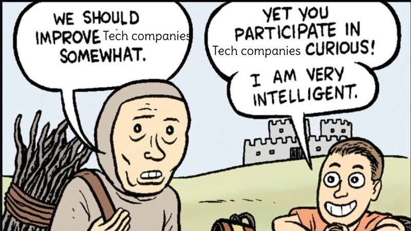

This tweet about office politics and relationships generated some interesting responses. Lot’s to unpack here:

[Post by Glenn Stovall - statetransition.substack.com (@GSto)](https://twitter.com/GSto/status/1598534893654392833)

I saw a few primary reasons why people felt this way: 

1.  **Morality**: engineers think it’s “cheating.” 
    
2.  **Preference**: they don’t want to
    
3.  **Capability**: They aren’t good at it
    

The capability argument is a cover for either a preference or a morality one. Working in an organization is a learnable skill, and anyone smart enough to get a tech job can do so. They either don’t want to or don’t believe that they can. 

this piece aims to dispel this myth. Refusing to learn to play well with others is a career-limiting move. Social dynamics in a workplace are moral, a learnable skill, and can even be fun. 

Why do you think they call it “playing” office politics?

## A better model for professional social interaction - Office: The Game

For the rest of this article, imagine office politics through a different lens: Work as a game.  
  
The players have unique viewpoints, hidden information, and personal incentives in this game. They win the game by working together, collaborating, and helping each other achieve those goals.

It is not a win-lose or zero-sum game.

There are many plays where both players benefit. To get pursue your goals, your best bet is to find plays that help both you and others.

Cooperation over the competition.

This office as a game model is not only more fun, but more productive and closer to the truth. 

If you want to understand this game model more, look no further than Survivor.

## What Survivor can teach us about office politics

Yes, Survivor is still going on CBS. Yes, I still watch it. 

Modern survivor is played exclusively by contestants with 20 years of seasons to study. Many people incorrectly assume that Survivor is a game of treachery and deception. But the strategy has evolved. Players today know it’s truly a game about trust and collaboration.

When there is a conflict between two players, one is always eliminated. The tribe keeps the peace. Winners are the player who can get along with the most people for the longest period of time. Working well with others is how you survive the office, survive the rounds of layoffs, and ultimately, survive each other. 

Survivor isn’t a game of deception, but it is a cutthroat one.  At the end of every episode, players have to vote someone out. Not so in the office. Hopefully, your organization is growing instead of shrinking. Collaborative play is even more effective under these conditions.

Even if you are being collaborative and honest, is that enough? Is there still something immoral about the game?

# 3 falsehoods programmers believe about office politics

## Office politics require dishonesty

As we’ve established, playing doesn’t require dishonesty. Some people consider any kind of putting on a face or biting your tongue as dishonest or manipulative, but that’s just being professional and civil. You don’t have to lie, and expressing ideas without wearing your heart on your sleeve does not constitute lying. 

Some people believe you support a broken system by participating in it. They think the push and pull of differing worldviews and incentives are inefficient, and they would instead focus on the work. This a meme-ably bad take.  

Yes, it would be nice if we could all easily agree on what needs to be done, by whom, and why, but that is never the case. You can either learn to be effective with a system (regardless of your opinion), or you can waste energy silently raging against the machine.

Your choice.

## You can and should be rewarded for results and results alone

Other people believe that they are disrespecting some kind of a “meritocracy” that should exist. You get ahead from the outcomes of your work, not manipulating people or exploiting loopholes. Sounds good in theory, but it’s only a fantasy. 

True meritocracies do not exist in the real world. 

The problem with this approach is those true meritocracies cannot exist in the real world. We’ve already talked about people having different perspectives and goals. What we haven’t talked about is previous experience, resources, opportunities, timing, and plain old luck. 

In fact, organizations can have a [paradox of meritocracy](https://gap.hks.harvard.edu/paradox-meritocracy-organizations): when trying to install meritocratic practices, they instead tend to discriminate and wind up enforcing racist and sexist hierarchies.  

There’s also a paradox at the personal level: More research suggests that when you believe in a meritocracy, you are more likely to act in [selfish and entitled ways](https://www.ncbi.nlm.nih.gov/pmc/articles/PMC3767679/) and think less critically. 

The idea that you should play fair because you want the world to be fairer is ludicrous. It’s playing yourself into playing the game sub-optimally.

## You have to be ruthless to win

Some people believe that acting selfish and self-entitled is a winning strategy. Steve Jobs is the quintessential archetype. Some people read the Steve Jobs biography and walk away with the thought: “If I was a bigger asshole, maybe I could be more successful like Steve.” 

But the research doesn’t bear this out either. [People who try to be combative and manipulative are no more likely to acquire power](https://pubmed.ncbi.nlm.nih.gov/32868412/). 

The opposite is true. Practicing generosity and gratitude is more likely to lead to success than more negative behaviors. It’s also easier to navigate the world when people don’t mind working with you. 

While playing the game aggressively in the sense of attitude is a mistake, there’s still the question of aggressiveness from an energy perspective.

# Are you playing passively or aggressively?

You *are* playing, no matter what. You have to play well with others. Being unable to do so will lead to more stress, getting sidelined from projects, being ignored in meetings, and in worse cases, termination. But you can decide how aggressively (in the gameplay sense, not the attitude sense)  you want to play.

The aggressive strategy isn’t for everyone, and it doesn’t play well in every organization. That’s okay. There’s nothing wrong with sitting back in a comfortable position. But if you’re considering chasing more prestige and opportunity, here are some factors you should consider:

1.  **Do you work in a growth-friendly environment**? Organizations with clear career paths that invest in their employees’ growth are excellent places to employ an aggressive strategy. These tend to be larger companies. Companies with fixed mindsets, slow growth trajectories, and where the COO is the owner’s nephew are less than ideal. 
    
2.  **Do you want to advance?** many developers stop at the senior engineer level and are happy writing code all day. Advancing comes with more money, power, responsibility, travel, and zoom calls. Does that tradeoff appeal to you?
    
3.  **Are you ready to be intentional and take ownership of your career?** What we are talking about is a mental shift where your career changes from something that happens to you into something you are proactively steering.
    

If you want to play the game, realize that you can practice and improve. Not everyone realizes this. They’ve internalized the stereotype that engineer types are antisocial. Taking ownership means accepting that you can work on and improve your shortcomings when working with others.

# Working with others is a learnable skill

If you’ve decided to invest some skill points in your interpersonal skills, what are some specific places you might look to improve? Here are some options to consider.

1.  **Managing your emotional state** \- We can’t control how we feel, but we can control how we express, harness, and process them. 
    
2.  **Having empathy for others -** It’s easy to forget that there are human beings on the other side of software.  Build empathy for coworkers and customers alike. 
    
3.  **Communicating clearly & honestly -** it’s your responsibility to be understood. Learn to speak in a way that people will hear.
    
4.  **Being persuasive** \- Humans are all running the same OS, which is hackable. It’s not enough to communicate information. Information is only helpful if it causes a state change. You need to communicate in a way that gets people to *move.*
    
5.  **Writing -** The internet runs on words. Between Slack, email, tickets, and project specs, a large amount of your communication is via writing.
    
6.  **Taking initiative -** A big part of leveling up in your career is learning to find problems and solutions instead of waiting on someone to tell you what to do. 
    
7.  **Yes and-ing people -** All communication is improv. People will like you better if you can learn to play along with what they are doing and build off of them. Avoid disagreeableness
    
8.  **Finding alignment -** Observe what games other people are playing. Make your goals fit in with theirs.  
    
9.  **Compromise & negotiation -** Once you find alignment, you must learn how to reach actionable agreements with others that you both feel good about.
    

these are all things you can practice, cultivate, and develop.

These tasks are part of the work. By playing well with others, you will work on better projects and increase your success rate. coding in silence is suboptimal.

tired of working on features that don't make sense? try getting in the conversation earlier when these decisions are being made, or at least know when and how to push back. 

Coding is a solo activity. Building software is a team sport.

# Further reading

Some books I highly recommend on improving social interaction. 

1.  [How to Win Friends And Influence People - Dale Carnegie](https://www.amazon.com/How-Win-Friends-Influence-People/dp/0671027034), obviously.
    
2.  [Nonviolent Communication: A Language of Life: Life-Changing Tools for Healthy Relationships 1. Marshall B. Rosenberg, Deepak Chopra](https://www.amazon.com/Nonviolent-Communication-Language-Life-Changing-Relationships/dp/189200528X) - how to communicate without bias, finger-pointing, anger, or defensiveness.
    
3.  [Impro: Improvisation and the Theatre - Keith Johnstone](https://www.amazon.com/Impro-Improvisation-Theatre-Keith-Johnstone/dp/0878301178/) - because all conversations are improvisations
    
4.  [Radical Candor - Kim Scott](https://www.amazon.com/Radical-Candor-Revised-Kick-Ass-Humanity-ebook/dp/B07P9LPXPT/) - how to be nice and not kind
    
5.  [Games People Play - Eric Berne](https://www.amazon.com/dp/B005C6E76U/) - Understanding what goes on in social interactions.
    

I’d also recommend this thread about ‘reply game’, and think about how you can apply it to conversations in a professional context.

[Post by Visakan Veerasamy ⛵️ (@visakanv)](https://twitter.com/visakanv/status/1039420186586038273)

And some stuff on career strategy:

1.  [The Gervais Principle](https://www.ribbonfarm.com/2009/10/07/the-gervais-principle-or-the-office-according-to-the-office/) - This book teaches organizational literacy via the U.S. version of the Office. 
    
2.  [Developer Hegemony](https://www.amazon.com/Developer-Hegemony-Erik-Dietrich/dp/0692866809) - This book builds on The Gervais principle and talks career strategy specific to engineers
    
3.  [Staff Engineer: Leadership beyond the management track](https://www.amazon.com/Staff-Engineer-Leadership-beyond-management-ebook/dp/B08RMSHYGG) - a tactical guide to having more of an impact within your organization.
    
4.  [You and Your Research (transcript)](https://www.cs.virginia.edu/~robins/YouAndYourResearch.html) - A fantastic talk on how you have to think about your work holistically if you want to do great work.
    

# Change how work feels every day

Once you view the office as a game and one you can play without guilt, you open many more options for approaching the daily grind. 

You can reframe work as somewhere you have agency instead helplessness. 

You see organizations as systems. Systems you can learn to work with instead of against in service of your goals. 

Instead of seeing weaknesses as fixed properties about yourself, you see opportunities for learning and growth. 

Instead of a combative playground for craven sociopaths, you see a community of players helping each other do great work.
