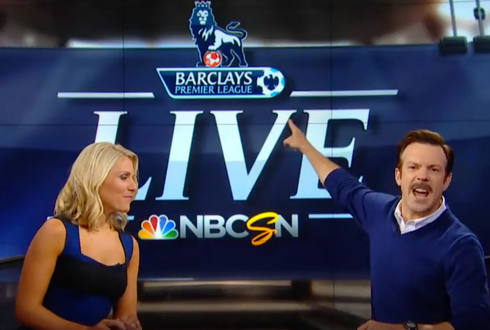

\[*Brief programming note: I’m back on my bullshit after a year-long hiatus to post a series of articles about money & agency. Here’s issue No.1\]*

The “Financial Independence, Retire Early (FIRE)” movement focuses on saving a large percentage of their income to try and retire as early as possible. It’s inspired by the book [Your Money of Your Life](https://www.amazon.com/Your-Money-Life-Transforming-Relationship/dp/0143115766), and the Essay [If You Can:How Millenials Get Rich Slowly](https://www.etf.com/docs/IfYouCan.pdf). It’s a philosophy of frugal living and anticipating the magical day when you can finally break out of the rat race.

Behaviors of followers include:

-   Saving as much as possible
    
-   Investing in index funds within tax-advantaged accounts
    
-   Think a lot about your “Number,” the amount you believe you need in the bank, never to work another day in your life.
    

However, something always felt hollow about the practice to me. After learning about Albert Camus’ philosophy, I finally understood why.

In this piece, I want to examine why FIRE is a toxic belief system that leads to people missing out on life and what a more generative approach to money might look like.

## Camus, Suicide, and the Absurd

In *[The Myth of Sisyphus](https://en.wikipedia.org/wiki/The_Myth_of_Sisyphus),* Camus describes the concept of “**philosophical suicide**.” This term refers to accepting beliefs or a system of thought that provides absolute, ready-made answers to life's fundamental questions. These systems ultimately deprive the individual of freedom and responsibility for their existence.

To Camus, life is absurdly meaningless. The best way to tackle that absurdity is to face it, accept it, live authentically, and build meaning.

Philosophical suicide is turning your head away from the absurdity and denying its existence. Accepting a rigid belief system gives you an excuse to check out.

Never think for yourself,

Never figure out who you are.

Never truly live.

That’s what FIRE is—a set of answers that are ultimately not about money but about life.

What do you do for work? It doesn’t matter if it provides enough money to help you retire. Work cannot bring joy; it’s a burden to be discarded. What do you do with your money? Index funds, mega backdoor ROTHs, VSTAX, and relax. Everything else is a sin.

It’s a philosophy of non-doing. It rejects late-stage capitalism while being *obsessed* with money.

An escape mechanism.

## FIRE promises freedom, but not in the way people think

While FIRE promises independence and freedom (whatever that means, we’ll get to that in a bit) in the future, it provides a type of freedom *today.* Saving is easy, but leveraging capital to live a more authentic life is hard. FIRE frees you from the anxiety of deciding how to spend your money.

If you focus on retirement, you can kick the can on investigating what you want out of life. You can avoid finding or making meaning in work. Why get anything out of life now that every day could feel like a weekend in 2050?

Here’s a fun question to ask yourself:

If you received a windfall of $100,000, free and clear of taxes. What would you do with it? One caveat: you cannot use it to invest in the stock market[^1].

Your answer must be specific. “Travel” is insufficient.

It’s a surprisingly difficult question. Asking yourself what you want out of life requires self-knowledge and exploration.

Saving is easy. Figuring out what you want out of life is hard.

## When the FIRE burns out

I’ve seen the outcomes of this on [Reddit](https://web.archive.org/web/20210709133416/https://www.reddit.com/r/financialindependence/comments/ofl36f/anyone_feel_similar_i_wasted_my_teens_and_20s/). People get their number, can retire, and then what? Some people get depressed and don’t know how to fill their days. Others go back to work. Others still decide the number needs to be higher, and they aren’t at the end yet. Some choice quotes:

-   “I regret my whole life. I had an unhealthy fixation with money but wouldn’t spend it.”
    
-   “I didn’t take any risks in life. I did not experiment socially with dating, networking, or travel.”
    
-   “Saving was easy because I didn’t do anything.”
    

They pushed all the living and figuring out who they are to the end, and now they don’t know how to handle it once they are there. Once you’ve committed philosophical suicide, it’s hard to come back.

If you want to hear what this sounds like, check out this episode of *I Will Teach You To Be Rich:* [We achieved FIRE with $4.3M. Why can’t we enjoy it](https://www.iwillteachyoutoberich.com/108-mindy-carl/)?[^2] Imagine having 4 million dollars in the bank and booking a flight with a 4-hour layover to save twenty bucks. That isn’t frugality; It’s insanity.

Passing a milestone in the bank will not change who you are. While there is some truth to “you can’t beat the market,” and there’s nothing wrong with investing in index funds regularly, it’s still a lazy way to think about money[^3].

Work can be a drag, *obviously*. There is no denying that most jobs are meaningless and absurd. But it can be a craft and have a purpose if you let it. At some level, you must participate in your survival, which means providing value to others.

FIRE is an ultimately selfish philosophy, another reason it leaves people feeling unfulfilled. The spreadsheet will never love you back. People would be better served finding ways to make meaning from work instead of trying to forgo it altogether. Even if the only meaning you find out of your 9-to-5 is “This is what I do to bankroll the things I am passionate about.” that’s a start.

## What we can learn from FIRE

I want to be clear that there are some worthy lessons to be taken from this. FIRE is a lot of people’s introduction to financial literacy. Having decent savings rates and putting money into tax-advantaged savings accounts is a profitable strategy and perfectly cromulent smart default.

I went through a [Mr. Money Mustache](https://www.mrmoneymustache.com/)[^4] (one of the most prominent FIRE bloggers) phase, and stories about [$20 swims](https://www.mrmoneymustache.com/2018/07/25/the-twenty-dollar-swim/) made me think twice before making large purchases. He also showed me that there is no 1:1 mapping between dollars spent and happiness gained or utility earned. Walks with my family are free. The biggest wealth is your physical and mental health.

All of these are a fine financial foundation. My critique is when these beliefs become an obsession, a limiting belief, or a copy for your shitty job.

## You do whatever you like. Live!

# LIVE!

At the end of the day, if you are searching for external solutions to internal problems, then you’re looking in the wrong place. No number in a savings account will ever change your relationship with money, time, work, or death.

Ask yourself questions to determine what you can get out of time *now.*

Out of work now.

Out of your money now.

-   How can I find joy in my craft?
    
-   Looking back at the past year, when did I feel most alive?
    
-   Looking back at the past year, what am I most proud of?
    
-   If I hit my “number” today, what would I be doing in three months? What’s a version of that that I could be doing now?
    
-   How can I leverage money and work to make meaning in this absurd existence?
    

Feel free to post your answers in the comments below 👇

*(Not financial advice, obviously.)*

[^1]: This includes workarounds like spending it on your mortgage and re-investing the payment.

[^2]: There is a downside to blogging about trying to get financially independent. When the blog makes enough money to get you to your number, what the hell do you write about next?

[^3]: I want to write a whole other piece on this, but in short, even if you can’t beat the market, there are plenty of other ways to gain leverage outside of it.

[^4]: The original writer, Peter Adeney, no longer maintains this blog. He sold it. I suppose that’s one exit strategy for indie finance bloggers.
