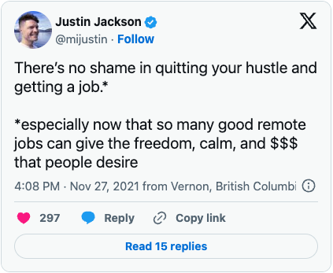
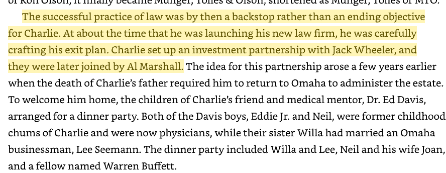

  
How is it that I feel freer now at my 9-to-5 white-collar job than I did a decade ago when I was a young indie freelancer working with whoever I wanted and choosing my own hours? Were all of those lifestyle influencers on X Formerly Known As Twitter, *wrong?* Shouldn’t my soul be feeling a little more crushed at this point?

## The constraints of indie and the liberties of the rat race

I was surprised that while I gave up some freedoms, I gained others. When I worked independently, there was no such thing as paid time off. When I wanted to take a vacation, I had to talk to clients first. It usually involved doing extra work before and after the trip. But now I was part of a team. I could leave for a week, and things just… got done? The wheels kept spinning.

When you bill hourly, some weird psychological effects change how you perceive time. Every hour you aren’t billing is, in theory, one you could be. Leisure feels expensive. You tell yourself that if you double your hourly rate, you could work half the time. But the opposite happens: free time now feels twice as expensive, and you are even more disincentivized to take it. With a salaried position, it was much easier to leave work at work.

Justin Jackson has some thoughts on how a full-time job can be more “freeing” than bootstrapping a business, especially if you have children.

[https://twitter.com/mijustin/status/1464702720456073216](https://twitter.com/mijustin/status/1464702720456073216)

Charlie Munger took a similar approach with his law practice. Even though he was part owner in the firm, he saw it as a foundation for other pursuits. From *Poor Charlie’s Almanack:*

I realized that freedom is not binary. Freedom is categorical. No matter what kind of work or lifestyle you take on, you are trading some kind of freedom for another. In this essay, I want to examine the multifaceted uses of freedom in work, life, and craft. How would different ways of making money affect the types of freedom I have in various parts of me life? An initial attempt at mapping them out:

## Different income streams in their freedoms

1.  **Full-time employment:** It has low ownership and responsibility. Consistent paychecks and healthcare provide a nice foundation for other pursuits. However, I have little say in what I work on, when, and who I do it with.
    
2.  **Freelancing:** More freedom in what I do and who I work with, but you’re still beholden to the client’s whims and timelines. On less consistent financial grounds. Free time feels like free.
    
3.  **Selling a product, book, or course p**rovides the highest amount of ‘freedom in work,’ but you are beholden to consistently marketing your product. Your income is only “passive” as long as you stay on the content hamster wheel[^1]. Without a boss or a client, you are 100% responsible for managing the work and product.
    
4.  **Owning a rental property**: This is the only option where generating equity and cash flow is fully divorced from your labor[^2]. However, now you have a financial burden of ownership. If your property is vacant or the HVAC system dies, you’re on the hook. You’ll need more cash in an emergency fund for such events, so you are less free to use that money elsewhere. If you’re handling things yourself and need to stay local, you have more restrictions on where you can live and travel.
    
5.  **Running a software product:** Customers’ 99% uptime expectations mean you are either on the hook for hiring someone to babysit your servers or can’t truly relax during vacation until you do. In exchange, you get the highest financial upside of the options presented.
    

From here, what different flavors of freedom can I suss out?

## 7 Flavors of freedom

1.  **Freedom from work:** This is what FIRE people are chasing: not being required to work 40+ hours a week to exist.
    
2.  **Freedom in work:** How much say you have in what you do when you do it and whom you do it with.
    
3.  **Financial Freedom:** I’m distinguishing here between freedom from work because, as we’ve seen, a steady paycheck that covers your needs is its own kind of freedom.
    
4.  **Freedom of time(amount):** How much leisure time do you have in your life?
    
5.  **Freedom in time(flexibility):** Hours of free time are not created equal. If all of your friends work 9-to-5, does it matter that you don’t? Social relationships are dependent on the people involved having leisure time that’s in sync.
    
6.  **Freedom of location:** Are you working remotely or from home? Are you able to take advantage of your remoteness? Does your work enable you to travel how you want? Does it require more travel than you would prefer?
    
7.  **Freedom from responsibility:** When you are a team member at a full-time job, you can go away for a week, and the gears will keep turning while you are away. If you are a solopreneur, you either have to have contractors and systems in place or do double work before vacation and never fully relax during it.
    

I’m still riffing on this idea. It doesn’t feel complete, but it does feel more useful than that “free as in speech / free as in beer” model.

What do you think?

Are there other flavors of freedom I’m missing?

Which ones are most important to you?

Which ones are you willing to sacrifice for others?

* * *

This post is part of a series on money and agency. Read the other parts here:

[Financial Independence as Philosophical Suicide](/blog/financial-independence-as-philosophical/)

[Creative fire, destructive fire](/blog/creative-fire-destructive-fire/)

[^1]: However, after reading [Write Useful Books](https://www.amazon.com/Write-Useful-Books-recommendable-nonfiction-ebook/dp/B0983HFQX7/ref=sr_1_1?dib=eyJ2IjoiMSJ9.j7v1LxH349W7-24_5u8d-EDOpNP4Lvtf1SIeVJL236pzPD7BVyvzbBOEp9nzCYNbNHiPsk_vuDqR2E_dP60cYAObZUBiDzprJdUyDSlJyFCwmquyViQYT8mHugIMzya18xVvwd1cXzsvPJY276xjjnDHChKIMVRdVw_4RhsT6EBEZoGbDYiddDFKpE-Ona8tYOWvHtVPcua2Ogmonfo75bk3qHZZfhadR9m3iCyhXc8.fgNZE_bt9dSEHYg9UGmoKRdX3NZIRolMUCftBeCNsyA&dib_tag=se&hvadid=598613954529&hvdev=c&hvlocphy=9013290&hvnetw=g&hvqmt=e&hvrand=13940222432496789340&hvtargid=kwd-1457590979019&hydadcr=22598_13531291&keywords=write+useful+books+by+rob+fitzpatrick&qid=1714819988&sr=8-1), I realized there may be ways around this. It sounds good to build a flywheel of referrals and word-of-mouth, but that’s a whole undertaking in addition to creating a prescriptive non-fiction piece of work.

[^2]: Assuming you’re working with a property management company and contractors. You could rent a place in your area and handle everything yourself.
