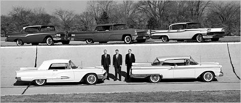
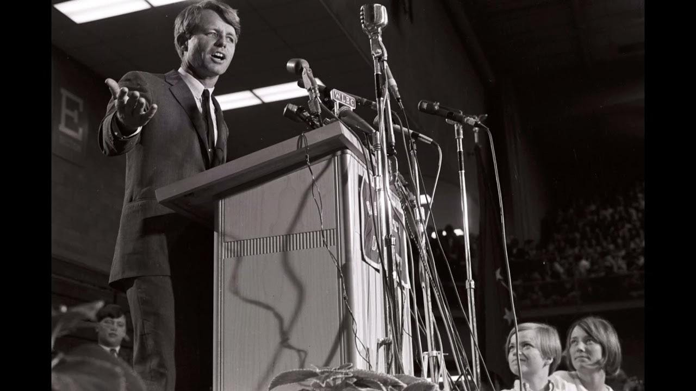

A brief 80-year history of a recurring conversation I have at work:

### **1946**

Robert McNamara steps into Ford's World Headquarters in Michigan. A former statistical control officer from the Air Force, Robert is tasked with bringing mathematical rigor to Ford's purchasing department. For 15 years, McNamara's quantifiable decision-making practice lays the groundwork for modern management science. He climbs the corporate ladder.

### **1948**

500 miles south of Robert, Edward Lansdale starts work in a different enterprise. A recent psychology graduate, Edward joins the CIA to explore unconventional tactics of influence and persuasion. His psychology-based strategy lays the groundwork for modern psychological warfare

### **1960**

Both men had made huge strides in their careers. Robert McNamara is the president of Ford. Edward Lansdale works at the Pentagon, a special assistant for counterinsurgency reporting directly to the Secretary of Defense. He rises through the agency ranks.

### **1962**

America is entrenched in Vietnam. Lansdale has a new boss: McNamara. There is belief his mathematical approach will win the war. Lansdale disagrees. While united fighting on the battlefield, they are at each other's throats in the war room.

McNamara believes he can solve for x, where x is ending the Vietnamese civil war. He runs the army like an assembly line, optimizing for metrics like enemy troop strength, area controlled, and body count. He's famous among deputies for his catchphrase: "If it can't be measured, it doesn't count."

Lansdale believes the war is being fought on what can't be measured: the hearts and minds of the Vietnamese people. We shouldn't optimize for body count but for loyalty and trust.

> "You can kill a Viet Cong, but if you don't win over the villagers, he's back tomorrow" — Edward Lansdale

While Lansdale strongly disagrees, McNamara is his superior. It’s his duty to follow orders. The war rages for three more years. While McNamara turns in briefings boasting statistics like "enemy losses of 10,000 in the past week," Lansdale watches the enemy's conviction hold firm. Unable to solve the conflict on a psychological and personal level, the United States is forced to tuck its tail and run.

### **1968**

Robert F. Kennedy (senior, the sane one, not the possum-nomming one), on how metrics miss what’s most important.

> The gross national product does not allow for the health of our children, the quality of their education or the joy of their play. It does not include the beauty of our poetry or the strength of our marriages, the intelligence of our public debate or the integrity of our public officials. It measures neither our wit nor our courage, neither our wisdom nor our learning, neither our compassion nor our devotion to our country, it measures everything in short, except that which makes life worthwhile. — Robert F Kennedy, commencement address at the University of Kansas, 1968

### **2025**

The stakes are lower, but the shape is the same. Companies track product performance and health through metrics. Instead of counting bodies, we count clicks.

I'll fight the same fight Lansdale did, even if it doesn't make me the most popular person. But I can't help it. Sitting in a room for 8 hours a day, alone, jumping between Zoom, Slack, Notion, and Cursor, and back again, is psychologically draining. What keeps me going is knowing that when I push pixels around, another human being sees them and accomplishes their goals without feeling frustrated or manipulated by my work. Remember: numbers don't use products, people do.

## Motivations matter

To create a quality product experience, you must be attuned to your user. You need to be able to understand and feel their mental and emotional context, even if you can’t articulate it.

Your motivations show in your work. People can tell when a page was designed to help them, and when it was designed to manipulate them. AI has led to a proliferation of more and different kinds of slop, but slop has always existed. The question isn’t if something is AI-generated or not, the question is whether or the person who created it tried. People can tell if you tried.

Every product decision doesn't need to move a needle. Making users' lives easier, building trust with them, or making them smile at a delightful surprise is enough. If you can't do this, metrics approach zero because no one will want to do business with you.

Metrics are useful, but they are not a replacement for taste, effort, or care.

## Don’t serve spreadsheets, serve people

How people feel when using an application cannot be quantified. It can be ruined by putting numbers over people.

People slack on social media, and feel guilty. They read rage bait and raise their blood pressure. The iSkinner Box of random red circles feeds an undercurrent of anxiety. No one feels good after a doomscroll. Our feeds fill with vertical videos created to serve the algorithm, not the audience. They lock their phone, curse the time wasted, and do it again. Tech companies have won the numbers game, but the people have lost a piece of their hearts and minds.

## Why does this happen?

People hate uncertainty and love legibility. Our lizard brains interpret uncertainty as risk and trigger unhelpful threat responses. We become less rational, more reactive. What threatens us? The consequences of being wrong. We reach for numbers to give us certainty.

The nice thing about data is its friend: plausible deniability. If you make a decision based on perception, taste, or expertise, you own the outcome. If you point to a graph, you can pass the buck. You were doing what the data drove you to do.

We like legibility because it’s simple. It's difficult to compare two versions of a product UI and know which users will prefer. However, we can ask people on a scale of 1 to 10: Would you recommend this to a friend? Then it isn't a value judgment, it's a simple comparison. A much easier question to answer.  
  
Taste, qualitative data, are all illegible, messy, and worth it.

## Metrics are signal, not strategy

I'm not anti-metrics, I am anti-metric myopia. Some things can and should be boiled down to numbers. System performance can be quantified and changes measured.

Metrics can provide insight and help identify leaks in your product and opportunities we would otherwise miss. They are *one* lens through which to see the world.

Problems arise when you assign numbers to things where they don't belong, or you push less measurable aspects aside because they don't fit the equation you've devised for setting priorities.

> The first step is to measure whatever can be easily measured. This is OK as far as it goes. The second step is to disregard that which can't be easily measured or to give it an arbitrary quantitative value. This is artificial and misleading. The third step is to presume that what can't be measured easily isn't important. This is blindness. The fourth step is to say that what can't be easily measured doesn't exist. This is suicide.  
> — Daniel Yankelovich, "Corporate Priorities: A continuing study of the new demands on business" (1972)

Metrics are useful, but they are not a replacement for taste, empathy, and giving a damn.

> **[Sign up to be notified](https://engineering-product.kit.com/0d5f0028f8)** when my book on product thinking for engineers, is available for purchase.
