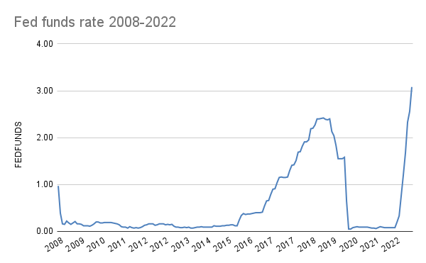
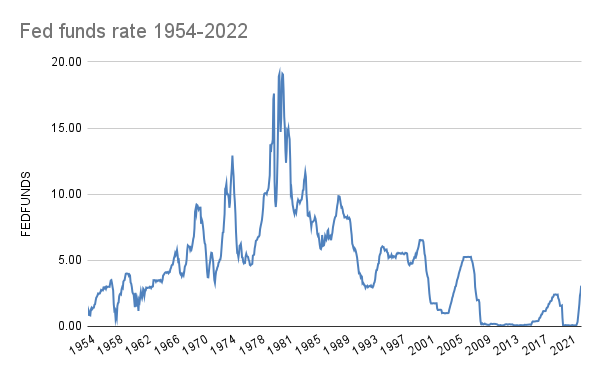

There have been six(6) federal fund rate hikes in 2022.  [J-Pow](https://en.wikipedia.org/wiki/Jerome_Powell) cannot be contained. For millennials, this is the first time they’ve seen this in their adult lives. How do you cope with entering a new economic environment you’ve never seen before? 

[Post by Drew Austin (@kneelingbus)](https://twitter.com/kneelingbus/status/1537864690340175873)

First, some perspective:

## Rates are moving back toward “normal”

We have lived our entire adult life in a bull market. To us, interest rates look like this, a lifetime high:

But over the long term, it looks something like this

Rates are at a local maximum, but are they high? We’ve survived much higher rates before. The US has had positive GDP growth for [42 of the last 50 years](https://www.macrotrends.net/countries/USA/united-states/gdp-growth-rate). We’ve survived this before, and we’ll survive it again. 

Interest rates are rising steadily towards pre-2008 levels. Is this a “new normal” or a “back to normal?” 

Either way, it’s the end of one cultural season and the beginning of another.

## Fuck around season is over. Find out season is here

Rivers of capital and stonks that only go up carried with them a sense of enduring optimism. As the river dries up, we instead see realism over-optimism, skepticism over idealism, and accountability over impunity.

### In the fed rate was lower, would Elizabeth Holmes receive a shorter prison sentence?

A fraud like Theranos can only exist in a low-interest-rate world. The reason people bought into it was that they *wanted* it to be true. I was sure Elizabeth would get a slap on the wrist: she’s too pretty, too pregnant, too rich, too well connected. No way she suffers consequences for convincing people to mistakenly stop taking their blood thinners and blowing [$686.3 million](https://qr.ae/prXuFM) of investor cash. 

But now it’s find out season, and she’s getting 11 years.

[Post by Bucco *Parody* Capital (@buccocapital)](https://twitter.com/buccocapital/status/1591464179307012096)

While it’s nice to see a huckster get what’s coming to her, the more important impact is how it affects our day-to-day life.

### The end of the age of convenience

Imagine how different travel would be without Uber, Lyft, and Airbnb. Soon, you may have to. 

Investors are no longer interested in engineering an on-demand economy from scratch.

Without free-flowing capital to deploy, these kinds of businesses can’t continue to subsidize costs. 

For example, Doordash. [The thing that should not be](https://www.youtube.com/watch?v=bYJGt67Mwmo&ab_channel=MegaHermansen).

The only way they have stayed afloat has been through venture capital, stealing driver tips, and charging restaurants a 30%. All of this, on top of the exorbitant fees they charge customers

Airbnb started in 2008. Uber was founded in 2009. Lyft followed in 2012. These companies have only existed during the previous economic season, and there is no guarantee they will survive the next. 

Like Twitter, these businesses will not truly die but will be husks of their former selves. The beauty of building with cloud computing is that it scales both ways.

But the real question isn’t where VCs are putting the money, it’s where we should put our assets.

## It’s never been a better time to hoard

Stocks are cheap, takeout cheeseburgers are expensive, and places to park cash are back on the menu.

[I-Bonds](https://www.treasurydirect.gov/savings-bonds/i-bonds/) became a popular investment vehicle when their rate hit 9%. They are still returning a respectable 6.89% as of this writing. 

High-yield savings accounts are back. Ally is currently offering 3%. Now that banks are making money lending to the reserve again, they have incentives to increase deposits and are sharing some of those rates with customers. 

Stocks are also on sale. High valuations are dropping. This is another part of the Find out season effect, or as economists call it, “normalization”: 

> “A normalization of rates would return the focus to market fundamentals and off of focusing on the nuances of each Fed statement”  
> – David Nice, former senior economist at DS Economics in Chicago.

Crypto is on super sale, but it might go to zero. 

Typically it takes the market 12 months to react to interest rate changes fully. With more investment options and places to store cash than ever, it makes the most sense to spend as little as possible and invest what you can now. 

Besides savings, how can we find opportunities in the new season?

## Thriving in the new climate

### **Work for a business that makes money**

harder than it sounds when you’re a software engineer. Approach businesses like you would invest in them. Does their business model make sense? Do they seem stable? Find a company that can weather find out season. 

The companies laying off are highly leveraged and not profitable. The fud about engineer hiring is overblown. If you’re looking, here’s a list of [500 companies still hiring](https://airtable.com/shrAPDHg8apj4mnRR/tbl6Kz4KeeCp3HrSM).

### **Become an investment, not an expense**

Plenty of companies still have money to deploy, but they are being more thoughtful about where it goes. If you sell products or services, think about how you can position yourself so that companies see you as someone who can save on costs or increase revenue. Many successful businesses are forged in recessions. 

### **Learn to cook** 

Is it just me, or is eating out getting progressively worse and simultaneously more expensive? Seems like a good time to pick up a copy of *The Food Lab* and learn to make a nice stew.

### **Relax**

Things are not as dire as they seem. People have weathered worse. There are opportunities here. Finally, remember:

> **It’s time to stop fucking around.**
