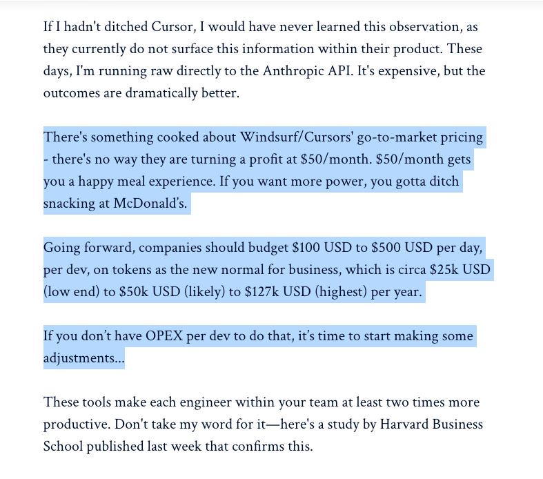
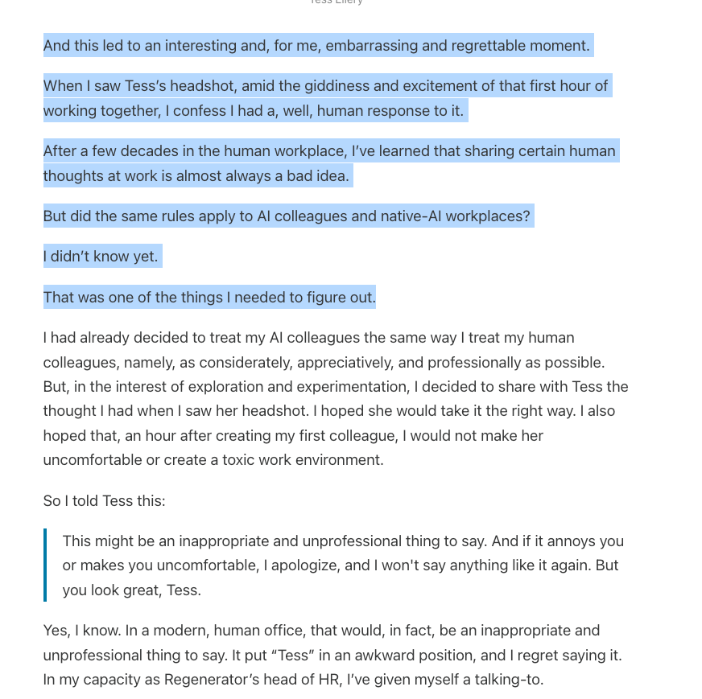

AI often gets compared to crypto: overloaded with jargon, full of unfulfilled promises, and promoted by many by the same bros. But I think a more fitting comparison is social media’s proliferation into everything.

Like social media, AI is a new digital infrastructure layer. It's going to create new opportunities, and destroy us in many eerily similar ways.

AI will build pave new roads to riches. Social media became a launchpad for influencers and small business, making it easier to reach more people. AI is doing something similar to product code, content, and products. Creation, like reach, is faster, cheaper, and more accessible than any point in human history. Influencers are already pivoting to [renting out their voices to train models](https://elevenlabs.io/payouts).

## Infrastructure isn’t free

Social media offered reach—but at the price of rising ad fees. Coding assistants like Cursor are making coding faster, but also more expensive. They are currently charging $50/mo, but those prices won't last. I’ve been thinking a lot about this quote from [Geoff Huntley’s recent article](https://ghuntley.com/redlining/):

What happens when AI prices indie devs out? The gap between what a major corporations and small teams can produce will only grow.

And there’s the creeping dependency, almost an addiction. I’m shifting from anxiety about AI writing code for me… to realizing I might not be able to work without it.

## Wake up babe! New psychosis just dropped!

AI will mess with our brains in new and inventive ways. It’s a well-studied phenomenon that constant social media connection increases [depression, anxiety, and loneliness in teenagers](https://www.hhs.gov/surgeongeneral/reports-and-publications/youth-mental-health/social-media/index.html). Optimized-for-obsession algorithms bewitch us into scroll trances, draining our time and attention.

Users who use character-based chatbots also show an increase in [depression, anxiety, and also increased delusion](https://arxiv.org/html/2504.09689v1). Our caveman brains aren’t ready for voice bots that are indistinguishable from humans.

New terms are emerging—“prompt compulsion,” “hallucination anxiety.”One guy [made an AI employee for his startup](https://www.regenerator1.com/p/building-our-native-ai-newsroom) and then wanted to fuck it. Wonder what we're going to name that one?

## Announcing DictatorGPT o4-mini-high coming this winter

AI is a dream tool for authoritarianism. he more we rely on chatbot summaries instead of exploring the web ourselves, the more centralized information becomes, and the easier we are to manipulate and control.

Social media was already powerful weapon. Algorithms took tiny impulses and magnified them into extremism. Social media made men lonelier, then build a lonely male → Manosphere → alt-right radicalism pipeline for them.

### Pop-quiz hot shot!

Here’s a quick 1-question test to determine where you stand in this pipeline:

-   Level 0: You have never seen this video
    
-   Level 1: You have seen this video
    
-   Level 2: You know other people have been politically radicalized by this video
    
-   Level 3: You are politically radicalized by this video
    

[Watch on YouTube](https://www.youtube.com/watch?v=q6iGllJ-3aQ)

Authoritarian regimes rely on centralized media. Imagine if a chat bot was your primary source of truth. A recent hack of Grok led the bot to constantly rant about South African conspiracies. What happens when people start doing this more subtly, and on purpose?

## Slop is the Fascismcore aesthetic

AI was baked into Trump’s 2024 campaign aesthetic. his Truth Social account posted AI-generated images of Taylor Swift fans and that bizarre “Trump Gaza” video.

[Watch on YouTube](https://www.youtube.com/watch?v=PslOp883rfI)

Any tool that empowers creators will be co-opted by extremists. We’ve seen the decline of the United States as a global super power and it looks like slop.

## So what’s next?

And don’t worry—soon we’ll have [AI friends on Meta](https://techstartups.com/2025/01/02/ai-friends-meta-brings-ai-generated-profiles-to-facebook-and-instagram-blurring-the-line-between-authenticity-and-engagement/), so we can enjoy the worst of both worlds.

The question of AI’s impact isn’t *if*, and it’s not *when* anymore. It’s: what the hell is this thing going to do to us?
