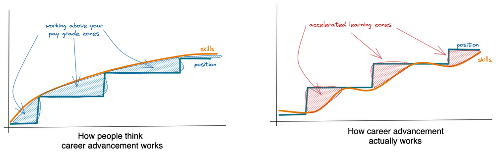

The quickest way to advance in your career is to position yourself where you are unqualified and grow into said position. It’s called “playing up.” 

Mia Hamm used this tactic to become the greatest female soccer player of a generation. In her own words (emphasis mine):

> "All my life I've been **playing up**, meaning **I've challenged myself by competing with players older, bigger, more skillful, more experienced -- in short, better than me.** When I was six, my big brother, Garrett, ran circles around me. At ten, I joined an eleven-year-old-boys' team and, eventually, led them in scoring. Seven years later I found myself playing for the number-one college team in America after becoming the youngest player ever to suit up for the U.S. Women's National Team."  
> – Mia Hamm**, [Go For The Goal](https://www.amazon.com/dp/B00D184QVM/)**

Playing up is a powerful career tactic. By putting yourself in a position where you're underqualified, you'll grow your skills and advance quicker than you would by toiling away alone on study projects and online course content.

## Every significant move in my career I made by playing up:

-   **Noob to small-town agency hack:** First, I got a job at an agency when I barely knew about web development.
    
-   **Small-town agency hack to government contractor:** Then, I moved into a larger corporation and eventually led a small team with zero management experience (don't all managers start managing with zero experience at some point?).
    
-   **Government contractor to indie freelancer:** After that, I went out on my own as a freelancer, even though I knew nothing about running my own business.
    
-   **Indie freelancer owner to senior unicorn tender:** Today, I work for a unicorn that requires a pristine design that I can only deliver by being at the absolute top of the frontend game, even though I was a 7/10 *at best* beforehand.
    

But playing up doesn't come without risk and takes a lot of work. It's only for the ambitious and those who won't have an appetite for keeping work interesting.

## **How academia has teaching exactly backward** 

Academia teaches you to build a foundation of knowledge in the basics and build up skills from there. This method isn't effective. How much does what you do in your day-to-day work line up with what you were taught in school? Have you ever studied technology but felt it didn't "click" until you used it in a production-ready app?

Instead of studying for the test, you put yourself at the end. Work backward and leverage those stressors to adapt to your new situation. We are an adaptive species, after all. If you want to be a baker, get in the kitchen.

## **So THAT’S how Steve got that job in product management**

Have you ever worked with someone and thought, "how did they get this job? They don't seem qualified at all!" That could be you! Dream big! 

Here's how you can pull it off. But first, some clarification:

## What Playing up is and isn’t

### **Playing up is not overcoming impostor syndrome (but it will help)** 

Impostor syndrome is a pattern of doubting your talents and abilities. It manifests as an irrational fear of being "found out."  That you shouldn't be where you are. Playing up is knowingly putting yourself in a spot where doubt is rational. Playing up is putting yourself where you deserve to be, *eventually.*

Impostor syndrome pervades the tech industry. We don't have a formal education and accreditation system like other industries. We don't have a rite of passage to tell us we've made it other than landing a job.

One way to manage impostor syndrome is by talking to your peers about your experiences. Chances are, you have been underrating yourself. You are not an impostor. You are exactly where you need to be.

In fact, playing up can be an antidote to impostor syndrome. You surprise yourself by doing something you thought you couldn't, proving to yourself you are qualified.

### **Playing up is not "faking it until you make it"**

Faking it works for mindsets and perspectives. You can't fake your way into competence that takes deliberate practice. But, you *can* fake yourself into a *position* where more competence is required.

Faking it is a strategy that rewires your internal framing. For example, you can fake confidence, optimism, and even happiness, which generates more authentic versions of those feelings. "Faking it" isn't fake at all. Instead, it's a flipping of the script: instead of letting your emotions influence your actions, you are using your efforts to influence your emotions.

Developing skills requires deliberate, consistent, intentional practice.

Get into situations where you aren't *quite* competent. Then get yourself to that level. Of course, it will require some faking to get there, but that's only the first part of the story.

[Watch on YouTube](https://www.youtube.com/watch?v=Gu8YiTeU9XU)

## **Why playing up works**

One of the fastest ways to level up your skills is by watching masters in action. Playing up allows you to learn from others more skilled than you. You can't get this at home. With online courses, you only see manicured, curated simulacrum of expertise.

When you are on a team, people have a vested interest in your success. Coworkers and bosses will help you.

You also learn more quickly when you *play for stakes*. Playing for stakes means working in an environment that rewards for success and involves risk if you fail.

Moving up before you are ready lets you move faster.

## The downsides

### You might lose your job

Worst case, you're fired. This happens when you play up but don't get good. Depending on your skill set, this may not be as catastrophic as you think. If you work in tech, there are plenty of remote job opportunities at various companies. All you have to do to find work is start applying to places besides the ten companies everyone else is applying to.

Honestly, I think that if you don't get fired at least once, you aren't playing the career game aggressively enough.

### It requires hard work

You should know going into it that playing up takes work. Playing up is playing on hard mode, with all the benefits and costs. If you are someone who always wants to leave work and work and not think about it outside of 9 to 5, then this strategy isn't for you. Even with on-the-job learning, you'll likely need to invest extra time and resources into skilling up.

[Post by Steph Smith (@stephsmithio)](https://twitter.com/stephsmithio/status/1515354871217614851)

But if this is a challenge you want to take on, how can you get started?

* * *

# Quickstart guide: playing up

### Start by applying for jobs (even if you like the one you have)

The fastest way to get started is to apply for jobs one degree higher than where you are. Job interviews aren't just a way to get hired for a new position. [They are a tool you can use strategically for career growth](/blog/antifragile-interviewing/). Don't feel guilty applying for jobs even with no intention of taking them. You can use these to test your mettle for new opportunities.

You probably can't move from a mid-level frontend engineer at an agency to a CTO of a unicorn startup. Instead, think about moving just enough to get uncomfortable in one of these directions:

1.  job title
    
2.  job role
    
3.  team size
    
4.  company size
    
5.  project impact
    

Applying for jobs *way* outside your comfort zone will not yield results, but I believe in erring towards taking the opportunity.

I often hear people say, "should I apply for this job? I don't know if I'm qualified or not." This mindset is the wrong approach. It's *the interviewer's* job to decide if you are qualified, not yours. Don't do their job for them. 

Good things happen when you get out of your own way. 

If you don't get the job, you've received feedback that informs you where to go next. Feedback you can use to refine answers and presentation, and skill set. This feedbacks points to where you have gaps you need to fill. As you learn and improve, confidence will come naturally, making you an even more attractive candidate.

## **Build a narrative for the opportunity and cover**

There's an old joke: How would you describe changing a lightbulb on your resume?

\> Single-handedly managed the successful upgrade and deployment of a new environmental illumination system with zero cost overruns and zero safety incidents.

No one is as happy as they seem on Facebook, as pretty as they look on Instagram, or as employed as they act on LinkedIn.

Before you can apply for jobs, you need to be able to tell a narrative about how you belong and why you are asking.

Update your LinkedIn for the job you want, not the job you have. This doesn't mean lying; it means being strategic. Your LinkedIn & resume are a highlight reel, so pick the highlights that position you where you want to be. For example, when I switched from being a full-stack engineer to a frontend engineer, I reworked my work history to focus on accomplishments with JavaScript and less on backend work.

Job postings for jobs you want in the future can act as a roadmap. Look at what skills are required for the positions you want. If you have them, highlight them. If you don't, start getting them.

## **Take on new projects in your current role**

This is the safest way to play up. You can play up towards a promotion or towards learning new skills. As an engineer, you could take on more managerial or strategic projects, examples include:

-   Taking on training/mentorship responsibilities
    
-   Contributing to documentation or coding standards that affect the whole team.
    
-   Work with stakeholders to help with product decisions and roadmapping.
    

* * *

# **The call to adventure**

Over time, you will build both confidence and competence. You'll be able to deliver quality work without working many extra hours. You'll have enough knowledge that extra studying is not required. Careers go through narratives, you've slain the beast, and now it's time for a liminal break.

Until you decide to take on your next challenge.
