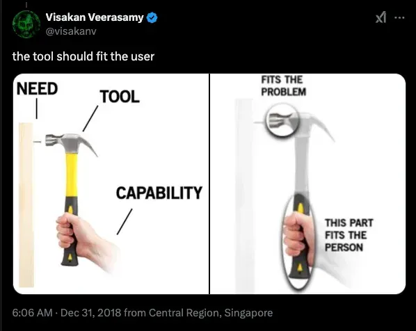
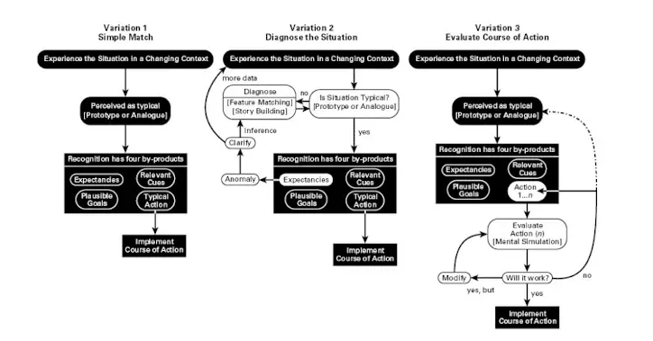
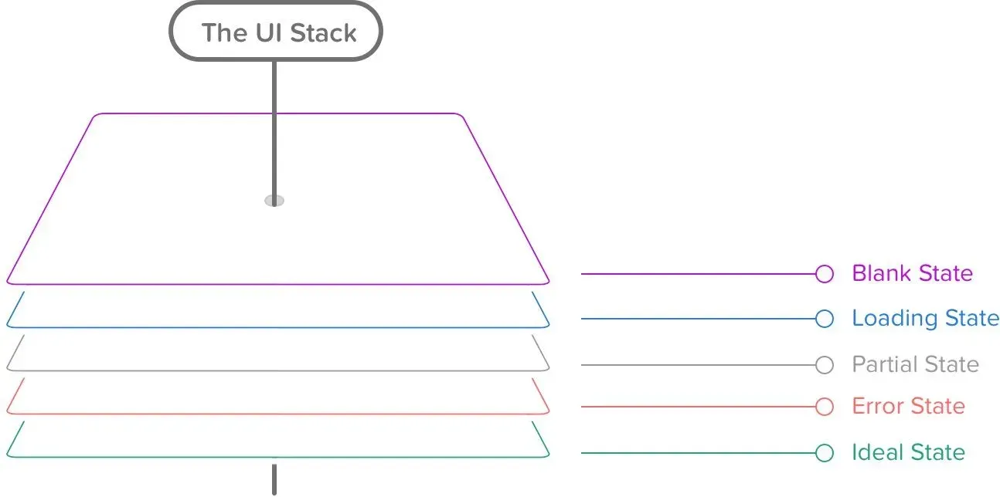

*(The following is a sample chapter from a book I’m working on, **System is as System Does: The Engineer’s Guide to Product Thinking**)*

Are you a developer contributing to customer satisfaction and business goals, or are you someone who costs money and causes problems?

Most managers hate working with most devs because they are the latter. Here’s a quick test to see if this is you:

-   When you’re working, are you focused solely on closing out tickets?
    
-   Do you stay silent when the designer pushes for a design that will take three times as long to build as a more straightforward solution? After all, it’s his job to make these decisions, not yours, right?
    
-   Do you push to be part of projects at work that drive the most business value? Do you know what those projects are?
    
-   Do you ever find yourself pushing for rewrites, refactors, or new technical solutions that don’t solve a problem you have today but might in the future?
    

If you answered ‘yes’ to any of these, you might be a developer who could benefit from focusing on product thinking.

No one likes using crappy software, and no one likes building it. But look around. Mediocre tech abounds. How does this happen? There are many factors, but if you’re a developer, you can only control your input in your part of the process. That input isn’t just code, but it’s how you communicate with teammates, managers, and product owners. Doing these effectively requires product thinking skills.

## What is product thinking?

“Product thinking”’s definition is nebulous. Putting it into practice is inscrutable, yet it’s a fundamental building block of being a higher-level software developer.

“product thinking” is the art and science of balancing business strategy, customer experience, and engineering robustness. It’s about thinking about software from the perspective of **how it behaves** instead of **how it works.**

Another way of thinking about it is balancing the **user's needs with the business's capabilities.**

## Feature-driven vs. product-driven development

The opposite of product-driven development is feature-driven development. This might sound weird at first. What is a product if not a collection of features? But there is a world of difference focusing on the collective rather than individual features. One sees the forest; one can’t see from the trees.

### Feature-driven developers are:

1.  Tech-centric
    
2.  Solution-focused
    
3.  Narrow-minded
    
4.  Disconnected from stakeholders
    
5.  Siloed
    
6.  Focused on inputs
    
7.  Robotic
    

### Product-driven developers are:

1.  User-centric
    
2.  Problem-focused
    
3.  Holistic
    
4.  Aligned with business goals
    
5.  Cross-functional
    
6.  Focused on outputs
    
7.  Empathetic
    

Feature-driven developers close tickets, fix bugs, and ship features. Product-centric developers solve problems, deliver value, and help people.

The only way we’ll improve software is to move more software engineers from the left side of the graph to the right. The reason I suspect engineers struggle with this is two-fold:

1.  Product thinking is more **abstract**. The lack of ambiguity is the flame that draws a lot of engineers into the craft.
    
2.  It’s a **tacit** skill - there is no leetcode for product thinking. It’s more of a way of thinking about your work than something you can practice deliberately.
    

Good product thinking requires developing your product intuition.

But can intuition be developed? People talk about trusting their gut, but don’t talk about how to train said gut to make better decisions. It turns out you can, and one psychologist figured out how:

## How intuition works

Delving further into tacit skills, we can use Gary Klien’s [Recognition-primed decision-making model](https://en.wikipedia.org/wiki/Recognition-primed_decision), which describes how people make decisions in complex situations, to further examine what’s going on in a product thinker’s mind when building:

1.  **Developing expectancies -** Using hindsight to figure out how the codebase got to this state and forecasting where it might go in the future.
    
2.  **Spotting relevant cues -** Determining which information you should pay attention to and which you can ignore.
    
3.  **Prioritizing & Triage -** Deciding what work needs to be done now, and what you can set aside.
    
4.  **Apply or create scripts -** The mind seeks established patterns to follow in familiar situations. For novel scenarios, it develops new approaches.
    

Here’s a more in-depth look at the model[^1]:

Like a language model, you can train your intuition for better results. You can use three tools: **heuristics, patterns,** and **application.**

## 1 - Heuristics

A heuristic is a practical rule of thumb or mental shortcut that helps you make decisions or solve problems quickly. They are more guidelines than a rigorous formula. They are generally but not always accurate. Some examples: “Keep code DRY: don’t repeat yourself,” “Premature optimization is the root of all evil,” and “If you have to explain a joke, it’s not funny.”

### The gold standard: Nielsen’s Heuristics for User Interface Design

If you read only one other article on Heuristics, it should be [10 Usability Heuristics for User Interface Design from the Neilsen Norman Group](https://www.nngroup.com/articles/ten-usability-heuristics/), a research-based user experience consultancy. Putting these into practice will put you ahead of 90% of other engineers. A summary:

1.  **Status visibility:** The product should always keep users informed about what is going on
    
2.  **Familiarity:** The design should speak the users' language and follow real-world conventions.
    
3.  **Emergency exits:** Users can quickly correct mistakes or backtrack on choices.
    
4.  **Consistency:** Words, actions, and other affordances should have consistent meaning
    
5.  **Error prevention:** Prevent errors where you can and provide clear feedback when you can’t.
    
6.  **Recognition over recall:** The machine is the user’s memory, not the other way around
    
7.  **Simple & powerful:** products should be plainly simple enough for novices and subtly powerful for experts
    
8.  **Focus:** Interfaces should contain the information needed and nothing more
    
9.  **Error recovery:** Error messages should provide a solution
    
10.  **Document:** Build a product that doesn’t require documentation, then document it anyway
     

### Other useful heuristics

There’s a handful of other adages out there that can serve as heuristics. Here is a collection of the ones I’ve found most helpful:

1.  **Jakob’s Law** - People spend most of their time using digital products *other than yours.*
    
2.  **Law of Prägnanz -** people will interpret groups of complex and ambiguous shapes in the simplest form possible.
    
3.  **Miller’s Law** - People hold an average of seven things in their working memory they can accurately identify.
    
4.  **Aesthetic-Usability Effect -** People are more tolerant of minor usability problems when an interface has an aesthetically pleasing design.
    
5.  **Fitt’s Law** - The time it takes to click a target based on the target's size, distance, and position.
    
6.  **The Von Restorff Effect** - One visually unique object will be remembered among a group of visually similar objects.
    
7.  **Teslers's Law** - Demonstrates that a system's complexity cannot be simplified beyond its condition to function. Simple interfaces require complex code.
    
8.  **Peak-End Rule** - People judge experiences mainly on how they end.
    
9.  **The Doherty Threshold** \- People's attention and productivity increase when the interaction response is within 400 milliseconds.
    
10.  **Sturgeon’s Law** - 90% of everything is crap[^2]
     

When building expertise and intuition, first, you learn the rules. Then, you learn which rule to apply and when. Then, you learn when there are exceptions to the rules. Then, you know how to break them.

## 2 - Patterns

While heuristics give you rules, patterns give you tactics. The more patterns you’re familiar with, the easier it is to devise a plan of action in different contexts. Patterns will even teach you tactics when you don’t realize it.

[Studies have shown](https://web-archive.southampton.ac.uk/cogprints.org/3255/1/chicken.pdf) that we can learn to discriminate different objects and automatically form categorizations from exposure to instances of things. The more features you build and the more you see, the more likely you’ll “just know” a solution to a problem when one comes up in a meeting, even if you don’t know how you came to that conclusion.

### Look for similar problems

Whatever problem you’re working on, chances are you aren’t the first person to face it. How have other people solved similar issues in the past? For example, you must build a form to capture a user’s address. Plenty of people have done this before, and if you look, you can find common patterns[^3]

-   Using an autocomplete powered by Google Maps to fill in the address for you
    
-   Calling them ‘postal code’ instead of ‘zip code’ if you are supporting non-US customers
    
-   Using input masks or placeholders to show people the format you expect for postal codes and, if you’re collecting them, phone numbers.
    

You may also check yourself to ensure you don’t believe one of the many [falsehoods programmers believe about addresses](https://www.mjt.me.uk/posts/falsehoods-programmers-believe-about-addresses/).

I’m not saying implement these patterns verbatim, though you might. What I am suggesting is looking for similar solutions for inspiration. As a bonus, these can be easier to pitch to stakeholders. No one gets fired for copying Apple.

### Search your memory banks for previous patterns

You might remember seeing a product solution either as an implementer or a consumer. For example, when I got a job at a financial services company, I had never worked in that industry before, but I paid a credit card online. I can relate to the customer’s expectations, needs, and frustrations.

This is what starts to happen subconsciously more and more as you practice. Let’s look at Klien’s decision-making model again:

1.  When you look at a problem, you form **expectations** of the effect of different solutions based on previous patterns.
    
2.  Also, based on previous patterns, you get a sense of **what’s essential and what isn’t**.
    
3.  You understand what a **reasonable outcome** is, which helps you pick your next course of action.
    
4.  You may recognize previous courses of action, which helps you **triage and prioritize**.
    

With existing work, you only get to see the outcome. Looking at your previous work, you see both the outcome and the process. Similarly, we can also study others' methods.

### Learn patterns from case studies and observing others

One good thing about engineers is that they love to blog. Another way you can improve your expertise is by reading stories of how other people solved problems. Watching videos of people's work is a less explored but powerful way to improve your skills.

I once heard a story about someone who was learning to draw. They read books; they drew dozens of pictures to practice. Then they watched another artist on YouTube, and within minutes, they had a breakthrough:  
  
They weren’t holding the pencil correctly.

None of the books taught him how to hold a pencil. It’s an oft-ignored detail of the drawing process. Watching others in action can teach you some of the ‘hold to hold the pencil’ type of tiny details that can make a big difference in your problem-solving. Some reading I would recommend for some case studies on solving technical problems:

-   [Creative Selection: Inside Apple's Design Process During the Golden Age of Steve Jobs](https://www.amazon.com/Creative-Selection-Inside-Apples-Process/dp/1250194466)
    
-   [The Mythical Man-Month: Essays on Software Engineering](https://www.amazon.com/Mythical-Man-Month-Anniversary-Software-Engineering-ebook)
    
-   Ryan Singer shares a lot about his process on his blog [Felt Presence](https://www.feltpresence.com/)
    

### Pattern identification as background process

You don’t have to look for a particular pattern to notice a potentially useful one. Try to pay more attention to times when a product or a piece of code makes you say, “Wow! That’s quality.” Ask yourself what you like about it. What makes it quality?

As prolific blogger and poster Visakan Veerasamy likes to say, [focus on what you want to see more of](https://duckduckgo.com/?q=Visakan+Veerasamy+focus+on+what+you+want+to+see+more+of&ia=web). The more you pay attention to quality software, the more quality software you’ll build.

## 3 - Practice

It’s been theory so far: how intuition works and how you can supplement it with heuristics and train it with patterns. But none of this is helpful if you can’t put it into practice. Here are some actionable next steps:

### Look through a product-focused lens

If you’re coding every day, you are faced with small decisions about product quality. Everything we create is a product, even if it isn’t customer-facing. Some other ‘products’ of your work

-   Your code is a product for other engineers on your team. The UX of code is experienced when other developers have to modify or fix it.
    
-   Bug tickets, pull requests, and code reviews are also products for your teammates.
    
-   Status reports, tech specs, and other documentation about your work are products for managers and stakeholders.
    

Books are products. Podcasts are products. A cookout you throw for your friends is a product.

Try to shift your perspective from “how it works” to “what it achieves.” Think about how others feel and react when interacting with your work.

### Ask yourself questions to hack your brain

When Klein developed the Recognition-primed decision-making model, he realized he could get people to surface some of their intuition into cognitive thought by interviewing them while they were working.

He would ask subjects questions like:

1.  What cues did you notice first?
    
2.  In this particular situation, what did you expect to happen next?
    
3.  What are your priorities right now?
    
4.  What courses of action immediately sprang to mind?
    

Try this exercise on yourself. It can help you examine and better understand your problem-solving process.

### Pair with designers & stakeholders

Ask your designers or product owners if there are any meetings where you can be a fly on the wall. You’ll pick up tacit knowledge by watching other people think though and discuss problems. Another opportunity to see how others “hold the pencil.”

Ask questions and provide constructive ideas. Contribute, but don’t interfere. This will give you feedback on your product thinking.

### Make microdesign decisions

Rarely does a design or tech spec come through with every edge case and permutation covered. Filling in these gaps is up to the engineer who is implementing them. I call these microdesign decisions.

One model you can use to help identify these is the rules [UI Stack](https://www.scotthurff.com/posts/why-your-user-interface-is-awkward-youre-ignoring-the-ui-stack/). The UI Stack is a concept from founder & designer Scott Hruff. In his model, each interface has 5 “personalities:” Blank, Loading, Partial, Error, and Ideal.

These are common blind spots. For pages representing collections of data, I also include a sixth “full” state. Imagine if your list had 10x the number of entries you would consider normal. What does it look like? Can it load quickly? Does it still function?

## Wrapping up

Being more product-focused, in my opinion, leads to a more fulfilling programming career. On average, you’ll build better things, be more proud of your work, and get along better with your designers, managers, and stakeholders. However, where programming is logical and well-defined, “building a better product” is a more obtuse skill and requires a different approach to improvement. The three primary ways we examined were:

1.  **Heuristics -** rules of thumb you can use to help you think differently and make better decisions. I think Heuristics is a smart default — they will serve you well 70% of the time, and when they don’t, that tells you something, too.
    
2.  **Patterns -** raising your awareness of quality design, seeking it out, and internalizing what makes it quality.
    
3.  **Practice -** Finding small ways to practice your product thinking in the real world. Questions, comments, and conversations are valuable, even if they don’t impact the final product.
    

We’ve all used software that felt thoughtless. Irritating software. Software that makes you do something manually that a computer could have done in a microsecond. It might just feel “off,” but you can’t put your finger on why.

Silicon Valley types love to talk about “changing the world.” but that cuts both ways—annoyance scales like value. Careless software makes the world just a little bit worse for everyone who uses it.  
  
You have a responsibility to the people who use what you build.

As a software engineer, you are the last line of defense when it comes to stopping bad software from getting out in the world.

Every little thing you can do to make it better helps.

[^1]: I find Klein’s work fascinating; I may do a deeper dive into his work in a future post.

[^2]: See also Dan Luu’s [95%-ile isn’t that good](https://danluu.com/p95-skill/)

[^3]: The US Government has a published guide for [address form best practices](https://designsystem.digital.gov/templates/form-templates/address-form/).
