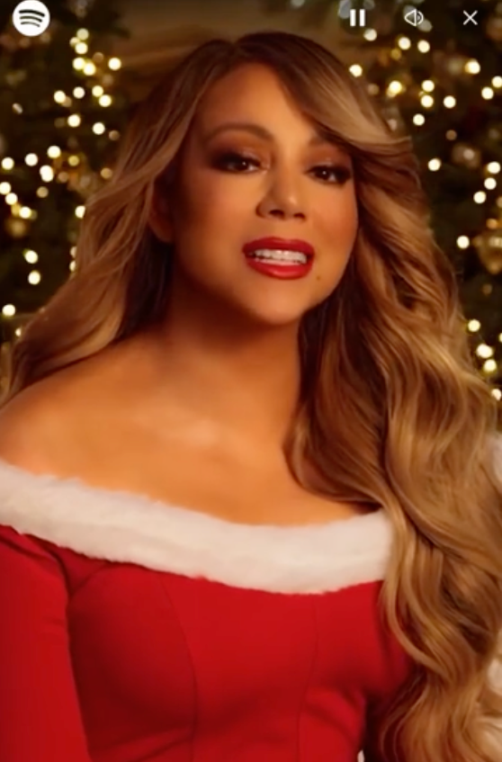

I’ve seen two companies use AI-generated content in their holiday campaigns, not as part of the process but as the whole campaign. The first is Cola-Cola’s 2024 polar bear commercial.

[Watch on YouTube](https://www.youtube.com/watch?v=E3-J0MwvBSI)

So much is '“off” about the new one—the animal’s faces jitter. Lighting and perspectives are off. A bottlecap flies unbounded by Earth’s gravity. It has that AI slop gloss sheen. There are so many camera cuts because AI can’t yet generate convincing video over three seconds long.

It is noticeably worse than in previous years. Compare this to [the 2020 commercial](https://www.youtube.com/watch?v=2de6ReSR4EI&ab_channel=WEMEIMEDIA). The animals *move.* They *emote.* They have personality.

Speaking of a loss of personality, let’s talk about this year’s Spotify wrapped.

Spotify Wrapped was worse writ large this year.

Generated genres were nonsense. We didn’t get lists of our top genres like last year. Everyone’s top artist #4 was *weird.* I had to DuckDuckGo[^1] to figure out who mine was. Spotify lost the thread; it’s not about showing us a list of songs, it’s about diving deeper and showing us something about ourselves that we didn’t know.

They kept the artist messages, little targeted commericals you get from your highly played artists, letting you know about their upcoming tours and albums. Some people speculate that [these were](https://www.youtube.com/watch?v=3govHAuafpM&ab_channel=CocoMocoe) *[also](https://www.youtube.com/watch?v=3govHAuafpM&ab_channel=CocoMocoe)* [AI-generated content](https://www.youtube.com/watch?v=3govHAuafpM&ab_channel=CocoMocoe), specifically Mariah Carey. You can [watch it here](https://www.reddit.com/r/popculturechat/comments/1h6nxe1/mariah_carys_spotify_wrapped_message_accused_of/) and judge for yourself.

The verisimilitude of Mariah Carey has always been in question. I’m not fully convinced this is AI, but it’s definitely not 100% organic.

I’m not an AI opponent. I think it has utility as a creative tool but not as content. When I use AI to write here, it’s used as a thesaurus, an editor, and an improv tool to riff with. I wouldn’t put out pure AI-generated words because if no human cares to write them, why should any human take the time to read them?

Corporations seem to be testing the boundaries of how much AI slop consumers will tolerate.

Hopefully, a shiny, slightly morphing Ghost of Christmas Yet to Come will pay a visit and show them what the future looks like if we keep going down this path.

[^1]: DuckDuckGo doesn’t work as well as a verb (do I “duck” something?), but speaking of AI ruining things, I’ve recently switched my default search engine. DuckDuckGo reminds me of the Google of yore.
