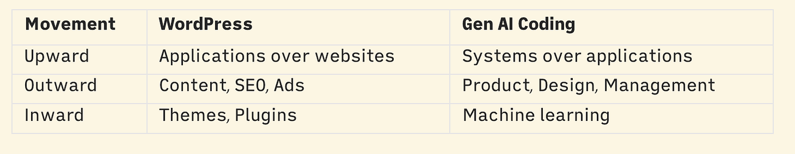
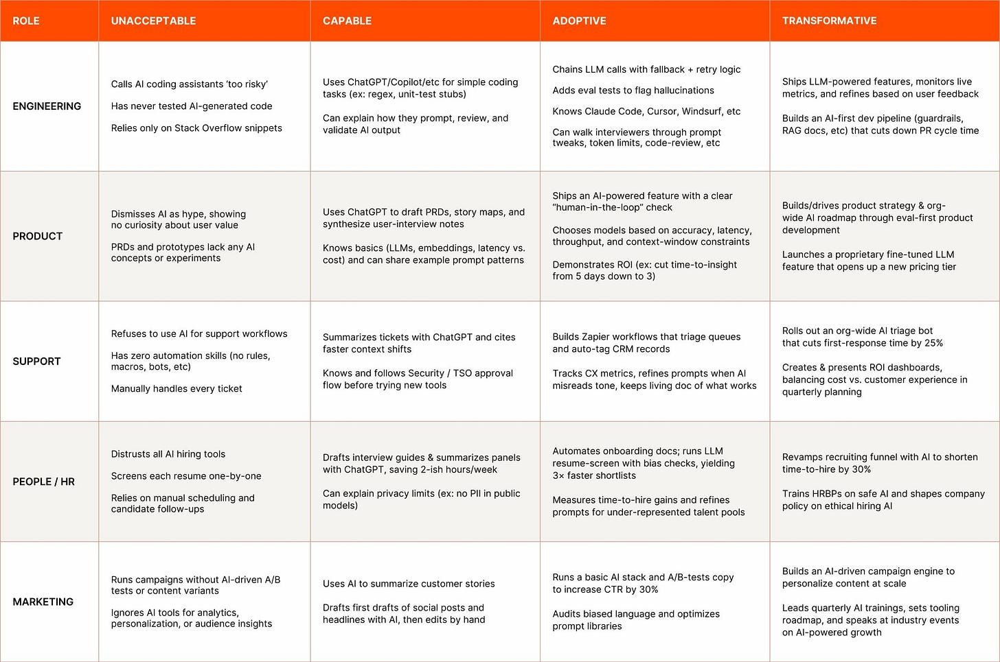
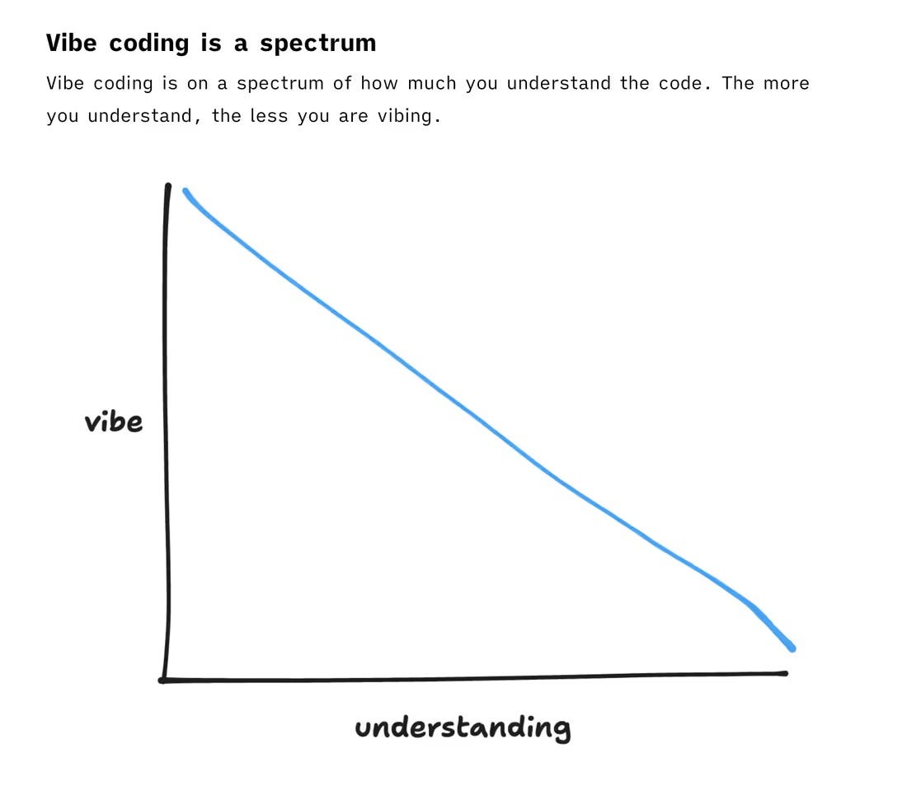

In 2023 I wrote a post about [how I thought AI would change my job](/blog/the-wordpressificaion-of-work/). Today I’m revisiting this to see what I got right, what I got wrong, and where we’re going next.

I said AI would be transformative, not destructive. Jobs would ,change and people would change jobs. Has that come to pass?

\## Where are people moving?

When old jobs ‘die’, people who make it through move one of three ways:

1\. Upward, solving bigger problems at higher abstraction levels

2\. Outward, moving laterally to related positions

3\. Inward, working on the platform that does the work they were previously doing.

Like it did with WordPress:

There are many new opportunities in AI. Especially with all of the VC money flooding in. For better or for worse, engineers can’t afford to ignore the changes.

I said I wouldn’t be doing my job anymore. Technically, I was right. Computers are boring, people are interesting. I felt I couldn’t stay competitive with younger, hungrier developers in a new paradigm for another 10 years. Coding is a young person’s game. I’ve since moved from a senior frontend engineer role to an engineering manager role. AI wasn’t the cause of this change, but it was definitely an influence.

How can you reduce risk in your career moving forward? Do you think AI will replace more engineers or managers?

How you answer that question shows how valuable you think judgment is for engineers, how personal relations are for managers, and how capable you believe future models will be at having those skills.

AI is not “going to change” to field, it already has. So, to look forward, we must take stock of our current environment.

## Where we are today

The biggest day-to-day change has been in \*how\* coding gets done. My workflow is entirely different now. I use CLI coding agents, primarily Claude Code. It writes code, runs scripts, and manages my version control. It’s a plain-text search engine of the codebase and its git history.

There’s also a shift in the wind of how companies are thinking about AI as a skill set. Zapier released an AI fluency matrix, and I think you’ll see more companies using rubrics like this.

## The changes I’m seeing

### 1\. The skill economics are shifting

The value of writing code is decreasing. The value of reviewing code, writing specs, system design, and defining processes is going up. Invest accordingly.

There’s also AI fluency as a job skill. If you’re on the job market, you need something on your resume about your LLM expertise.

### 2\. It will only get tougher to break into the industry as a junior

It’s already tough out there for junior developers. LLMs are raising the bar on what’s expected. Whether LLMs affect productivity is irrelevant here. It’s whether people in charge of headcount budgets \*believe\* it can increase their value-per-developer-dollar. Companies will expect more from juniors for less, and I think they’re in for a rough decade. The industry could also face a shockwave of an expertise gap in 5-10 years because of this.

I could see a world where the job of a junior developer is to act as a mini-conductor, babysitting coding agents. The ones out there figuring out how to leverage new tooling will be in a great position.

### 3\. It’s going to get harder to climb the ladder as an engineer

Even if you find a job, getting promoted isn’t going to get any easier. Previously, you could climb upwards by increasing either the complexity or the scope of your tasks. You moved from thinking at the ticket level to the feature level, and then to the multi-person project level. But with code being devalued, engineering skills are no longer enough to climb the ladder.

### 4\. LLMs will improve the code quality of large codebases

LLMs reward good engineering practices: Well-organized code, automated tests, comprehensive tech specs, documentation, smaller, coherent files, and choosing standard technologies over shiny new toys. All of these will make using LLMs more effective in your project. Turns out when you make your codebase dead-simple to work with, you can get a lot out of a dead-stupid computer. LLMs can compound tech debt just like they compound productivity.

### 5\. The quality of software will barbell

Creating slop is so fast and cheap now. Slop is not an AI-exclusive phenomenon. Slop means you didn’t try. People can tell when you don’t try. Now, not trying can produce more than ever before. I see this in writing already. Skilled writers can research more quickly and produce high-quality work faster.

There will be more crap. A lot of it. But there will also be people who understand the tooling and use it to create products at a quality that wasn’t possible before. LLMs will enable the best and worst of software.

### 6\. We gotta stop saying ‘vibe coding’

‘Vibe coders’ are an evolution of ‘Code Monkeys, ’ a derogatory term for people churning out work with little thought to quality or craftsmanship[^1]. There is a distinction between “vibe coding” by people who don’t know what a “tech stack” is and people who are implementing LLM-based practices into their software engineering jobs. Simon Willison tried to call that [Vibe engineering](https://simonwillison.net/2025/Oct/7/vibe-engineering/). Great article, despite replacing the wrong word. This graph[^2] from Maggie Appleton sums it up nicely:

This is not to disparage vibe coders. It’s a lot of fun! I can’t hate a technology that enables more people to express themselves and make more things.

### 7\. It’s gonna get weirder

Now that code is cheaper, and the tooling thrives on smaller projects, and more people can create more things, we’re gonna get weirder shit. Everyone can build a todo list how they like it. Everyone can make a game that caters to their taste. People with strongly attuned taste will build products they’ve always wanted. Companies will spin up internal tooling to solve their domain-specific problems.

These programs live behind VPNs and on people’s hard drives. A million dark matter applications.

## Excited to see what happens next

I’ll check in with y’all in 2027, see how I did. Till next time 👋

[^1]: Helluva [Jonathan Coulton song](https://www.youtube.com/watch?v=v4Wy7gRGgeA) though.

[^2]: source: [Vibe code is legacy code](https://maggieappleton.com/2025-08-vibe-legacy-code/)
