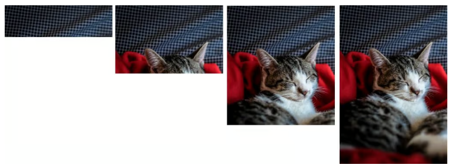
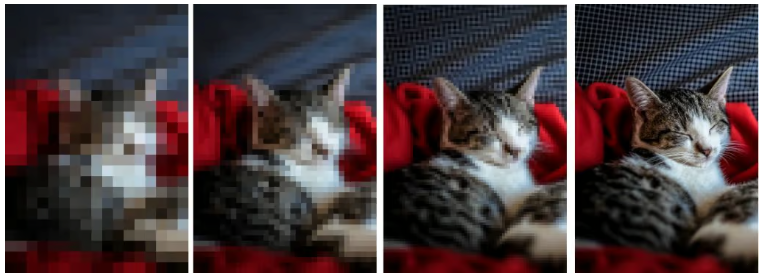
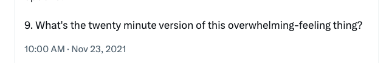

In January, I made a resolution to [be more like Leeroy Jenkins](/blog/my-leeroy-jenkins-year/). I was tired of overthinking, overanalyzing, and feeling stuck all of the time. Four months in, here are a few techniques that I’ve found help me avoid overthinking and take more action.

## Most decisions are satisficing decisions

I recently had to decide which projects my team would tackle over the next two months. We had several good options, but how could we know which was the right bet? We had informed guesses, but design needed enough runway—so we had to choose quickly.

Pretty much any option would have worked. We could have thrown darts and been okay. We listed our best guesses on impact and feasibility, and picked our next three projects.

Most questions don’t have a correct answer, but all questions have a *best* answer — subjective and based on context. The best choice is simply the best one you can make in the moment.

## Selection sort all the things

I learned this from a [beta copy of a book my friend Swizec is working on](https://swizec.com/blog/looking-for-beta-readers/). Humans are terrible at comparing a lot of options, but we’re good at comparing two at a time. When you’re unsure what to pick or prioritize, make a list and selection sort it.  

[Watch on YouTube](https://www.youtube.com/watch?v=92BfuxHn2XE)

*(God these videos are so satisfying)*

## Draw blurry pictures

There are two JPEGs compression algorithms: baseline and progressive. Here’s how they render:

**Baseline JPEG**

**Progressive JPEG**

  
  
Be a progressive JPEG. When you're working on something, start with a minimal but complete version. Better to have all the pieces, regardless of how flawed they are, than an unfinished piece.

There are several benefits to this approach:

1.  It informs the work —the middle oftens informs the end, and the end informs the beginning.
    
2.  You’ll likely hit “good enough” sooner than expected.
    
3.  Complete rough drafts are easier to share and get feedback on.
    
4.  It gets you to the revision phase faster. Quality comes from the edits. The trick to delivering high-quality work is a willingness to do more rounds of revisions than most people.
    

## What’s a 10-minute thing you can do right now?

I love this list of high-agency questions from [Chana Messinger](https://x.com/ChanaMessinger/status/1463160594941554696). The whole thread is gold, but I want to highlight this one in particular:

There’s usually a smaller step you can take to move things forward or a simpler version of what you want to do. When stuck writing an article, I’ll ask myself “can I write a 250-word version of this idea?” That’s enough to get started.

This pairs well with the blurry picture approach. My new favorite way to finish a piece is to set a series of timers[^1].

-   Can I make in outline in 10-minutes?
    
-   Can I flesh it out and order it in another 10?
    
-   Can I get together a complete shitty first draft in 30 minutes?
    

In under an hour, I’ve gone from an idea to something I can work with[^2].  

## Finally, have some fun with it

  
Thanks to work travel and other internal writing projects, I haven’t posted on here in nearly a month. I felt overwhelmed trying to get back into it, especially with the growing list of articles I feel I “should” finish. Shouldn’t I focus on the most important, biggest ideas first?

I carved a section of this Substack out specifically for informal, off-the-cuff writing. But I felt I “shouldn’t” write one of those, because I had “more important” pieces I should work on instead.

The problem is, that makes this feel like work. I already have work from 9-to-5 and it’s plenty. I start avoiding this text editor entirely. The whole attitude is silly if I think about it. No one is forcing me to write here, or meet any kind of editorial guidelines or deadlines except the ones I set for myself.

[Writing is generative](/blog/you-dont-write-to-share-more-you/), and sometimes fun is what gets you unstuck.

Sometimes the best way to be productive is to spend 20–30 minutes on something frivolous. It reminds me why I enjoy this in the first place. The bigger stuff can wait. they’re easier to write after I gave myself a little time to do a small stakes writing sesh.

Maybe it’s productive procrastination. But — it builds momentum. This resolution isn’t about optimizing productivity or getting more done.

It’s about getting and staying unstuck.

[^1]: This comes from David Perell’s Write of Passage course, a technique he calls “CrossFit for Writing.” A summary of the technique in [this thread](https://x.com/adityatheverma/status/1680221224331247616)

[^2]: This isn’t just for posts on Substack. I use the same approach when writing internal reports and documentation.
