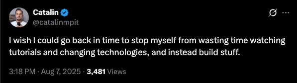

A line from a podcast stopped me in my tracks so hard I almost fell off the treadmill. A huge unlock.

I recently found the [\*Complex Systems](https://www.complexsystemspodcast.com/)\* podcast, a where Patrick MacKenzie talks investing, AI, building software. An oddly high number of guests are former professional poker players. It could not be more by shit. In [a July 2025 episode](https://www.complexsystemspodcast.com/episodes/think-like-a-trader-ricki-heicklen/), In July he talked to former Jane Street employee Ricki Heicklen. Ricki founded [Trading Camp](https://trading.camp/), an immersive four-day bootcamp where people learn quantitative trading through simulated stock games, team projects, and lectures.

The Line:

> **Ricki:** So when people walk through the door, the very first thing we do is have them start trading. Absolute number one, immediately just throw people in without explaining the rules, without explaining too much logic about what is all the syntax going to look like? We say, "Hey, we're going to go around, play this trading game," and we get them started and correct as they go. And that's because a very very big part of our pedagogical philosophy is that **the best way to learn how to trade is to trade.**

The best way to trade is to trade.

Later that weekend I was thinking about tinkering with Claude Code—and regretting how much time I’d spent *talking* about it, watching YouTube, and reading articles without learning the tool. The exact [kind of behavior I’ve been trying to curtail all year long](/blog/my-leeroy-jenkins-year/). I took Ricki’s advice. I installed Claude Code, bought $20 in API credits, and started pushing some buttons.

## Diving headfirst into Claude Code

At first it felt daunting. What project should I build? Which model? What belongs in my local [CLAUDE.md](http://claude.md/) file? How will I verify correctness? How do I prompt it? I’d stall there. I even keep a note with twenty “LLM Project Ideas,” yet when I sat down, I didn’t know where to start. After the episode, I figured, “start anywhere!”  
  
I had a few changes I wanted to my personal homepage. I use Claude Code and it was able to get the job done! I wanted to try something bigger. Then, I stumbled across this post: “[The 7-Day Roguelike That Took Six Minutes](https://liminalwarmth.substack.com/p/the-7-day-roguelike-that-took-six).” Perfect! I love roguelikes, and this is a decent sized greenfield project.

It took hours, not minutes. When I got stuck, I read docs and searched for answers. I kept a running list of open questions and filled them in as I went. I wasn’t “studying for someday” anymore—the mythical day when I’ll “have time.” As a parent, the only thing more fantastical than a dungeon of skeletons and orcs is the idea that time will appear out of nowhere. I was looking for specific information to remove specific roadblocks, so I could get back to work.

The next week at work, I shipped more pull requests than I had in the previous month—thanks to tricks, tactics, and prompts I picked up while experimenting. The best way to vibe code is to vibe code. You just gotta push buttons.

## Pushing buttons in fast-moving fields

Someone asked me for AI course recommendations. I said I’m skeptical of books or courses. because the field is moving fast, and LLMs are an always morphing black box. What worked last week may not work this week. By the time anything that long gets published, it’s dated. You have to get comfortable taking the path less traveled, ordering off-menu, going off-book.

There’s plenty of alpha out there if you’re willing to just push buttons.
