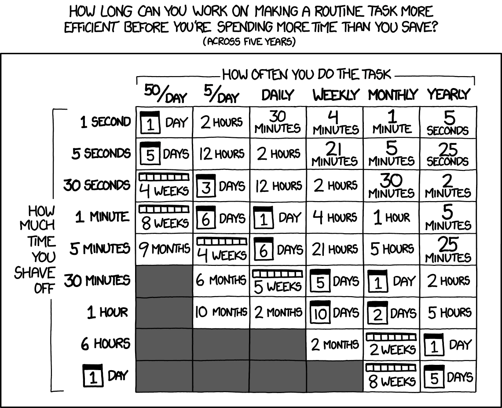

[^1]

I sometimes can't tell when AI makes me more productive or slows me down. When I'm learning or brain rotting. So I started collecting case studies, doing research. Then I found this article: [How to use AI without becoming stupid](https://commoncog.com/how-to-use-ai-without-becoming-stupid/). Eureka moment. Now I have a clear line in the sand for deciding whether an LLM is up to the task.

> **Vaughn Tan Rule**[^2]:  
> Do NOT outsource your subjective value judgments to an AI, unless you have good reason to—in which case make sure the reason is explicitly stated.

This matches my experience & that of my coworkers. So what does it mean in practice?

## Use LLMs to inform, not decide

Don't ask "What should my next career move be?" Instead, ask "Give me examples of career strategies for people in my scenario." LLMs gather information, humans make the call.

One big source of alpha: CLI-based tools like Claude Code and Codex as plain text code search engines. Customer support asks, "Do we have a setting to disable the transaction email with {subject line}?" I work for a company whose backend is written in Haskell, a unique language with a steep learning curve. A curve I've never bothered climbing. Now I have a much easier time understanding how things work.

## Use LLMs to edit, not interpret

LLMs excel at data transformation. LLMs are great at turning text from format A to B. Haskell to English. Code to customer support. I've used it to generate plain English summaries of JSON objects. You can take a screenshot of anything and turn it into text or a CSV.

Now that I'm in a more managerial role and writing on the side, I find this kind of 'text scripting' incredibly useful. These are cases where judgment calls aren't needed. When it is, I find a way to stay on top of the process.

I don't trust LLMs to write; they lack voice[^3]. Instead, when writing this piece, I will have an agent copy a draft, then make edits based on a style guide. Afterwards, I diff both pieces and put together a final version. Fewer mistakes, more humanity.

However, I would be wary of using it for summarization. Some text processing is sneakily a value judgement: You are deciding what to include and what to omit. What to emphasize and what to downplay. You are also making decisions about structures and prioritization. These are the kinds of writing work I wouldn't outsource to an LLM.

## LLMs don’t always write good code, but code doesn’t always have to be good

Tell me if this resonates: You see the hype around AI delivering developer productivity gains. You see the takes on social media calling it bullshit. You try it at work. The result? A tool that ignores instructions, reimplements existing code, churns out slop. You spend more time writing prompts and reviewing than coding. You've hit the [paradox of automation](https://personalmba.com/paradox-of-automation/).

The faster code can be written, the more crucial human judgment becomes. Real savings come from code that requires less judgment.

Day job code requires working with a large codebase and trying to achieve a specific result. It requires subjective judgment on which parts of the codebase are important, and what the output should look like.

Sometimes code doesn't matter much. Prototypes. Command line utilities. Utility scripts cost nothing now. CLI-based LLM tools write *and* run them. Contrast coding at work with "vibe coding," an app, where you care less if the final outcome is a little different than what you were expecting. It's all jazz, baby.

LLMs drastically changes the math on automation.

I think I could whip up any single-purpose script in 30 minutes or less. Automation costs roughly a pizza.

The biggest gains aren't in optimizing existing workflows. They're expanding what's possible. With a tool that writes & executes scripts, what wasn't worth doing before?

Product engineers and designers can now open PRs to production. Should companies encourage this? Why or why not?

[^1]: A geologist in a cave trips over a stone; two women and a man holding a candle in the background. Etching, ca. 1870. Wellcome Collection. Source: [Wellcome Collection](https://wellcomecollection.org/works/fzzqbvku).

[^2]: I love Cedric’s writing, but real missed opportunity here not calling it “The Vaughn Tan Line” 👙

[^3]: Unless it’s writing some TPS-report corpo-content, where removing voice is a feature, not a bug.
