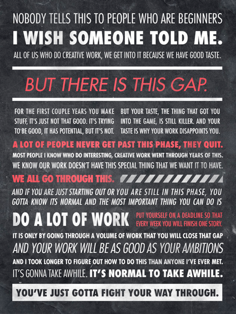

Being comfortable with uncertainty and disorder is challenging. Resisting uncertainty is hardwired into our lizard brains, which aren’t equipped for today’s world. 

In previous articles, I’ve looked at breaking down [what disorder is and how it works](/blog/the-foundations-of-disorder/). Then, I examined how reactions to it can [affect the amount of disorder we encounter](/blog/the-uncertainty-tailspin/). I did this to [invite Mara to tea](https://aboutmeditation.com/having-tea-with-mara), to let uncertainty into the door, so that we can sit with and make peace with it. 

Why? 

Disorder is coming whether we like it or not. If we can sit with her and look her in the eye, we can see that she invites us to a world of both opportunity and truth, creativity and wonder. 

## Creativity - you can’t know the destination until you get started

> “Writing a novel is like driving a car at night. You can see only as far as your headlights, but you can make the whole trip that way. You don't have to see where you're going, you don't have to see your destination or everything you will pass along the way.  
> You just have to see two or three feet ahead of you.  
> This is right up there with the best advice on writing, or life, I have ever heard.”  
> \- E.L. Doctrow, Novelist

Writing got easier when I realized I wasn’t supposed to know how an article would go until I started writing it. “plan, then execute” is not the pattern most creative processes follow. Instead, execution and discovery are tangled in a way that makes this impossible. When you don’t know enough to plan, the best option is to get started.  The software industry started to see the contours of this with [Agile](https://agilemanifesto.org/):  One of the values is “Responding to change over following a plan.” Agile has many failings, but at least it acknowledges that the creative process requires uncertainty and disorder. 

Your creative vision is always a little bit ahead of your execution, as it should be. You can’t know what you will create until it’s done. And each piece informs the next - the goal of most work turns out to be research & development for the small percentage of your work that is truly great. 

I want to draw a distinction between creativity and innovation here. Creativity is the act of creating something where that was nothing. Innovation is navigating uncharted territory. Writing, painting, coding, cooking, and entrepreneurship are all creative acts. It’s about putting your soul into the output of the world. Innovation is doing something new. While they are different, they are often tightly coupled, so it’s no surprise that disorder also plays a role in innovation.

## Innovation is required for novelty and style

Innovation makes your work distinctive. It gives you a competitive edge. What would your work look like without it? 

This kind of uncertainty is particularly challenging for large companies. Companies gain an appetite for process, metrics, and standardization as they grow. Weapons they plan to use to keep Disorder at bay.

> "Companies whose investment processes demand quantification of market sizes and financial returns before they can enter a market get paralyzed or make serious mistakes when faced with disruptive technologies. They demand market data when none exists and make judgments based upon financial projections when neither revenues or costs can, in fact, be known. Using planning and marketing techniques that were developed to manage sustaining technologies in the very different context of disruptive ones is an exercise in flapping wings"  
> \- Clayton Chirstensen, Innvoator's Dilemma

Uncertainty is more advantageous at startups and less desirable the larger and more established a company gets. Companies have more to lose, they get risk avoidant. 

This philosophy holds at the personal level. The less you lose, the easier it is to embrace Disorder. This is why it’s harder to start a startup after getting a well-paying job than when you are young and broke.

## Being comfortable with uncertainty is a competitive advantage

> "Profit arises out of the inherent, absolute unpredictability of things, out of the sheer brute fact that the results of human activity cannot be anticipated"  
> — Frank Knight, Economist

We’re all working with the same outdated firmware. Learning to outthink your caveman OS is something most people can’t or won’t do. If you can, you have a competitive advantage. 

In fact, [research shows that people will avoid financial upside if uncertainty is involved](https://www.nature.com/articles/nrn3524), *even if they know it is advantageous to do so:* 

> "Tanovic recently asked participants to play a game called the “Uncertain Waiting Tasks.” Throughout various trials, the participants can win a little money. The outcome of each trial is purely random, but the participants have a choice to know the result immediately instead of waiting a few seconds before they find out. The immediate knowledge comes with a penalty, though: if they win the trial, the prize will be smaller."

"Despite it being the more rational option, only 37% of the participants opted to wait on every single trial. The [rest were willing to take a financial hit to avoid the anxious waiting state of uncertainty](https://doi.org/10.1177/2043808718778982)."

  
In [prospect theory](https://www.jstor.org/stable/1914185)*,* this is called **The certainty effect:** people are drawn to sure things over probabilities, even when the probability is a better choice.

## Avoid uncertainty can lead to making the wrong decision

Imagine you are surfing waves in the ocean. You cannot decide when to catch a wave or how big it will be. The ocean has the final say. There's no arguing with her. You have to work with it instead of trying to timebox it into your schedule. 

You have the best chance of success by working *with* forces outside of your control instead of against them. By watching the waves instead of trying to control them, you can see the ocean more honestly for what she is. 

Some fields require precision, like astrophysics and flying plane. Other fields, including any that involve the vagueries of human emotion and bias, are seas of uncertainty. You can't change human nature; only learn to navigate it.

When you learn to accept uncertainty, you can evaluate some decisions under a new framing: Am I doing this because it reduces uncertainty, and do I need to be doing that here? To summarize a previous post, [sometimes trying to reduce uncertainty increases it](/blog/the-uncertainty-tailspin/).

## Preparation over prediction

This doesn’t mean throwing caution to the wind. There is still real risk in the world. What I am suggesting is that you stop trying to control what you cannot. Focus on **preparation over prediction**. I love aggressive gambles, but I have an emergency fund and a life insurance policy. Having sufficient preparation in place is required to take some chances. 

That’s why emergency funds are common: No one knows exactly what the emergency will be when it happens or its intensity. But we recognize that given a long enough time horizon, "unexpected" emergencies are guaranteed.

## To reject uncertainty is to accept death

What is death but the absence of change? If accepting uncertainty is required for growth and change,  then rejecting it in favor of comfort is accepting stasis and, eventually, death. 

As companies grow, they desire to standardize. More people get larger and unwieldy. They do this via standardization. Companies have more to lose; they get risk adverse. But as a trade-off, standardization leads to a decline in innovation and creativity.

As I am writing this, $GOOGL is down 8% after a disappointing showing of AI. They standardized on being an ad-based business. They had an internal process that rewarded new projects but not supporting them. The end result is a company that can no longer ship new products.

Vaughn Tan nails it in *[The Uncertainty Mindset](https://uncertaintymindset.org/):*

> The vast majority of **organizations are founded, figure themselves out, plateau, stagnate, then die**. The teams in this book managed to defer this fate by kicking themselves out of the plateau—the combination of **open-ended roles, open-ended goals, and desperation projects allowed them to move on upwards, repeatedly.**

This is why, in my opinion, planning and OKRs are overrated. The world is too random and unpredictable for 2-year roadmaps. The better strategy is learning to improvise and to adapt to environmental conditions. To get comfortable with uncertainty. 

## To accept uncertainty is to be more alive

The fact that most people can’t conquer their lizard brains makes being someone who can be superhuman. You’ll be more perceptive, more adaptive, more creative, more innovative, and more resilient. 

And it’s a hell of a lot more fun, I promise.
