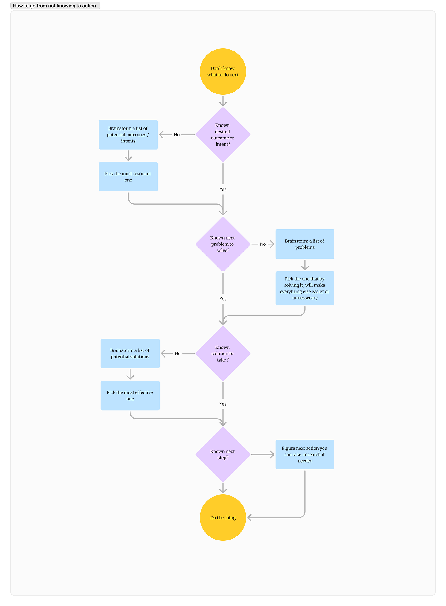
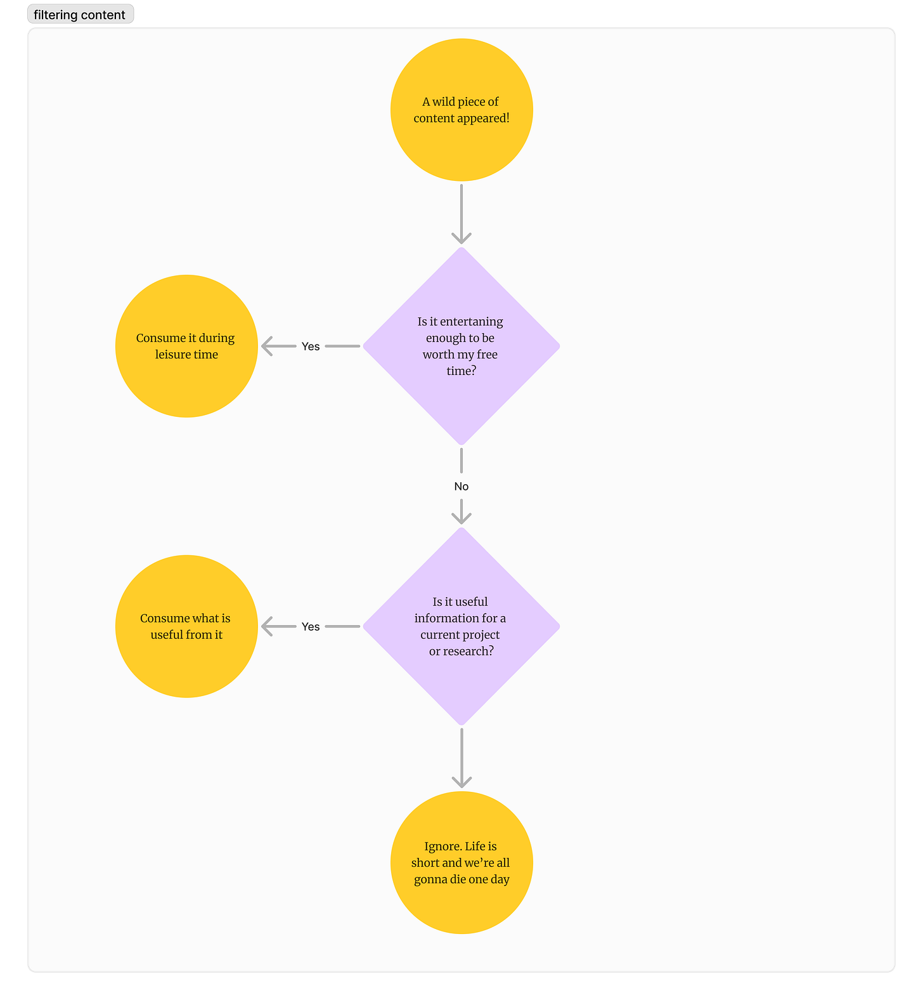

A failure mode I’ve recognized in myself: analysis paralysis. Overthinking, over-researching, underperforming.

There’s that Lincoln quote:

> Give me six hours to chop down a tree and I will spend the first four sharpening the axe.

I would spend all six hours sharpening the axe. I would watch axe swinging technique videos on YouTube. Then I would shop different axe models on Amazon. Then I would second guess myself and wonder if chopping down a tree is what I should be focusing on right now.[^1]

I don’t think I’m alone here. Does anyone else take a moment to look back at their 2024 resolutions and goals and notice that they barely got out of the gate for some? You wanted to track calories, but the last time you opened MyFitnessPal was January 21st.[^2]

# Planning as recreation

Past a certain point, planning ceases to be useful and can unwittingly become a form of play. Planning is no longer about mapping a course of action, it’s about the fun of drawing the map

There’s a dopamine hit with “a ha” moments. You get them when you write plans, learn new ideas, and fantasize about reaching your goals.

[Embedded media](https://www.tiktok.com/player/v1/7099413639412731142)

My goal is to minimize map drawing and maximize exporting. Less ruminating, theorizing, and noodling. When thinking, I try to keep it as action-oriented as possible. Here’s my framework for my internal dialogue[^3]:

Sometimes, the “next thing” is doing research, and that’s fine. Research is **collecting information with intent.** You ask questions, you get information to answer that question well enough, you move on.

With this mindset, when you see a piece of content, you can quickly filter it:

This rubric helps you avoid the infotainment trap.

# How infotainment traps us

Learning is fun. Our brain gets a dopamine hit when we learn something new, even if never put that information to use. Infotainment is a whole genre of content based around people who enjoy this kind of engagement.

TED talks, Malcolm Gladwell books, Planet Money. All examples of infotainment.

I’m not hating on this content. Hell, I’ve produced plenty of it myself. What I’m hating on is the false sense of productivity this content can create.

Enjoying infotainment is fine so long as you recognize it as leisure \*\*not work. It took me a while to make peace with the fact that I would read about copywriting for fun. But that’s just the kind of nerd I am.

But I have to be mindful of my information diet, because I’ve fallen into this trap before.

# My time in the trap

When I was a freelancer[^4], I listened to indie biz podcasts on runs, doing the dishes, and driving in my car. I *felt* like I was doing something. I was fooling myself. I was simply looking for those “a ha” dopamine jolts. In truth, outside of the cardio, the clean dishes, and getting where I needed to be, I accomplished nothing.

I spent too much time theorizing about my ‘business’ and not enough on billable hours.

I went to conferences and even spoke at one of them. I made some great friends, had fun, and left feeling energized. But very little changed in my day-to-day work.

Eventually, my freelancing businesses folded after a client offered me a full-time position with a salary that was higher than any revenue year I had had previously.

I learned how to write persuasive proposal & how to stand firm on my fees with stingy clients. But now I realize I substituted too much of my judgement with that from various “experts.”

Not this time.

# Perfection’s never possible, progress always is

  
For 2025, I’m paying close attention to how I spend my time. When I know a directionally correct next step, it’s time to close the notebook, shut the Kindle, and get to work.

But unlike Leeroy Jenkins, I’m sticking to the plan and coordinating with others. And unlike his pals, I won’t stand around number-crunching my chances of survival anymore.

[Watch on YouTube](https://www.youtube.com/watch?v=mLyOj_QD4a4)

[^1]: Adam Mastroianni of Experimental History calls this “[Stroking the problem](https://www.experimental-history.com/i/140270094/stroking-the-problem)”

[^2]: Same.

[^3]: Essentially, faster [OODA loops](https://thedecisionlab.com/reference-guide/computer-science/the-ooda-loop)

[^4]: 2012 - 2015, after working at agency for a couple of years and thinking “hey I could this myself.”
