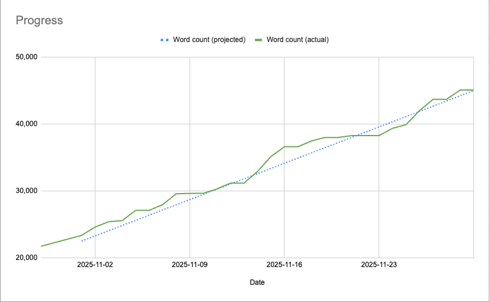
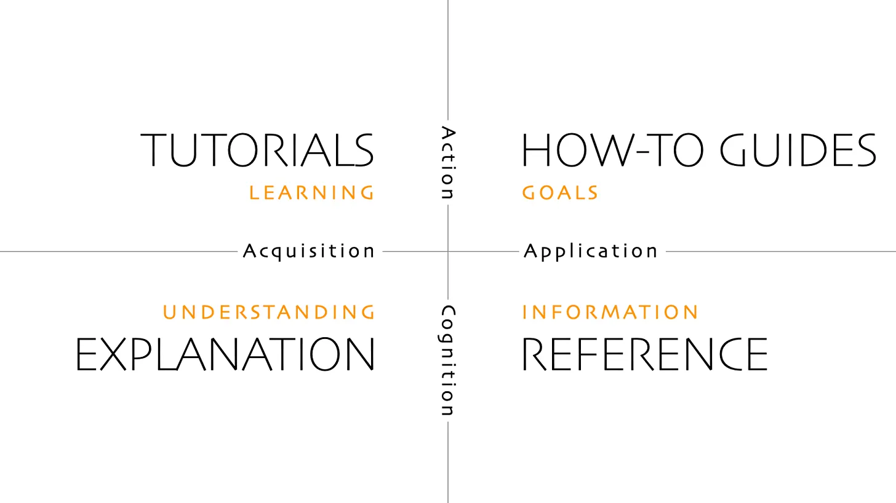

")

> Beyond the mountains, more mountains — Haitian Proverb

Victorious over my November writing challenge, I’m feeling a mix of exhaustion and pride in what I’ve accomplished, mixed with excitement and terror for what comes next.

I challenged myself to grow my Product Thinking book [up to a 150-page draft by the end of November](/blog/im-committing-to-a-nanowrimo-style/). From June 2024 to October 2025, I wrote 21,000 words (~70 pages). In November, I wrote another 24,000 (~80 pages)[^1] words to reach the goal.

Here’s what I learned:

## Number go up is stupidly, infuriatingly effective

It’s been a while since I challenged myself like this, and even longer since I succeeded at one. Apparently, the secret was to set up a spreadsheet, share it with a few friends, and track my progress.

I suspect it was the accountability in particular. I don’t know if they looked, but I knew that they *could.*

I kind of hate how effective this was on me. I am well aware of how companies use gamification to manipulate you: I am on day 87 of my Duolingo streak and I don’t even quiero aprendar Español anymore. I didn’t think it would work if I did it to myself.

### But it comes with a cost

The metric was a tradeoff: I hit the goal. I have a lot of wet clay to work with. But I also spent a lot of time in ‘shitty first draft’ mode. I hesitated to edit because editing means fewer words, especially towards the end when it was down to the wire.

But in exchange, I have content to work with, I’ve built new writing skills, and I have more confidence that I can take on large self-directed projects. Worth it.

## Being Consistent-ish

I needed to hit 778 words per day on average to reach my goal. But if I knocked out 2,000 in a day, I could take a day off and still be on track. I liked that the structure was consistent-ish. I wasn’t beholden to perfect daily consistency, awkwardly explaining to my in-laws why I’m furtively typing during Thanksgiving dinner.

There’s an apocryphal quote from Jerry Seinfeld about forming an unbreakable chain:

> Seinfeld’s advice was “to get a big wall calendar that has a whole year on one page and hang it on a prominent wall,” then get “a big red magic marker.” According to the 2007 legend, it was Seinfeld himself who repeatedly emphasized the phrase “don’t break the chain.”

Later, in an interview with Oliver Burkeman, Seinfeld revealed he never meant this to be taken so literally:

> ‘It’s so dumb it doesn’t even seem to be worth talking about!’ Seinfeld told me. ‘If you’re a runner and you want to be a better runner, you say, well, I’ll run every day, and I’ll mark an X on the calendar every day I run! I can’t believe this was useful information to anybody. Really? There are people who think “I’ll just sit around and do absolutely nothing, and somehow the work will get done”?’[^2]

Perfect streaks can be counterproductive. Chain systems can become a restraint instead of a motivator. If my Duolingo streak ever gets reset to 1, I promise you there will not be another 2.

We all have off days. Why punish yourself for being human?

## Strengthening my words-per-session muscle

Before he founded Kit, Nathan Barry kept a writing streak of 1,000 words per day. He cited the “Seinfeld Strategy” as inspiration. He did this for 80 days and published *The App Design Handbook.* When I first heard about this, it sounded impossible. 1,000 words? That’s so many! How do you have that much to say, and so consistently?

Now, I’ve put in reps. 1,000 words feels easier now. That doesn’t mean I plan to bloviate and pump up my word count. What I do have now is ways to go deeper and make the material actionable: finding case studies to illustrate and adding exercises to put into practice. It’s not about using more words; it’s about having more of value to say using as few words as possible[^3].

I have no interest in writing a book on product theory. Knowledge is useless without strategies to put it into action. So, I lifted techniques from [Diataxis](https://diataxis.fr/), a framework for writing actionable documentation. It gave me more ways to think and talk about topics.

For example, [The Big List of Product Heuristics](/blog/the-big-list-of-product-thinking/) is reference, [Trust Over Titles: The Engineer’s Guide to Workplace Influence](/blog/trust-over-titles-the-engineers-guide/) is a how-to guide, [How to Improve Your Product Intuition](/blog/how-to-improve-your-product-intuition/) is explanation.

## What comes next

I’ve spent enough time in monk mode, typing away mostly to myself. My next steps are to socialize the work, collect feedback, and keep iterating. I’m doing this in two ways:

1.  **Another challenge** - I’m setting a goal to publish 10 posts on Substack in December. A TenPoWriMo, if you will. Some, but not all, will be content from November edited into blog-shaped objects fit for human consumption. I’m excited to share thoughts on product taste and designing for agency soon.
    
2.  **Another beta book** - I’m putting together a 20-30 page beta book from samples, and sending it out to readers for another round of feedback.
    

It’s been so long. It feels like I’ve done so much, and I’m just getting started. Beyond the mountains, more mountains.

***[Sign up to be notified](https://engineering-product.kit.com/0d5f0028f8)** when my book on product thinking for engineers is available for purchase.*

[^1]: “How long is a page?” varies, but 250-300 words is a good-enough estimate. I used 300\*15 to land on the 45,000-word target.

[^2]: Burkeman, Oliver. Meditations for Mortals: Four Weeks to Embrace Your Limitations and Make Time for What Counts (p. 66).

[^3]: Language should be simple, too, though I cannot resist the temptation to occasionally toss in a college word like ‘bloviate.’
