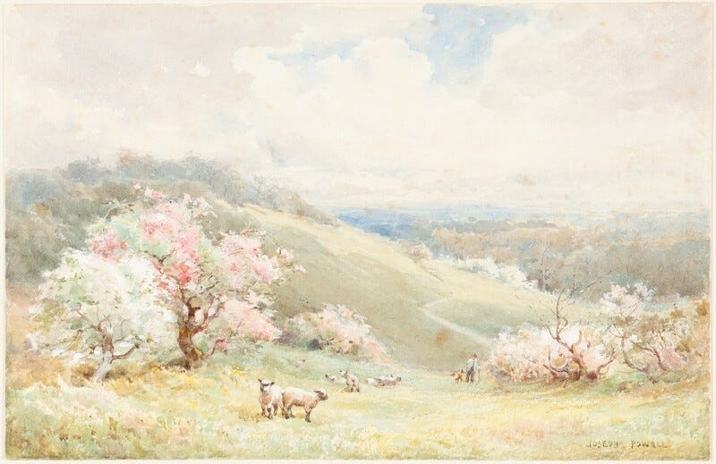

New Year’s is a terrible time to stick to a resolution (or follow a [new strategy](/blog/this-new-years-try-a-strategy-instead/).) Spring is not a great time to be cleaning. The air is warmer, the days are longer. I don’t want to be cooped up in an attic, going through the remnants of old hobbies. I want to be sitting on patios drinking margaritas with the people that I love. It’s much more effective to spend the time between years cleaning and leverage spring energy to propel change in your life.

After Christmas, there is a natural rhythm for cleaning up and reorganizing your physical space. Rolling up Christmas lights, stuffing them back in the closet. figuring out where to put new gifts you received, and what to get rid of to make space for them. It’s the last week of the year, the closest we get to the capitalism meat grinder taking a beat.

This period is perfect for clearing the deck and closing loops. Wrap up those projects. Get ready for tax season. Getting the house in order physically, mentally, and spiritually. In Japan, they call it Oosouji, “big cleaning.”

Then, January rolls in. It’s dark. It’s cold. The elements test you with the shittiest weather, rain 3-5 degrees above freezing. All of the chill of snow without any of the fun. I would choose a tornado over a 36℉ storm. I force myself up at 5 am to make it to the gym. It is beyond crowded. I do what I can. I’d work out outside, but you know, the rain.

I stay home. I open the work laptop. A 12 encircled red greets me. An inbox full of people who had the audacity to circle back in the new year.

I press on. February rolls around. Statistically, the worst month for seasonal depression. Whatever seasonal joy I had in the reserves is gone. If I was doing good on eating habits, too bad, combo breaker: Girl Scout cookies are back. I am not trying to be my best self right now. I am trying to *survive.*

And I always do. The sun rises, soup season comes to a close. People crawl out of their blankets. I was walking to my car from the doctor’s office, and a woman at the crosswalk, apropos of nothing, looked at me and says ‘wow it’s so beautiful out today!’ There is an *energy* in the air.

When the sun rises, so does serotonin. A [2017 study in](https://www.cell.com/current-biology/fulltext/S0960-9822(16)31522-6) *[Current Biology](https://www.cell.com/current-biology/fulltext/S0960-9822(16)31522-6)* [by Stothard et al.](https://www.cell.com/current-biology/fulltext/S0960-9822(16)31522-6) showed that humans’ circadian rhythms shift earlier in spring. People wake up more energized, more biased towards action, with more daylight to act on it.

Trying to be resolute in January is working against nature. Doing so in spring is working in harmony with it.

And as a bonus, the gym will be less crowded.
