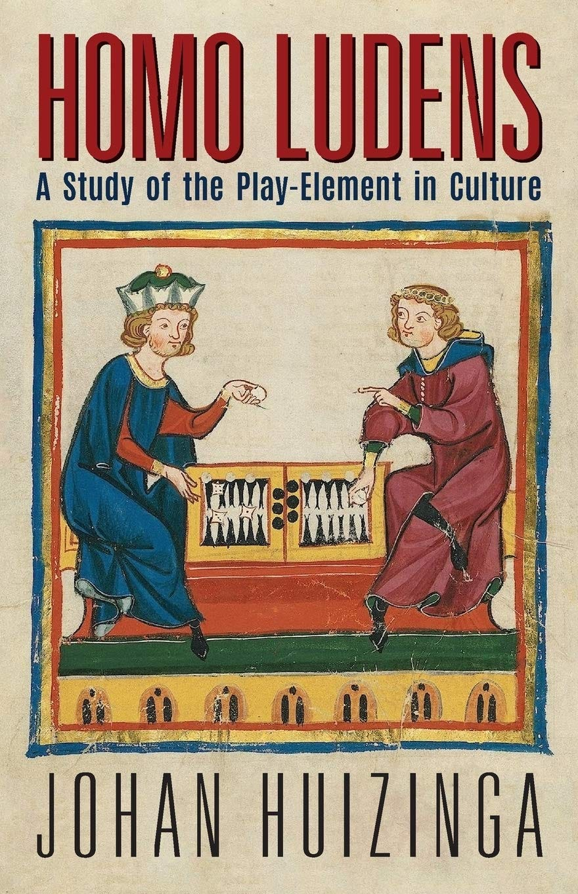
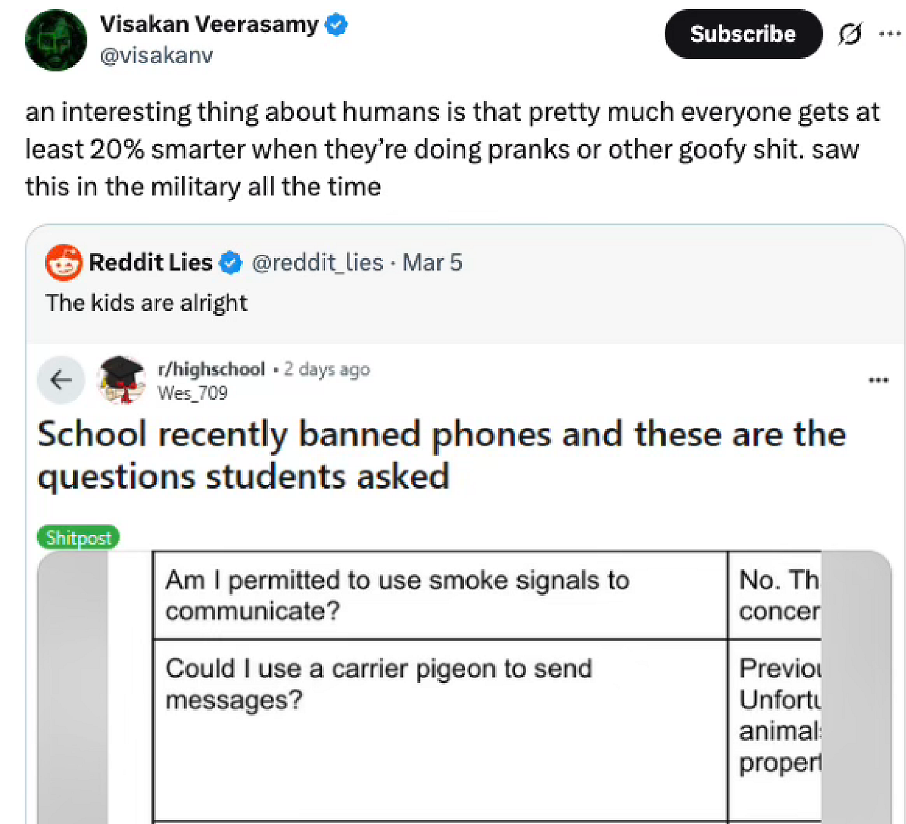
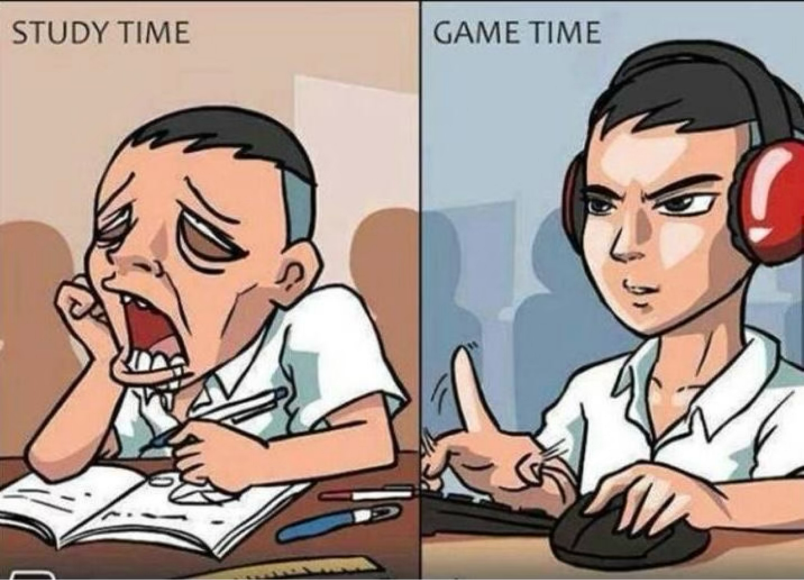
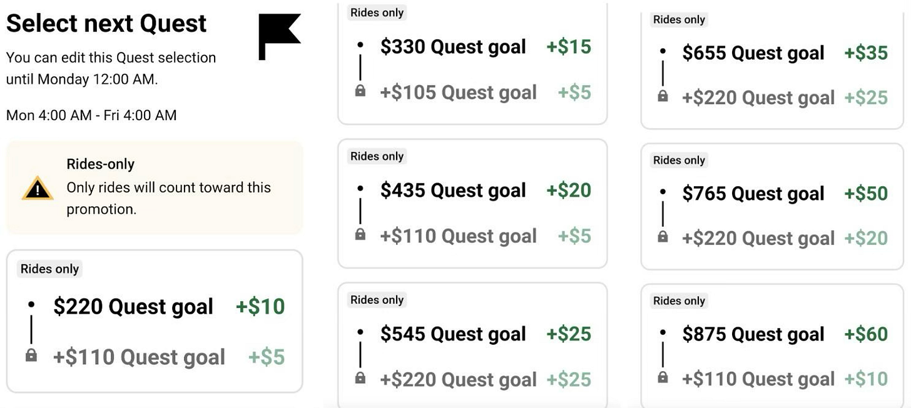
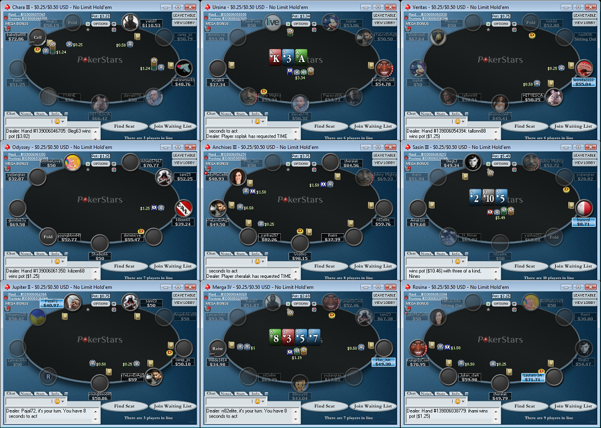

Being playful at work is good for both you and your employer. But more than that, approaching life with a playful spirit is essential to living a rich, creative life.

And don’t just take my word for it. *Ludology,* the science of play, was pioneered by Dutch historian Johan Huizinga in his 1938 book *[Homo Ludens: A Study of the Play-Element in Culture](https://en.wikipedia.org/wiki/Homo_Ludens).* In it, Huizinga examined what play is and why it matters.

He saw play as so essential that he described humans as fundamentally creatures of play—hence the title. Video game designer Hideo Kojima loved this idea so much he created a mascot called “the Luden” for his studio.

## So what *is* play?

Huizinga defined play as free, unstructured activity that exists apart from ordinary life and creates its own order. He also introduced the idea of “the magic circle”—a specific space and time where the game exists which dissolves when the game ends.

For example, when I play pretend with my son, Magna-Tiles become houses, cars, and sushi restaurants. When we stop, they go back to being colorful connectable polygons in a bin.

## The forms of play

Huizinga observed that play manifests in many forms:

1.  **Joking & jesting** - Humor bends expectations and opens up shared space.
    
2.  **Child’s play:** What Maria Montessori called “the work of the child.” Also observed in animals.
    
3.  **Competition**: such as sporting events and board games.
    
4.  **Pretend play**: Improv, acting, & mimicry.
    
5.  **Rhythmic play:** dance, music, poetry.
    
6.  **Imaginiation:** Mythmaking & storytelling.
    

## The benefits of play

Huizinga viewed play as foundational to the human experience. It gives us so much:

### Play builds community

Play isn’t a part of a culture — it creates it. Take professional sports for example: teams compete for a win, but also for the right to be celebrated. Fans join in too, sharing in joy or heartbreak with friends and strangers alike. (Fun fact: “praise” and “prize” share the [same latin root](https://www.etymonline.com/word/praise).)

### Play increases flexible thinking and problem solving.

As Visakan Veerasamy points out, people often come up with their cleverest ideas when they’re joking around.

### Play teaches emotional regulation and perseverance.

Setbacks don’t sting as much when you have a lighthearted approach. And when you’re enjoying what you’re doing, you’re more likely to stick to it.

### Play increases engagement

When you approach things as play, it’s easier to stay engaged, bringing more attention and energy to your craft.

## Weaponized Play

Play is powerful, so obviosuly people will twist it for profit—and the results aren’t always good.

One common example is making work more “gamelike.” But play and games aren’t the same thing. Games are just one form of play—they have rules, goals, and structure. Sometimes game-like ideas are useful, like when we “level up” our skills or follow a “skill tree” to build knowledge. But they can also be harmful.

### Gamification considered harmful

Gamification is adding game mechanics to systems with the element of play stripped away. Think leaderboards, quests, achievements, unlocks, and XP to drive behavior. It is psychologically manipulative. Uber rolled out a “quest” feature for drivers, offering bonus cash for hitting milestones. But as drivers got close to their goal, Uber would feed them lower-paying rides, keeping them behind the wheel longer. They are out driving, eyes burning, concentration fraying. Uber is helping driver’s have fun it’s putting them and others at risk to increase profits.

Gamification can have positive effects too. I used to go to a CrossFit gym, fully aware that CrossFit is just gamified workouts. But it worked: it kept me coming back and got me in better shape.

When you see gamified systems, you should stop and ask: What behaviors is the system pushing? Who benefits most from them?  

### Why gambling breaks some people

Gambling is another example of play gone awry. It’s subject to the **overjustification effect**—when external rewards crowd out internal enjoyment.

Gambling can be fun, but when done compulsively it can be destructive. Playing for stakes removes the intrinstic joy of the game, makign it worklike. In college I paid rent “playing” online poker for two years. It was miserable. It turned an activity I used to enjoy with my friends around a table into four-suited Excel hell.

### Mandatory fun

At my first job, I received an email (remember those?) inviting me to the company picnic on Columbus day. It informed us that attendence was “mandatory and fun”.

Play cannot be a top-down directive. You cannot force your reports to play and have fun. Play, by definition, is free. As soon as it is put on your calendar with an objective of team building or building trust, it’s no longer play. It’s a a meeting with an above-average level of cringe.

## So, How to we achieve this?

We must do what Johan called “**Embodying the spirit of play**”. It has to come from within. It’s about choosing to bring an attitude of play and lightness to everything to do.

**Because Play in the human engine of creation**. \*\*From it, we create culture, poetry, jokes, stories our communites . Being playful brings our own best, most creative, most. engaged, more powerful selves to the world. That’s why joking about the outcomes you want, bringing the character of play, enables you to be authentic, open to new possibilities, “yes and” reality, and meme your dreams into existence.
