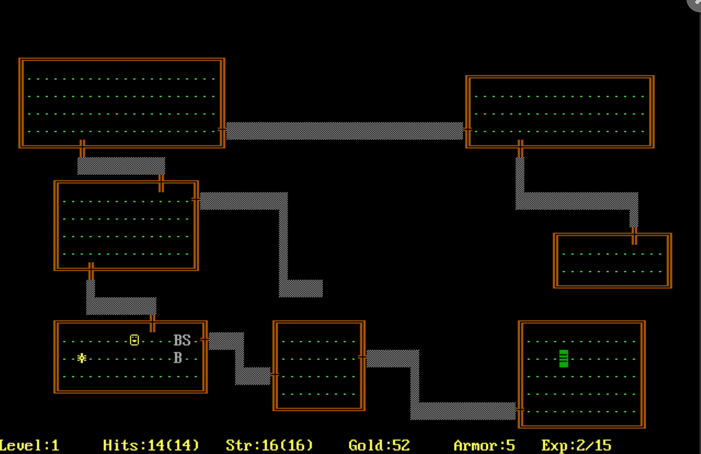
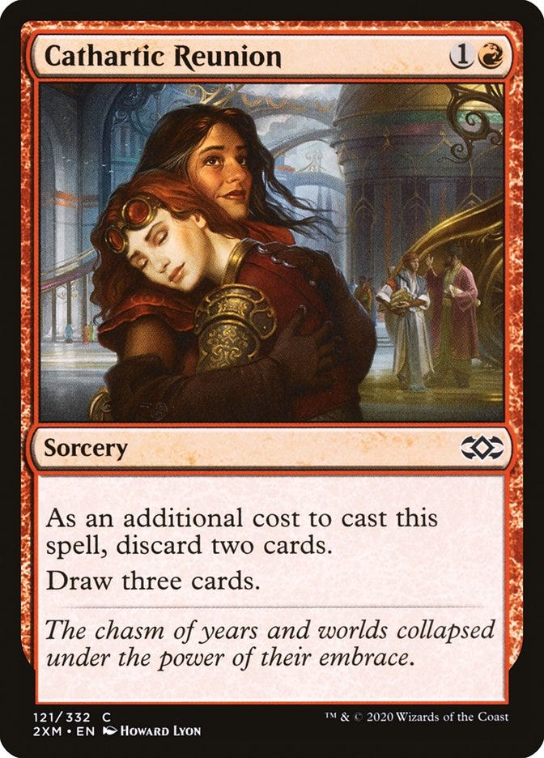
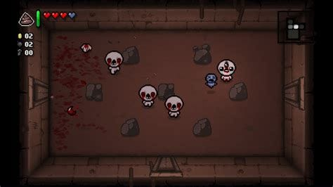
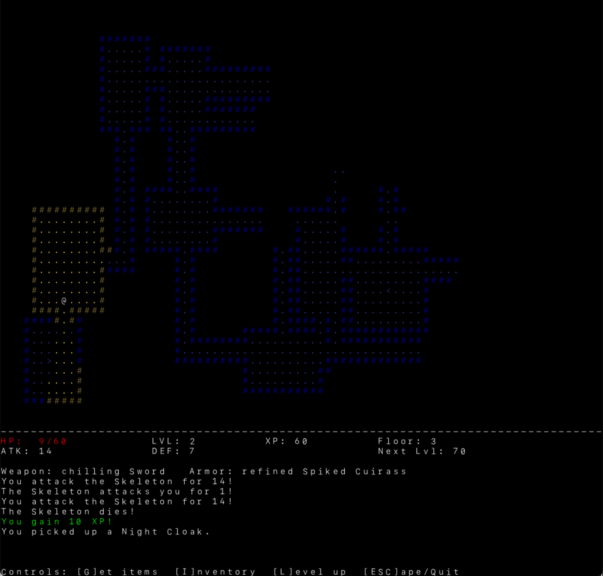
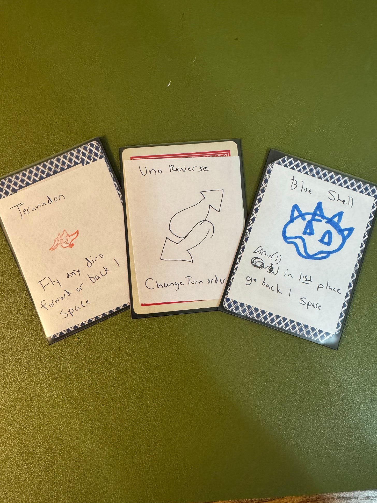

My favorite games use modular pieces and invite emergent strategies. I call these **menagerie games**. In this piece, I'll tell you about three games I love and how they inspired two games I designed. One helped me skill up on AI coding; the second helped me connect with my son.

## Core elements of a menagerie game

1.  **A varied pool of interlocking game pieces**. Cards, weapons, items, anything. You draw from a random subset each game.
    
2.  **Interlocking mechanics** that influence one another and generate emergent interactions and strategies
    
3.  **Combos and nonbos**. Some pieces are synergistic, others antagonistic.
    
4.  **Infinite extensibility.** There's always room to add new pieces and mechanics.
    

Being dealt a pile of random pieces and figuring out how to put them together is the core hook. The mix of puzzle-solving and discovery keeps me coming back. The randomness adds to the addiction; each run is a fresh puzzle to solve. A new space to explore.

## Menagerie archetypes: roguelikes and deck-builders

Two genres of games fit into this: roguelikes and deck-builders.

**Roguelikes** are games inspired by the 1980s video game [Rogue](https://www.myabandonware.com/game/rogue-4n/play-4n). In Rogue, you navigate a labyrinth of randomly generated dungeons, with random item and monster placement. While other fantasy games are 30-60 hour epics, Roguelikes are built around 30-60 minute runs. One life, you either finish the dungeon or start over with a new one.

**Deck-builders** are what they say on the tin. You have a deck of cards you can modify, either before or during the game. You are drawing from a random pile, but you get to have agency in the design of the pile.

Roguelikes give you a lot of different game pieces to randomize: dungeons, monsters, player stats, equipment, and consumables. Deck-builders have cards, an endlessly extendable game piece.

The three menagerie games I've had an obsession with, in chronological order, are *Magic: The Gathering* (the OG deck-builder), *The Binding of Isaac* (An absurdly funny and grotesquely horrifying roguelike), and finally *Balatro* (a deck-builder *and* a roguelike, drool).

## To Magic: The Gathering, and Beyond

As of this writing, there are [30,367](https://scryfall.com/search?q=game%3Apaper&order=name&as=grid&unique=cards) unique Magic: The Gathering cards. Magic has been releasing new cards for 32 years. It doesn't get more extensible than that.

Magic cards have always represented a variety of concepts: spells, places, things, magical devices, weapons, battles, vehicles, and even reuniting with a long-lost old friend.

Magic wove extensibility into the lore. Magic takes place in a 'multiverse' with an infinite number of alternate universes called planes. This way each set can explore a new theme. Over the past 30 years they have had planes inspired by, but not limited to:

-   Greek mythology
    
-   Japanese mythology
    
-   Indian mythology
    
-   Fairy Tales
    
-   Tolkien-inspired worlds
    
-   Hell
    
-   A world with a 600-year-long day/night cycle
    
-   A 15th-century ecumenopolis
    
-   A plane Gothic + Lovecraftian horror
    
-   A plane of campy 80s campy horror
    
-   A return to that Japanese mythology world but it's 2000 years later and now it's all cyberpunk
    
-   Pirate dinosaur world[^1]
    
-   Cowboy world. Yee-haw!
    

Executives at Hasbro recently had a very profitable realization: Magic's system could support not just any world, but also any IP. They could play the same game as Lego and Fortnite. Why make a Tolkien-inspired set when you can just print the *Lord of the Rings* set? Magic released a *Final Fantasy* set, and it's their biggest seller **ever.** making more money than many other video games and movie releases this year. $200 million. If it were a movie, it would be tied for no.8 at the box office beside *Captain America: Brave New World*

They are seriously trying to become the everything trading card game. The Amazon of sci-fi fantasy. 30 years and 30,000 cards later, their rate of producing new cards is actually *increasing.*

## The Binding (and duality) of Issac

Edmund McMillen gained notoriety with his breakout hit *Super Meat Boy*: a platformer that dared to ask the question: "What if Super Mario Bros. was batshit insane?" His follow-up, *The Binding of Issac*, a top-down roguelike that dared to ask the question: "What if The Legend of Zelda[^2] was batshit insane?"

The loop is simple: Like Legend of Zelda, there are dungeons, each with an item and a boss. But instead of an overworld, you move from dungeon to dungeon.

The lore is a little more complicated. It's an allegory to Genesis 22. The one where God asks Abraham to sacrifice his son Issac, then at the last minute says 'jk' and merks a ram instead. In the game, Issac's mother believes a televangelist ordered her to kill her son. Isaac flees to the basement, which happens to be a cascade of procedurally generated dungeons.

Power-ups are all over the place. McMillien includes references to anything and everything, including:

-   in-game lore
    
-   His previous games (Super Meat Boy, Time Fcuk[^3])
    
-   His favorite games (Magic: The Gathering)
    
-   The Bible
    
-   His dead cat (RIP Guppy)
    

It's whiplash. The game swings from funny to tear-jerking. Horrifying yet goofy. While playing, you reflect on how Christian upbringings can fill children with a deep sense of guilt and shame, then collect a power-up that's a fart.

## Balatro, the genius of Joker Poker

In Balatro, you play sets of poker hands and must hit a minimum score to advance to the next round. Every round, the minimum increases. Between rounds, you earn money and visit a shop where you can spend money to acquire jokers (permanent modifiers), one-shot items, new cards for your deck, or planet cards that increase the point value of specific hands.

[Watch on YouTube](https://www.youtube.com/watch?v=VUyP21iQ_-g)

Just like in poker, hand strength matters, but it's a small factor. Balatro's randomly generated dungeons are not the rounds; it's the shop. The shop gives you a limited number of options and 5 joker slots, which is your primary way of building your strategy and increasing your score.

Then there's also the deck-building. You start with a standard 52-card deck, then add, remove, and modify cards in it. If you have a joker that rewards hearts and another that rewards flushes, you can bias your deck towards hearts. If you have a joker that punishes face cards, you cut as many of them as you can. One of the most optimal decks is often 40 enhancement-packed kings of a single suit.

## Building my menagerie game

In my [last post](/blog/just-push-buttons/), I mentionwed how [another Substack post](https://liminalwarmth.substack.com/p/the-7-day-roguelike-that-took-six) inspired me to build my own roguelike. Menagerie games are ideal learning projects. There are always new mechanics and pieces you can invent.

Add weapons. Then add elemental damage. Then status effects. Then triggers tied to player actions. Each layer asks new questions of me and of the game.

This creates an addictive, multi-tiered iteration loop:

1.  I iterate on the **game**, adding new items, tweaking and balancing.
    
2.  Then, I iterate on the **engine**. Adding new mechanics, refactoring code as the system grows.
    
3.  Finally, I iterate on my **build process**. How can I leverage Claude Code to build more interesting gameplay faster?
    

I don't know when I'll stop iterating on this game. There's plenty else I want to build, but it's nice to have an evergreen playground that can be anything and everything. Just like Magic keeps adding expansions, there is always another weapon, monster, or mechanic to toss into the pot.

[Devil's Den on Github](https://github.com/GSto/seven-day-roguelike-challenge-claude-code)

## Playing game design with my son

I've co-designed a board game with my son, titled *Dinosaur Breakover*[^4]. At the start, you pick which of four dinos you think will win a drag race. Then, players take turns drawing cards from a deck until one dino crosses the finish line. Former college drunks like myself might recognize this as a family-friendly riff on the drinking+gambling game Horserace.

What it lacks in complexity, it makes up for in how much watching my son draw his new card idea warms my heart. The deck contains various references that I put in and his ideas.

As he grows, maybe we can extend the lore and the mechanics. Make our own expansion packs.

One time, we sat down to play, and he asked:

> "What if it had dinosaurs AND dragons?"

Great question, big guy. What if it did?

[^1]: Yes, one line, this is not a typo. There are also mermaids and vampires.

[^2]: *The Binding of Isaac* and *The Legend of Zelda* having the same meter is no coincidence.

[^3]: Also not a typo.

[^4]: His name. I have no idea what a ‘breakover’ but he loved it.
