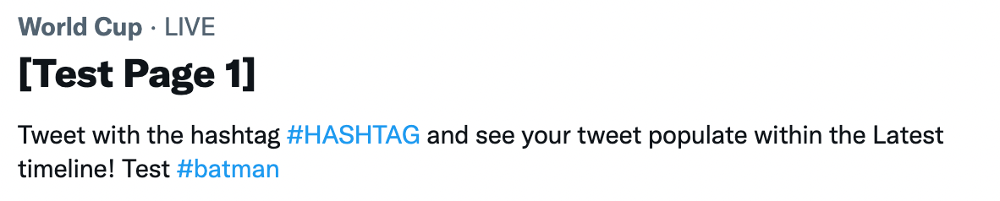

Some questions about the Musk takeover of Twitter:

1.  is it as bad as some people say it is,
    
2.  could Elon pull it off and successfully launch a “Twitter 2.0” or “X, the everything app?”
    
3.  Should you care?
    

The answers, in short:

1.  No.
    
2.  No
    
3.  It depends.
    

Twitter would have died with or without Musk, but he’s accelerated the process.

## How exactly is Elon “killing Twitter?”

Internet hyperbole aside, here’s what’s been going on at the bird site:

-   **Igniting advertiser goodwill.** Elon showing an unstable public roadmap, as well as accusing advertisers of leaving as a political act, is burning goodwill. This means a loss of revenue for the company.
    
-   **Burning poster goodwill.** Some people won’t want to be part of the richest man in the world’s political play. He told people to vote republican. He ran a poll asking if he should reinstate trump, so he can ask like his hands are clean after doing so.
    
-   **Losing 83.5% of the engineering staff.** Can Twitter handle the world cup on a skeleton crew? that remains to be seen.
    

[Post by Mosquito Capital (@MosquitoCapital)](https://twitter.com/MosquitoCapital/status/1593541177965678592)

Twitter may not “die,” but do websites of a certain scale ever truly die? technically, Myspace and Digg are still around, withered husks of their former selves.

While the Musk midlife crisis has made for great popcorn internet, there’s been a slow death of social media over the last four years.

What did social media get us, why did it stop, and where do we go from here?

## The jobs to be done of social media

What is it we want from social media? What do we hope doom scrolling will do for us?

1.  Discovery, 
    
2.  Discourse, 
    
3.  Dopamine, and
    
4.  Distribution.
    

We can find new ideas and share our own. We enjoy it and talk with our friends about a bit. Discourse is the only difference between media and “social media,” and it’s slowly being phased out.

## The death of the feed and the rise of the reel

Twitter and Facebook have decided that your news feed is no longer for discourse. both default to more content from creators and less from your friends.

Twitter may be dying, but Facebook is already dead. 

The only reason I keep Facebook is that it's the last tendrils of the meat space in my social media. I have a neighborhood group where I hear about yard sales, and we organize meetups and block parties. We complain about who Airbnbs what.

That's it. Everything else is a useless feed filled with ads for T-shirts that will make my dadbod look less fat.

No friends, only algorithms.

Mark Zuckerberg realizes that the old Facebook is going, which is why he has spent so much money trying to make Metaverse happen that his company is now worth less than Home Depot.

[Post by D🌑CFUTURE (@topherflorence)](https://twitter.com/topherflorence/status/1592677748383719424)

## A new challenger approaches

Tiktok changed the game when it comes to discovery.

They realized they could learn more about you by not looking at what you like but looking at what you reject. Tiktok stares into your soul. They win the dopamine game.

My friends talk about losing hours to TikTok as if that is a normal thing to do.

There’s nothing social about any of these applications anymore. They’ve gone all in on discovery and dopamine. Distribution is available but pay-to-play.

## The public square is gone, & we’re better off for it

on default public social media, people can only show heavily-edited, non-offensive versions of themselves. 

This context collapse creates a “[lowest-common-denominator philosophy of sharing \[that\] limits users to topics that are safe for all possible readers](https://journals.sagepub.com/doi/10.1177/1461444810365313).” 

Instead, we’ll find our connections in more fragmented and cozy spaces. 

## Why Substack?

I’ve asked myself, what is it I want from social media? Mostly, discourse.

What I like about Twitter is that it is still the best place to have interesting conversations with strangers. I like sharing and hearing new ideas.

Twitter is the real professional social network, not LinkedIn. Like how Instagram is the real dating site, not Tinder.

That's why I switched to Substack. With it's mix of longer-form content, chat, comments, and email replies, it seems to fit what I'm looking for in a social media platform.

No one tool will replace Twitter. Socializing online will be a mix of different mediums, platforms, and communities.

## Where do we go now?

-   **Private communities -** Communal Slacks and Discords.
    
-   **Group chats -** WeChat, GroupMe, Telegram, Signal.
    
-   **~~The Metaverse~~**
    
-   **Real-time online hangouts -** Zoom calls with friends, Discord voice channels. Watching each other on Twitch.
    
-   **New Twitters -** [Cohost](https://cohost.org/rc/welcome) and [Mastodon](https://joinmastodon.org/). The old new Twitter Tumblr. I’m bearish because the energy seems more anti-twitter than pro these platforms. Maybe there is alpha in being an early adopter if you want distribution?
    

Or fuck it, [let’s go back to forums](https://text.nickd.org/archive/ask-a-question-in-the-flame-free-zone/).
