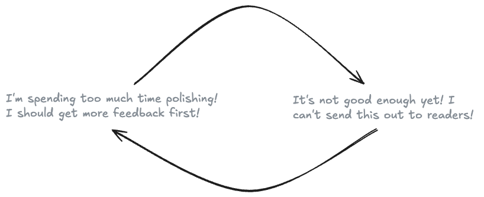

It’s been a while since I’ve posted about my product thinking for engineers book, *System is as System does.* Turns out writing an entire book is the most psychologically challenging thing I’ve ever done. I can say from experience that finishing a book is more difficult than quitting smoking.

I promised ‘behind-the-scenes’ of the process when I kicked this off, so here goes. The two big stumbling blocks I hit, and where I’m aiming to go next.

## The story so far

My goal was to create a ‘beta book ': a 20-30 page version of the book that I could send to a few beta readers for feedback. After a lot of writing, I ended up with 60 pages of content.

**Roadblock 1: Initial beta doom loop.** Working on something that large, for that long, and showing it to someone in a messy, unfinished state is *terrifying.* I spiral between “it’s not good enough” and “this isn’t fast enough.”

Eventually, I printed out the book, went over the whole thing with a red pen, and worked it into something I was comfortable showing people. The physical book set a good boundary. Editing in paper is more taxing than dragging and dropping digital blocks. Whatever came out of this phase, I decided that was the beta book.

## The feedback

I was able to find some wonderful people who were willing to take the time to provide honest feedback. (You know who you are, much love ❤️).

Beta reading was painful and indispensable. Design is a collaborative process, and writing a useful non-fiction book is a design problem.

Key points:

1.  **More case studies, more examples, more exercises**. I need to do a better job of painting a picture and putting the principles into action
    
2.  Some topics were underexplored, such as **taste** and **social responsibility**.
    
3.  I need to spend more time **explaining and clarifying complex ideas**, like the recognition-primed decision-making model
    

**sticking point 2: The pile of grist?** Grist is the raw material from wheat that is processed into flour and other useful commodities. I am sitting here with 60 pages, 133 notes, comments, and an ever-growing pile of articles, papers, books, and videos to sift through for research. I am buried in grist.

How in the world am I going to get from here to a polished 150-250 pages, which is my goal? I feel like I signed up for a marathon and just hit a wall on mile six. It has felt overwhelming thinking about how much further I have to go.

## The plan

Stop overthinking, start anywhere. [Same monster I’ve fought all. year](/blog/my-leeroy-jenkins-year/). I’ll start cleaning up small mistakes, adding new information as I discover it, and applying the feedback I’ve received so far.

### Focus

I am going to double down on the sections that are working and cut on the ones that aren’t. I’ll dive deeper into building product intuition and collaborating with others. I’ll cut back or reduce the focus on things like prioritization and estimation. That content might end up as content on this site.

### Interviews

I am going to reach out and interview product-focused engineers, product managers, and designers across a variety of companies. This will help me collect more case studies and cover blind spots.

### Read the canon

I heard (obviously false but truthy) that if you read the 4 books on the canon of a subject, you’re more knowledgeable about that subject than 98% of people. So, figure I need to start by digging into the most often recommended books on my subject:

-   [The Design of Everyday Things](https://www.goodreads.com/book/show/840.The_Design_of_Everyday_Things)
    
-   [The Mom Test: How to talk to customers & learn if your business is a good idea when everyone is lying to you](https://www.goodreads.com/book/show/52283963-the-mom-test?)
    
-   [Inspired: How to Create Tech Products Customers Love](https://www.goodreads.com/book/show/35249663-inspired)
    
-   [Sprint: How to Solve Big Problems and Test New Ideas in Just Five Days](https://www.goodreads.com/book/show/25814544-sprint?)
    
-   [The Lean Startup](https://www.goodreads.com/book/show/10127019-the-lean-startup)
    

### Collect

I love hoarding examples and frameworks like a little digital goblin[^1]. As I go, I want to build reference materials on product thinking models, usability heuristics. Like when Anthony Hobday made a list of [every interaction concept](https://anthonyhobday.com/sideprojects/interactionconcepts/).

## Want to help?

DM or email me if you’re interested in being a future beta reader. Or if you know any product-focused engineers who have a story to tell, I’d love an intro :)

Also, if you want to have a conversation about product thinking, taste, why engineers should care about this, or the obligations engineers have to their impact on society and the world writ large, reach out via DM or email, I’d love to have an interesting conversation!

The more interesting conversations I have, the better the book will be in the end. Hell, having an excuse to kick off interesting conversations is one of the reasons I started this project.

**[Sign up to be notified](https://engineering-product.kit.com/0d5f0028f8)** when my book on product thinking for engineers is available for purchase.

[^1]: Look, I already made one, a small but mighty reading list of the product thinking canon!
