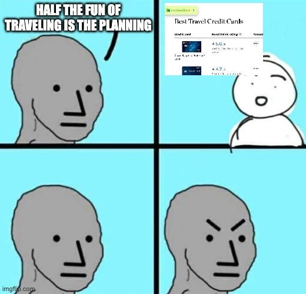
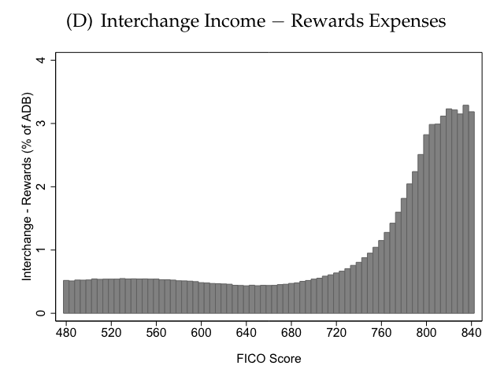
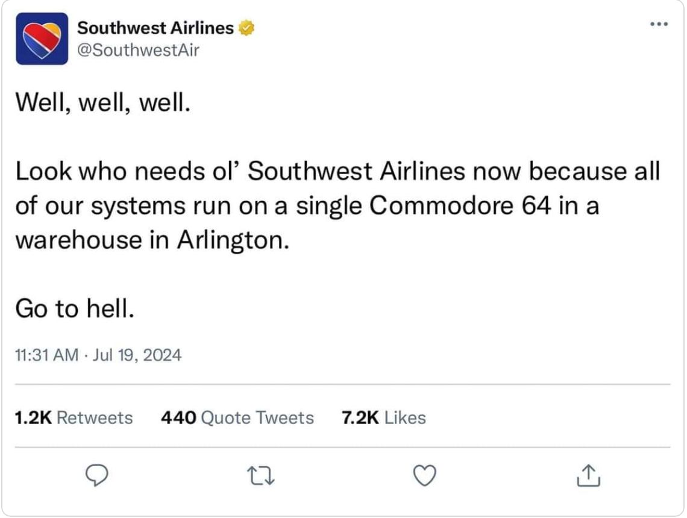
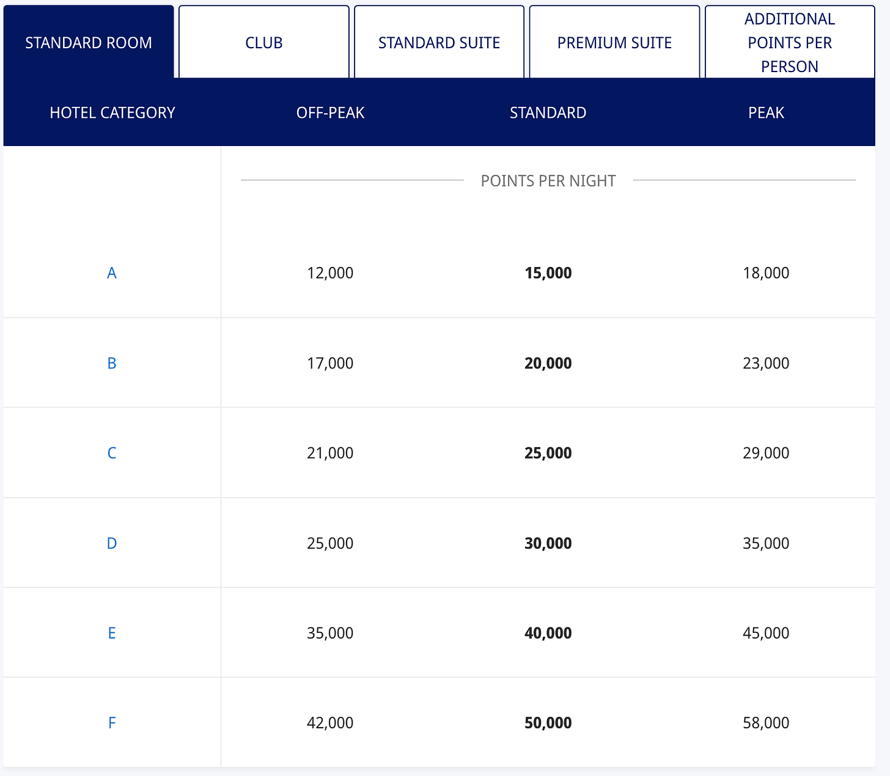
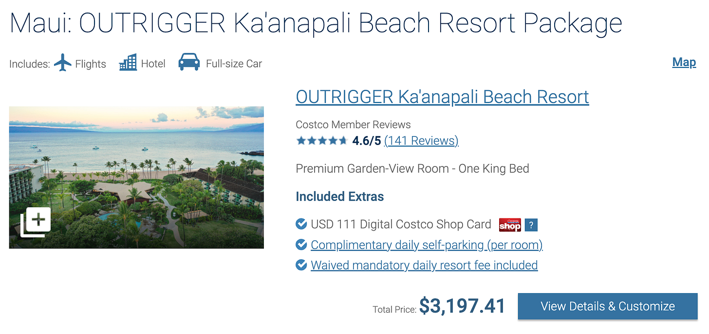

There’s no shortage of TikToks and travel blogs that talk booking first-class ticket to Bali for $17. These stories are often bullshit, and if they’re not, they require booking flights with lots of flexibility about where you go, when, and how long your layovers are. Booking these kinds of ‘rewards flights’ aren’t realistic for people who have spouses, kids, and jobs with limited PTO.

I’m a dad pushing 40. I use a credit card. I like to travel. I love playing games and exploiting systems and all these different points are alluring to me. There has to be *something* I can do, right?

Turns out there is. It’s not as exotic as what you might see online, but you generate a few thousand bucks in travel equity a year with a few high-leverage decisions and a dozen hours of work.

This is my anti-viral, made of words not videos, travel hacking guide for the rest of us.

In this article, I’ll share the primary credit card, hotel, and airline brand I use. I don’t claim this is the optimal approach; I’m sure that it isn’t. But it’s one that is simple and works for me.

*(Disclaimer: I tried to include specific numbers whenever possible, but these values change frequently. Values are accurate as of the last time I updated this article, which is August 2, 2024. Depending on when you read this your (airline) mileage may vary.)*

## Why is travel hacking possible?

Taken at face value, travel hacking seems too good to be true. Why would airlines just *give* flights away? Aren’t they losing money? What about credit cards offering $500 signup bonuses to customers who never carry a balance or pay interest?

Airlines and hotels are in a unique position where they have liabilities on their books (empty seats and rooms) they can position as assets for the consumer (free vacation woohoo!). They dole these out via points based on frequency of travel.

I used to think credit card companies made most of their money on interest and fees. Turns out they make more on the interchange(the percentage cut they take on every transaction, typically around 3%). High spenders are where they make their money, even if they don’t carry a balance.

They attract these high spenders by offering them a cut of the interchange, either in the form of cashback or points.

Credit cards also make money on partnership deals with other merchants. Put all of this together, and you get credit cards programs with travel portals where you can book travel, and transfer partners where you can exchange credit card points for points at airline and hotel points.

If you want to read more about how all this works, I strongly recommend Patrick MacKenzie’s piece [Anatomy of a credit cards rewards program](https://www.bitsaboutmoney.com/archive/anatomy-of-credit-card-rewards-programs/).

However, I would recommend not thinking too hard about the fact that these companies are still making money off of you, even when you’re travelling for “free.” Travel hacking is more fun from an iconoclastic mindset, and believing that you putting one over on major banks and airlines. I’m still sticking it to the man while I drink my piña colada on the beach, right? right?

In short, that’s the game here: pick a credit card, pick a preferred airline, pick a preferred hotel chain. Rack up the optimal amount of points on each, then exchange them to reduce the cost of trips you want to take.

## Preferred credit card vendor: Chase

Many credit cards offer a signup bonus in the form of “if you spend X dollars in the Y months, we will give you some points.” **These offers are your primary source of accuing value.**  
  
My current primary card is the [Chase Sapphire Reserve](https://www.referyourchasecard.com/19o/P3PIT93IH4)[^1] card, though I use multiple cards in the Chase ecosystem. It has an annual fee of $550/year + $75 per authorized user, and it's well worth the cost. Signup bonus: 60,000 points have a rought “value” of for $4,000 of purchases in the first three months. Chase points are worth 1 cent[^2], so you could think of it as a $600 signup bonus.

Every year, you get a $300 travel credit and a 1.5x multiplier on points exchanged for travel(so that $600 bonus could be worth $750), among other benefits, such as access to airport lounges via [Priority Pass](https://www.prioritypass.com/). I will leave the valuation of free time-unbounded airport beer and mid food as an exercise for the reader.  
  
Many people balk at the high annual fee, but if you’re using all the benefits, it pays for itself.

Other types of Chase cards will also earn ultimate rewards points and have a $0 annual fee.

1.  [Chase Freedom Unlimited](https://www.referyourchasecard.com/18j/Z95PQD5J9X) - $0 Fee and 0% APR for 15 months. Useful if you want a card with no fee to earn ultimate rewards points. Chase actually two kinds of points, and you want to avoid the much less value Amazon rewards points.
    
2.  [Chase Sapphire Preferred](https://www.referyourchasecard.com/19o/P3PIT93IH4https://www.referyourchasecard.com/19o/P3PIT93IH4)—$95 fee, 1.25x travel multiplier. Also offers 60,000 points for $4,000 spending in the first 3 months. This is a cheaper alternative to the preferred with fewer rewards, but you can use both bonuses if you like (within Chase’s limitations; see below).
    
3.  [Chase Ink (business unlimited or business cash)](https://creditcards.chase.com/business-credit-cards/inkhttps://creditcards.chase.com/business-credit-cards/ink) —$0 fee, 75,000 points if you spend $6,000 in the first 6 months. Unlike other cards, there is no rule against holding multiple Chase Ink cards, and they don’t count against your 5/24 limit. They are for "business," but you can use an SSN and get one as a "sole proprietor.” One new card every quarter seems to be the safe spot.[^3]
    

You can transfer points between cards and between household members, but you will need to call customer support to do the latter. You can get the 1.5x multiplier on all Ultimate rewards points, regardless of which card earned you the points. If you get 2 Chase cards, that's 150,000 points. With the Sapphire reserve multiplier and travel credit, that’s $2,550 in free travel bucks right there.

The biggest controllable factors for points accquisition is the number of signup bonuses you're willing to churn through and how frequently you’re willing to go update all of your payment settings.

### How many credit cards can you open?

It depends. You should be aware of the [5/24 rule](https://thepointsguy.com/credit-cards/ultimate-guide-chase-5-24-rule/)—if you open more than 5 personal credit cards from any issuer in 24 months, Chase will not let you open new cards. Opening 2 cards in a 30-day period could also get you flagged. Generally, one credit card every 4-5 months is safe.

These rules apply to individuals, not households. You and your spouse can double-dip and even send each other referral links.

### Tips for managing multiple credit cards

1.  Keep a spreadsheet of when you open every rewards card and when they expire. Set reminders to cancel credit cards with annual fees you don’t want to keep. I try to only have one annual fee active at a time.
    
2.  Make a spreadsheet of every recurring bill you have and every online merchant you frequent, with links to their payment pages. This will make it easier to switch cards.
    

### Games you can play with cash flow

1.  This should go without saying, but don’t spend extra “for the points.” That’s how you lose this game.
    
2.  If you have a large ($2,000+) purchase coming up, that’s a good time to open up a new card so you can get through the bonus quickly. You probably aren’t paying for 100% of your travel this way, so booking a trip can be a quick way to jump-start this process.
    
3.  Time spending with opening new cards. Hold off on optional purchases for a few weeks, then make them all at once when you open a new card.
    
4.  If you are approaching the end of a bonus’s time limit, buy gift cards for recurring spending you would make anyway, such as groceries and gas.
    

## Preferred Airline: Southwest

Two free checked bags, CrowdStrike immunity, what’s not to love?

Southwest is a travel rewards partner with Chase, so you can transfer points 1:1 from Chase to Southwest.

I will say airlines are the place I’m the least picky. I will happily fly Delta or American[^4] if it means one less layover or a more convenient departure times. Another part of travel hacking is deciding how you want to balance quality of the journey vs. price.

### Flight booking tips

1.  I use the [ITA Matrix search](https://matrix.itasoftware.com/search) to compare flights.
    
2.  Always have a frequent flyer number with every airline you fly with. Use it with business travel if your company allows.
    
3.  If you have a child, be sure to set up an email address and frequent flyer number for them as well.
    
4.  Always check the point cost of booking through Southwest direct and the Chase travel portal. You never know which one will be cheaper.
    
5.  Do not buy points from Southwest. They have one of the worst rates, charging you 2-3 cents per point, and redeeming them at 1.
    

## Preferred Hotel Chain: Hyatt

Hyatt has decent coverage, is a travel partner with Chase, and is the key to getting maximum value for your points.

Firstly, Hyatt values points at roughly 2 cents compared to Chase’s 1 cent, but you can transfer them 1:1.

Secondly, unlike airlines, which use an inscrutable calculus to determine point values for flights, Hyatt has a [fixed system](https://world.hyatt.com/content/gp/en/rewards/free-nights-upgrades.html).

Here’s an example: As of this writing, I found a room at the [Andaz Maui at Wailea Resort](https://www.hyatt.com/andaz/en-US/oggaw-andaz-maui-at-wailea-resort) for $871 dollars/night, *or* 40,000 points. That means if you followed the Chase steps outlined above, you could have 3 nights in a Hawaiian resort for free.

-   40,000 points exchanged for cashback = $400, 1 cent per point
    
-   40,000 points spent in travel portal = $600, 1.5 cents per point
    
-   40,000 points on Hyatt resort = $871, 2.1 cents per point
    

If that sounds interesting, Hyatt also has its [own rewards cards](https://world.hyatt.com/content/gp/en/rewards/hyatt-credit-card.html), which are good for another 60,000 Hyatt points[^5].

### Booking hotel tips

1.  I like [TripAdvisor](https://www.tripadvisor.com/) or the native Hyatt app for finding hotels, but I always book through Chase Travel (if spending points) or through Hyatt directly (if spending cash).
    
2.  Hyatt will sell you points for 2.4 cents each. It *might* make sense to buy them if you trying to book a higher-end resort.
    
3.  I like resorts, so I try to refrain from cashing in points on regular hotel stays and save them for nicer places.
    

#### What if I prefer staying in AirBnBs or short-term rentals?

Pay cash, sorry.

## Preferred tertiary travel booking: Costco

Costco travel is legit, y’all.

There are no points games to be played here, but you can find good rates on hotels, vacation properties, and sometimes flights, especially if you get a package deal. If you have an executive membership, you’ll earn 2% cashback on bookings. Many will include a gift card as well, so it still feels travel-hacky.

Take the package below; it costs $3,197, but once you factor in the gift card and the 2% back, it’s effectively $3,021[^6].

If you have an executive membership, I’d give it a look when exploring trip ideas.

## Other things I don’t do that are also probably pretty good

There are only two credit card companies that are competitive with travel rewards, the other one being American Express. I haven’t messed with them, but they did just build the [biggest Centurion lounge in Atlanta](https://www.americanexpress.com/en-us/newsroom/articles/amex-for-business/american-express-to-open-largest-centurion-lounge.html), so maybe I’ll try them in the future.

Hilton has a [similar fixed point system to Hyatt](https://help.hilton.com/s/article/How-many-Points-do-I-need-for-a-free-night#:~:text=Free%20nights%20can%20be%20redeemed,night%20for%20a%20standard%20room.), along with their own rewards cards.

Based on your nearby airlines and travel preferences, maybe those are interesting to you. But I haven’t tried them, so I can’t describe how well they work. However, the same general strategies outlined above should still apply.

## Summary

In short, you find credit cards you like, chrun some offers, get some points, move ‘em around, save a few thousand bucks. Pretend you put one over on multiple mega corporations even though they made their money on interchange and in-flight beverages. Have fun! If this was helpful, I’d love to hear about it. tell me about your trip!

[^1]: All Chase links are referral links (more hacks let’s gooo)

[^2]: I’m anchoring the value here on cash back. You can trade 10,000 points for a $100 statement credit. But ultimately points are worth what you exchange for.

[^3]: Untested by me, but that seems to be the consensus on Reddit.

[^4]: Fuck Spirit

[^5]: It's worth noting that hotel and airline points are less flexible than credit card points. You can transfer Chase points to Hyatt, but not the other way around.

[^6]: You could take this a step further and factor in 1% points earnings and say it’s really $2,989, but I digress.
