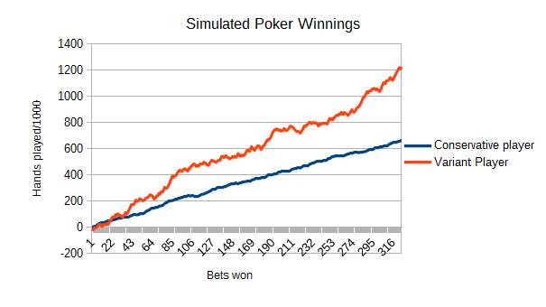

Our brain always tries to predict what comes next and goes on alert when it can’t. When our brain doesn’t know what’s coming, it shifts to fight or flight mode. 

Uncertainty is unsettling. 

This instinct was useful when we had to hide from sabertooth tigers. But today’s environment is more secure and less scrutable. This reflex isn’t as beneficial as it used to be.

Several closely related concepts are swirling around this disorder: risk, variance, uncertainty, randomness, and illegibility. I aim to break this down and examine the subtle differences between these concepts to make them easier to understand. 

Understanding uncertainty is the first step to getting comfortable with it. Being intentional and overcoming instinct, which leads to better problem-solving and decision-making.

## Risk vs. variance

Risk is the possibility of losing something. Variance is the spread of possibilities of an outcome. Variant outcomes are more uncertain but not always riskier. For example, if you get a free raffle ticket, you have an investment in a highly variant outcome (the raffle) with zero risk. 

Another example of high variance and low risk is publishing. You can write or build something to share on the internet. Most of the time, no one will notice. But the times they do, it can open up huge opportunities.

### Sometimes, trying to reduce variance can increase risk

I was once an active poster on [online poker forums](http://www.twoplustwo.com/) where people would discuss strategy. Once, someone asked, “how can I reduce risk in my game?” They wanted fewer swings in wins & losses, even if it meant a lower average win rate. After some discussion, an experienced player pointed out that the player was looking to reduce *variance*, not *risk*. 

They could play it safe and reduce their average wins and losses, reducing variance. However, by reducing their average winning rate, they were reducing their long-term success and would *increase* the amount of risk they would face. A lower win rate increases the chances of eventually going broke.

## Uncertainty vs. the unknown

If something is unknown, you aren’t aware of it. If it’s uncertain, it means it cannot be known. Many people’s first introduction to these distinctions comes from Donald Rumsfeld’s response to a question during a 2002 news briefing (emphasis mine):

> Reports that say that something hasn't happened are always interesting to me, because as we know, there are **known knowns**; there are things we know we know. We also know there are **known unknowns**; that is to say we know there are some things we do not know. But there are also **unknown unknowns**—the ones we don't know we don't know. And if one looks throughout the history of our country and other free countries, it is the latter category that tends to be the difficult ones.

I would argue there is a fifth category, **can’t know.** I’ll go back to the publishing example. There is no way to know what will be a hit in the market until you put something out there. It takes a combination of timing, fit, and luck. 

Miles Davis, one of the greatest jazz musicians who ever lived, said he had to write 88 songs to write one hit. 

Dealing with the unknown is easier and can often be tackled by research or experimentation. Uncertainty is more difficult and existentially threatening - we can only accept that it exists and learn to accept it. 

## On complexity, illegibility, and randomness

Everything so far describes outcomes; now, let’s look at a few ways to describe the workings of systems and events that cause said outcomes. 

Randomness defines a lack of pattern or predictability. Complexity is defined by the number of rules, variables, parts, and the relationships between those parts in a system. Illegibility is about the definition and understandability of a system. 

The stock market is complex, but I wouldn’t call it random. It’s a group of people making decisions based on their best predictions. But since there are so many actors and factors, it being non-random does not make it any more predictable. 

Complexity tends to add uncertainty. More parts, relations, and second-order effects make it harder to predict what a system will do. 

Complexity also tends to add risk. The more moving parts, the more that can go wrong. Conversely, the more guardrails and backups you can have. 

Complex systems also tend to be illegible.

Systems that are too vast to hold in our hands or are difficult to measure. Sometimes they seem more understandable on the surface until you get into the details. Did you know we [don’t know the length of the California coastline](https://en.wikipedia.org/wiki/Coastline_paradox)?

*(Illegibility is at the heart of why every software estimate is wrong, but that’s an article for another day.)*

To surmise:

## **The glossary of disorder**

### **Complexity** 

The number of relationships and dynamics within a system. The more complex a system gets, the more illegible it tends to get. The more expansive and interconnected the system, the more events cause unexpected second-order effects, which ripple through the system. Complexity increases uncertainty. It may increase risk.

### **Illegibility** 

Illegibility refers to a system lacking definition. It's complex and filled with ambiguities and irregularities. Social dynamics are illegible. Changing a system to make it more legible can increase risk or reduce its value. 

### **Risk** 

The chance of losing something. The possibility of losing everything is called the **risk of ruin**. The opposite of risk is **reward.**

### **Uncertainty** 

not knowing what is going to happen next. There's a distinction between uncertainty and not knowing. No knowing is incomplete for perfect knowledge. Someone out there knows it, but it's not you. Who is going to win the super bowl in 2035? That's uncertain. Will there be a super bowl in 2035? Less uncertain than the previous question, but the future is not guaranteed.

### **Unknown** 

different than uncertainty because it can be known. Unknowingness comes from incomplete information (in poker, we don't see other players’ cards). or imperfect information (when talking to customers, we don't know what they need, only what they tell us they need).

### **Randomness** 

Randomness is a characteristic of an unpredictable system. A genuinely random process will have high variance, but a process with high variance does not necessarily mean it is random.

### **Variance** 

Variance is the measure of the spread between outcomes. A 20-sided die has more variance than a 6-sided one. Just because something has more variance does not mean it is higher risk. Risk is the chance of loss or harm, variance is the spread of the range of possibilities. The opposite of variance is **stability.**
