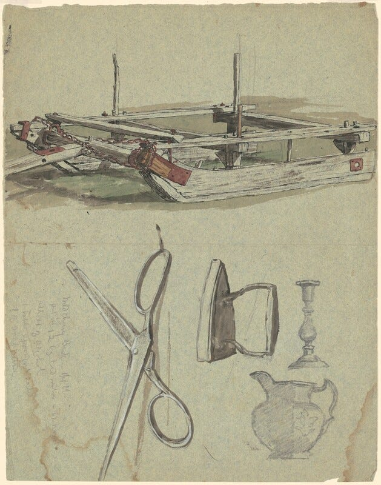
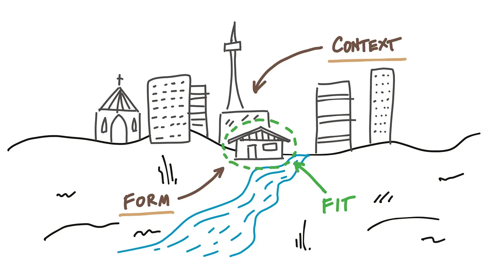

## What is product taste?

Product taste is hard to define. The most useful model I’ve found comes from Shreya Doshi’s “[How to Improve Your Product Sense](https://www.tryexponent.com/blog/product-sense-interview).[^1]” She decomposes it into three parts, stated here as “**The Product Taste Equation:”**

**Empathy:** Caring about the needs of the user and how they feel when they use your product. Defining problems and recognizing opportunities.

**Domain knowledge:** Knowledge about the space you can bring to bear on the problem; the set of tools you have at your disposal to solve that problem.

**Creativity:** Your capability to invent, identify, combine, and remix solutions to solve problems.

Taste is used to make subjective value judgements in your work. You apply all of these factors, together, to inform and improve both the inputs and outputs of your work.

### Taste requires coherence

Taste is about fitting all three values together in a way that makes sense. A product made with good taste meets all of the goals, values, and preferences of the users and the creator.

Taste isn’t about deciding what’s “good” or what’s “bad.” It’s about deciding what is coherent and what isn’t. In his 1964 work Notes on the Synthesis of Form, Christopher Alexander describes a system of relationships he calls the “ensemble” of **form**, **context**, and **fitness between them**. Form is the shape and structure of a product. Context is the environment in which the product is used. **Fitness** describes how the product matches the intended function within its context.

Good taste is about deciding what works in context. Coherence is fitness. Good taste is being able to recognize a good fit. Taste brings clarity.

### Taste as filter

When you can see what is coherent, you can begin to emphasize what matters most, and downplay or eliminate what doesn’t. These decisions happen at every part of the creative process:

**When looking at data and analytics:** Data can inform value judgements, but it cannot replace them. When we listen to numbers, we still decide which numbers are worth listening to and how much weight to give them. Taste is applied when people believe they are being purely objective. Leaning on “But the numbers say” without further justification is a cop-out.

**When collecting qualitative customer data:** Your taste dictates what questions you ask, and where you dig deeper and ask follow-ups. Like data, it helps you decide which feedback to listen to and which to ignore.

**Prioritization**: What do you solve first? Is a problem worth solving at all? Which strength should you play towards? All of these are ultimately questions of taste.

### Taste is attention to detail

You can tell when someone has put in the effort to pay attention to every little detail of an application. You see it in intentionally designed loading states, in thoughtful, useful error messages. When you hit a weird edge case and the product is one step ahead of you, handling it gracefully. And you think, “Wow, they thought about everything.”

Details compound.

I was once sitting at a cocktail lounge on a business trip to SF, and I overheard a bartender teaching a new hire how to make a mojito. He talked about the order of the ingredients and how many ice cubes. How many mint leaves to put into the drink, and how to arrange them. He talked about how these details affected the drink's flavor and presentation. He mentioned that the person can see you making the drink, so the performance of making it is part of the service.

Did you know Spotify’s shuffle isn’t truly random? It avoids playing the same artist twice in five songs. Those are the kinds of details that separate good products from great ones. When you’ve put your empathy for the user over what is ‘technically correct.’

### Taste in software engineering

What does taste look like when applied to writing code? At a foundational level, you may have ideas on what type of code you prefer to write. Do you write lots of small, single-purpose components, or larger, more utilitarian ones? How do you feel about TailwindCSS?[^2]

Another form of taste shows in early systems design: realizing what’s changeable and what isn’t. Certain database decisions and interfaces will be difficult to change in the future, while others are more malleable. Some things are one-way doors, and some decisions reverse easily. The trick is knowing which one is which.

Software taste is about writing code that best fits your context. Coding with coherence. If you write software for a company with coding standards, you stick to those standards over your own.

It’s important to remember that in-code interfaces are a product. They are made with a purpose, for an audience (other engineers).

### Taste is idiosyncratic

Everyone’s taste is different. Every company and every product exists in a different context. That’s what makes developing your taste worth investing in. Doing so will help you live a life that’s more coherent with both what you want and what you like. It is also specific to certain skillsets and proclivities.

For example, I feel I have a decent sense of what makes a good product or process. I’m smarter than the average bear when it comes to non-fiction business writing, else we wouldn’t be here together right now. I will *never* share my Spotify playlists, lest you see the cringy 00s nu-metal of my youth that I still listen to today.

The product taste equation includes *your* domain expertise. You can’t be an expert at everything. If you aren’t sure where to start developing your taste, start with what you’re best at.

## How do you tell the difference between product taste, subjective preference, and bullshit?

You might be thinking, If taste is subjective and personal, why should anyone else listen or believe you? Why should you listen to anyone else?

One aspect of believability is a consistent track record of wins. Has the person had successes before? Do they seem to be right more often than not? Why do people let Rick Rubin produce albums? Because he got the best out of Jay-Z, Lana Del Rey, Adele, Weezer, Slipknot, Slayer, Black Sabbath, Johnny Cash, The Mars Volta, Macy Gray, and Tom Petty. If he’s producing your album, chances are he can get the best out of you to.

[Watch on YouTube](https://www.youtube.com/watch?v=oJX7ifJaIAE)

For subjective decisions, you can still be more objective on what you and others are applying that judgment to. Are you trying to decide what’s best for the user or for you? Are you trying to justify your pitch, or are you seeking the truth? Are you applying taste, or stroking your ego?

You can typically tell when someone knows what they talk about or cares about others. I once heard a product manager say in a meeting, “Here are the actions we want the user to take.” Which, to me, is at least a yellow flag. What does it say when they are more focused on driving the user towards what they want, instead of trying to empower the user to do what they want to do?

The best way to detect bullshit is to watch for inconsistencies and a lack of ability to explain why they are making a decision, from any logical, emotional, or aesthetic endpoint.

There will never be a complete answer. How do you decide who to listen to and who to ignore? Are you ahead of me this time? That’s right, it’s applying your taste.

* * *

This is an excerpt from my upcoming book on product thinking for engineers. **[Sign up to be notified](https://engineering-product.kit.com/0d5f0028f8)** when it is available for purchase.

[^1]: “Product sense” and “product taste” are interchangeable.

[^2]: For those who aren’t frontend developers, TailwindCSS is a design framework based on ‘utility CSS.’ It’s a divisive pattern. Some people love using it, others can’t stand it.
