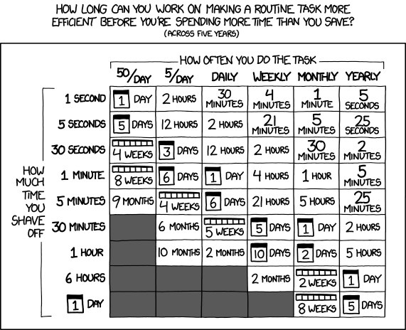

Does this sound familiar? You’ve heard the hype about AI coding tools, and how they can give you, the developer, a huge productivity boost. You install Cursor on your work machine, pull the latest master, and get to work.You try to prompt your way through it instead of writing code. Eventually, you have a working PR.

You saved time coding, sure, but you spent *more* time speccing, reviewing, and testing. You aren’t sure you saved time at all. This new method makes you feel a little uneasy in a way you can’t quite put your finger on. You’re still not sure what the hype is about.

I’ve been there. That’s when I realized I was seeing AI coding at it’s worst. If you’re only using AI code on large codebases, you’re missing out. AI coding shines on small projects. Little Keurig Cups of code. Utility scripts. Micro apps. Tools with no business on a production server. Disposable software.

## Writing disposable software

ChatGPT sometimes gives the perfect example of disposable software: you give it a task, it writes Python code, executes it, gives you the answer. You can cajole it in this direction by explicitly saying “use python code” to solve this. ChatGPT intends for code that is only ran once. But it’s cheap and fast enough to product that it’s okay.

AI Coding shifts the answer to the “is it worth the time?” test. More often now, the answer is “yes.”

I wanted to build out a tool for writing my [product thinking book](/blog/why-im-writing-a-book-for-engineers/): at this stage of editing I am constantly adding, removing, and rearranging entire sections. I wanted to keep each in a markdown file, and then assemble an ebook based on a table of contents file. Claude code was able to whip this up for me in about 15 minutes. Otherwise, I’d have slogged through a verrrry long Google Doc.

I could see a lot of my writing projects looking like this in the future: repositories that are a mix of markdown files and Python scripts that help with formatting, data viz, etc.

Disposable software sidestep’s AI codings biggest flaw: the code is often ass. Keurig coffee will never beat a hand-pulled espresso. But here, quality is irrelevant, only results matter. It’s like the hotel room coffee on a business trip, the one you make in your Keurig. The on you drink to muster the energy to venture into sunlight in search of a decent espresso.

## Disposability is a feature, not a bug

Trying to make disposable software production ready is a trap. Someone tried to make Vibe Coding Enterprise Edition and it [did not work](https://x.com/BrendanFalk/status/1939766141079232711). This is why I like this method for prototyping. Another trap I saw back in my coding days was someone taking a weekend prototype, and then trying to evolve it into a real app, instead of starting from scratch.

## Putting it into practice

As you go about your day, take note of rote tasks you could automate. Jot down small product ideas. When writing prompts, consider your options. You could ask ChatGPT “hey solve this for me” or you could say “write a python script that solves this for me.” Maybe it’s even something temporary, like an application to help you manage your Christmas shopping.

Then depending on the scale, you can later try to one-shot them, or go through a full vibe coding cycle of spec → write → review until you have something workable. It’s cheap to try. If it fails, you can always throw it away.

*(This piece is part 8 of the [Prompt Protocols](https://www.statetransition.co/t/prompt-protocols) blogchain)*
