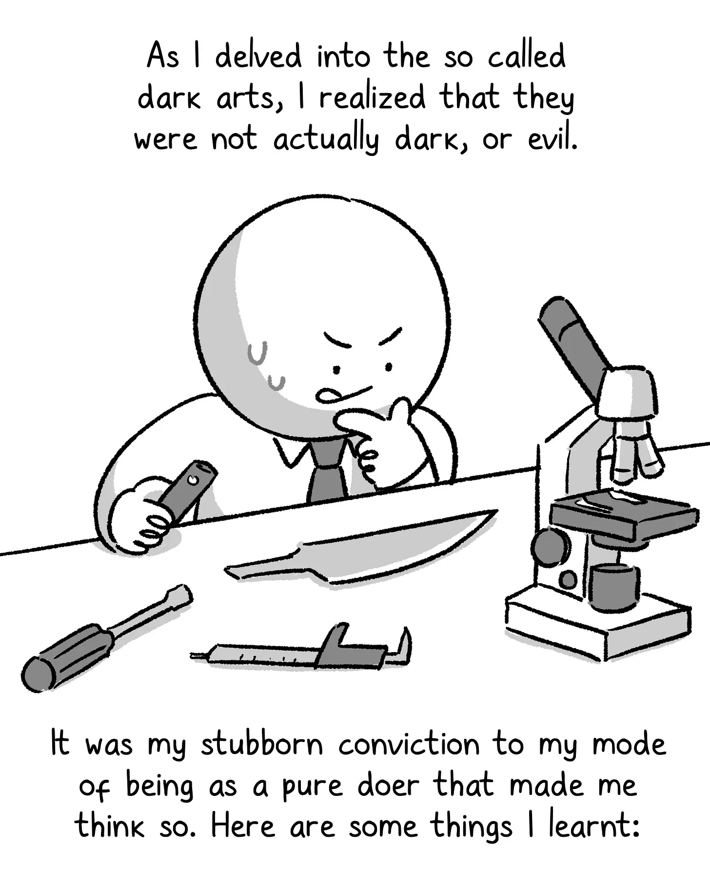

In Silicon Valley, the bright young stars of my young have become the slogging corporate giants of old. Facebook is now the [boomer social network](https://www.theatlantic.com/ideas/archive/2021/10/facebook-midlife-crisis-boomerbook/620307/). Google can’t [ship things anymore](https://medium.com/@pravse/the-maze-is-in-the-mouse-980c57cfd61a). Microsoft decided to buy a shiny new sports AI company, so at least there’s is going well.

[Watch on YouTube](https://www.youtube.com/watch?v=bxyDPJeStVo)

***Programming note**: It’s my birthday week, and all I want from you, dear reader, is to share this and help me get those rookie subscriber numbers up:*

From a personal standpoint, things are a bit different. As I’ve reflected on another year of getting older, I’ve come to realize a few things:

#### **1/ The default successful life script has a 20-25 year gap**.

…which I have followed, somewhat unconsciously. Go to college, get a job, get a wife, buy a house, put a kid and a dog in the house, and continue to climb the corporate ladder. Most of these can be finished by 40. Then what? Stay on the grind for two decades, then retire? What fills that void?

#### **2/ I don’t know a lot of programmers in their 40s and 50s**.

It doesn’t make me feel optimistic about my future. I don’t know where they went, and I’m not sure how I’ll get there.

#### **3/ Further climbing of the corporate ladder is no longer interesting to me**.

Bigger jumps in my career would mean more hours, more being available, and more travel, none of which I’m interested in. It would also mean more money, but that’s not motivating to me. I have enough. As long as I can make Silicon Valley money while living in an up-and-coming city, I’m doing *okay.* Don’t get me wrong, I enjoy my job and intend to keep doing it for the foreseeable future, but it’s missing a certain velocity in the tempo that it used to have.

[Watch on YouTube](https://www.youtube.com/watch?v=TMh1b8eUxtY)

##  So… now what?

Technology is an infinite game. Unicorns come, and unicorns go. I’m excited to see what the future holds as the next generation of talent phases in. 

For me personally, I’ll see where I fit into the new tech scene or if I leave to go sell pickles at a farmers market or start a dad rock band or buy a jet ski.

* * *

## Top score

[Post by Glenn Stovall - statetransition.substack.com (@GSto)](https://twitter.com/GSto/status/1640712620599832586)

I’ve written so many threads met with silence. Clearly, my time on Twitter would be better spent coming up with quips in the replies.

## A quality slideshow on TikTok

A friend sent me this TikTok about [the “dark arts” of office politics](https://www.tiktok.com/@thewokesalaryman/video/7215174792813563138) and said it reminded him of my piece on [ethical office politics](/blog/ethical-office-politics/). I loved this take and would highly recommend giving it a watch. Also, we’re doing slideshows on TikTok now? I don’t understand the new social medias.

You can also [read it on Substack](https://thewokesalaryman.substack.com/p/workplace-politics-play-or-be-played), which I assume is an app where you’re comfortable consuming content.

## A moment of gratitude

Thank you to [Elon Musk](https://www.reuters.com/technology/musk-experts-urge-pause-training-ai-systems-that-can-outperform-gpt-4-2023-03-29/?utm_medium=Social&utm_source=twitter) and others for asking for a 6-month pause on AI development. They must of have heard [my plea last week](/blog/drowning-below-the-llm/) and are giving us all some time to catch up. Otherwise, fuck that guy though.
