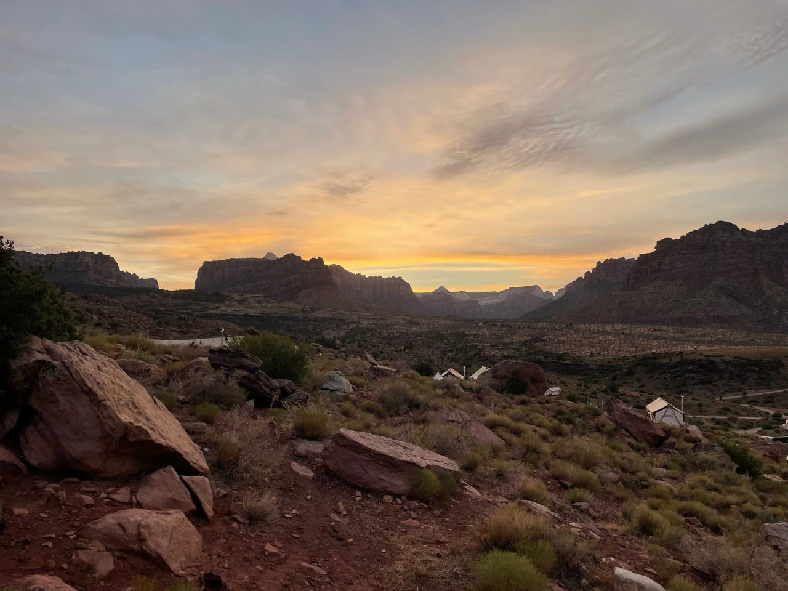

*\[Note: this is a guest post from my lovely wife Kim, who wrote this a while back when we flew with our child from Nashville to Zion National Park. Enjoy!\]*

Before we traveled across the country to a glamp in the desert with our 10-month-old, the best advice I received was to have no expectations. Worst case scenario, you are just parenting in a beautiful new location.

The next best advice I received is don’t panic.

You can always bail. This has been my motto throughout the first year of parenthood, and I readily applied it to our biggest trip. It would be harder to bail, but there is always a way out. If baby can’t handle the dinner, leave. There is no reason to stay with a screaming baby because you can’t enjoy it anyway.

Using this motto as a failsafe, I knew we could take on anything. 

So, how did we take on this trip? Planning. Weeks leading up to the trip, I paid close attention to all the items we used daily.

-   Are there toys or books that he asked for regularly?
    
-   Which spoons is he the most successful with?
    
-   Even though we weren’t tracking diapers anymore, I started to pay attention to how many diapers we used a day (mind you, on most trips, you can ALWAYS run out to get more diapers, but for us, the closest big box store was at least 40 mins away so we had to take it all… and then some). 
    

At first, I felt a little silly about the number of bags we brought, but in the end, we used almost all of it (and flew Southwest, so we might as well use the free checked bags!). So let’s chat through the gear and how we got it there:

## Checked in a large suitcase:

-   **Pack and Play**—We have a basic Graco pack and play, and it has served us well. It assembles quickly and provides a clean, safe sleep space at night. I know a lot of folks recommend getting one from the place you’re staying or possibly renting one when you get there, BUT I cannot tell you the peace of mind I had knowing that he had a place to sleep and containment area during the day. I also packed a sheet for the mattress that comes with the PnP. 
    
-   **Slumberpod**— I thought I was being extra when I ordered this. Who needs a tent in a tent? But let me tell you, we did. We have used this for every trip since it arrived and it is a game changer when you are room sharing with your baby/toddler who is used to their own space. It allows me to move around hotel rooms and go to bed after baby. 
    
-   **Sleep gear**— We got a travel white noise machine, the baby monitor, though we couldn’t use it in our yurt, sleep sacks, and PJs. We also took everything we normally use for our bedtime routine—soaps, lotions, etc. We tried to make it as familiar as we could for him.
    
-   **Extra Food**— He was nursing and eating several meals a day, but we weren’t sure we could always order something for him so we made sure to pack extra pouches and crackers. 
    
-   **Extra diapers**— After figuring out our average number of diapers, I packed those plus 50% more and man did they take up a lot of room.
    

## Second large suitcase:

-   Clothes for me and baby. 
    
    -   Packed a onesie for each day and then added 50% again. Onesies are the best- it’s a shirt, a sleeper, or a whole outfit if needed. Something is going to happen- food, poop or dirt, and it was wonderful having easy back ups.
        
    -   Adventure specific items: we were hiking so I packed some sun shirts. And I always take a bathing suit! (Just a life rule)
        
    -   PJs- packed a sleeper for every night- we ended up not using these due to the weather and relied on the onesies but it was good to have the option if it had been cold
        

## Car Seat:

We purchased a second seat that was FAA-compliant. Even though we opted to travel with him in our laps, we wanted a seat that we could strap into a plane when the time came. It’s lightweight, seems to be comfortable, AND is super easy to install! We also bought a backpack carrying bag for the airport since we opted to gate check it on the way to our destination. You can rent a car seat, but for the cost of the rental, we now own a second seat for our cars, AND we know it’s clean and never been in an accident.

NOTE: we fully checked the car seat on the way home. We had a seat installed in the car at the airport at home so IF it didn’t make it back, we would be ok. However, I didn’t want to take any chances on the way to vacation. 

## Baby Carrier

Little man loves being in the carrier, and we tested his limits on this trip! This was amazing for getting around the airport and around town. We use the Ergo Baby Omni Breeze, which helped with getting on and off the plane as well!  Since we only have a large stroller, we didn’t bring it, but will be trying a travel stroller on our next adventure!

## Carry on # 1, under the seat: The diaper bag:

This was stuffed to the brim with extras. What if we got delayed??? So I had too many diapers AND overnight diapers. We had a 4-and-a-half-hour flight, so along with boarding and deplaning we would be on the plane a little over 5 hours. I decided to change baby into an overnight diaper for the trip. We had no leaks and no solids, so we didn’t have to change on the plane!

TOYS: We packed some easy-to-reach toys and books for him that we could access when needed. 

Snacks and water- we packed him a water bottle and tons of puffs and crackers to help keep him happy.

## Carry on #2, overhead:

We packed additional toys and snacks in here. I wanted enough with us that IF the checked bag didn’t make it, or we were super delayed we could make it through at least double the meals we were missing. In hindsight, this was excessive. There are tons of options to purchase fruits and cheese at the airport. But for a first-time flight it did give me a sense of security.

## On arrival

Yes, we were that family at baggage claim, two large suitcases, one small, one car seat, two backpacks, AND a baby strapped to us.

BUT, we also were the family that hiked Zion, slept in the yurt, and had an amazing family trip with a 10-month-old baby.

We had to bail on one dinner, but we knew we were pushing his limits as naps were thrown off, but that’s ok. I took him back to the yurt and watched the sun set over the mountains with a glass of wine.

Want to hear more from Kim? Let her know in the comments!
