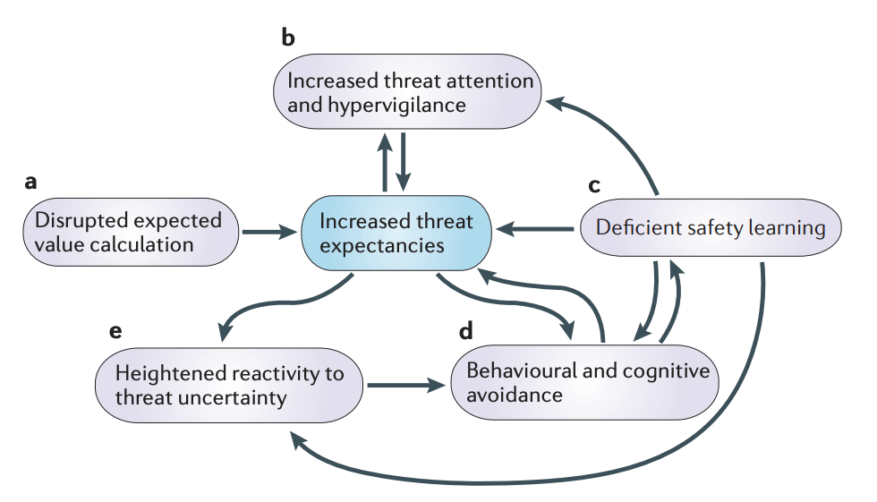

We find uncertainty threatening.

According to [a study in](https://www.nature.com/articles/nrn3524) *[Nature Reviews Neuroscience](https://www.nature.com/articles/nrn3524),* there are five maladaptations people, especially people with anxiety and depression, have when the future feels…

Uncertain.

Unpredictable.

Uncontrollable.

They call it the uncertainty and anticipation model of anxiety, or **UAMA**.  

When we feel threatened, we start looking for signs we are in danger (threat signals) or not (safety signals). We either look for ways to deal with the threat (fight response) or get away from it (flight).  
  
  
These responses are normal and rational. However, problems arise when anxious or depressed states lead to exaggerations of these responses, which then compound each other.

In UAMA, there are five forms these maladaptations take:

## 5 unproductive responses to uncertainty 

1.  **Inflated estimates of threat cost and probability** -  overestimating the risk and cost of taking or not taking action
    
2.  **Increased threat attention and hypervigilance -** Running through increasingly unlikely “what if?” scenarios, exaggerating the intensity of every threat signal. 
    
3.  **Deficient safety learning -** Ignoring signs that you are safe or signals the threat has passed. 
    
4.  **Behavior and cognitive avoidance-**  Running away from problems instead of facing them head-on. 
    
5.  **Heightened reactivity about threat uncertainty** - Letting problems get to you. The uncertainty caused increased feelings of anxiety or depression. 
    

## How responses feed the tailspin 

These responses cause a negative feedback cycle. 

1.  Avoiding low-downside, high-upside risks due to not recognizing how low-risk they are. 
    
2.  Over-indexing on threat signals and under-index on safety signals causes the perception of more threats, real and imagined.
    
3.  Avoiding problems, allowing them to fester.
    
4.  Wasting time and energy worrying about potential outcomes instead of preparing for them. 
    

Some examples: 

1.  A person grows up poor with little exposure to investing. They view the stock market as ‘too complicated,’ ‘risky,’ and ‘basically gambling.’ When they find themselves with a little extra money, they don’t invest it, leading to less money and, therefore, more financial stress in the long run. 
    
2.  Someone sees a small lump but fears seeing a doctor about it. A treatable condition gets worse because it was ignored. 
    
3.  Unsatisfied at their job, a person doesn’t apply anywhere else because they think the time to interview and the pain of getting rejected, in exchange for an opportunity to improve their salary and quality of life, is “not worth it.” 
    

What are some examples of people reacting to uncertainty or risk that caused them to experience even more? 

## What to do instead 

> “Invert, always invert.” - Carl Jacobi

Tailspins can be avoided or clawed out of one by simply doing the opposite of the extreme reactions in the UAMA model: 

1.  **Accurate cost, risk, and probability estimations** \- or at least as accurate as possible. 
    
2.  **Responsible attention to threat signal** - Be aware, but don’t be myopic. 
    
3.  **Observe safety signals -** are there signs you are ok? Can you trust them? 
    
4.  **Face problems head-on** - If you can take action, then do so. 
    
5.  **Manage emotions -** Don’t let uncertainty get to you. Approach it was a calm, rational demeanor. 
    

Facing uncertainty doesn’t mean you have to be uncomfortable.

In fact, Learning to be okay with uncertainty is the first step to understanding how it can be a tool:

A source of discovery, wonder, and innovation.
