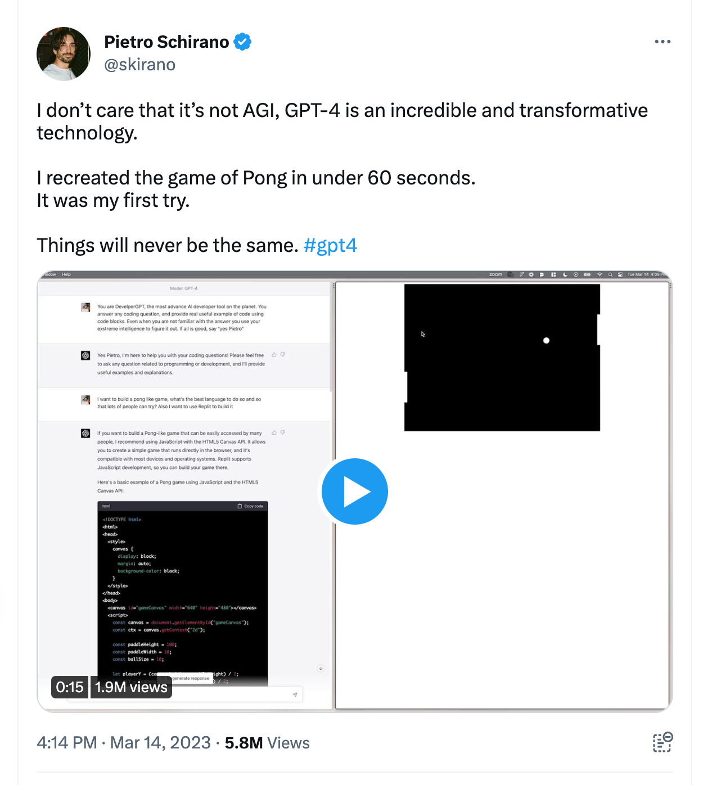
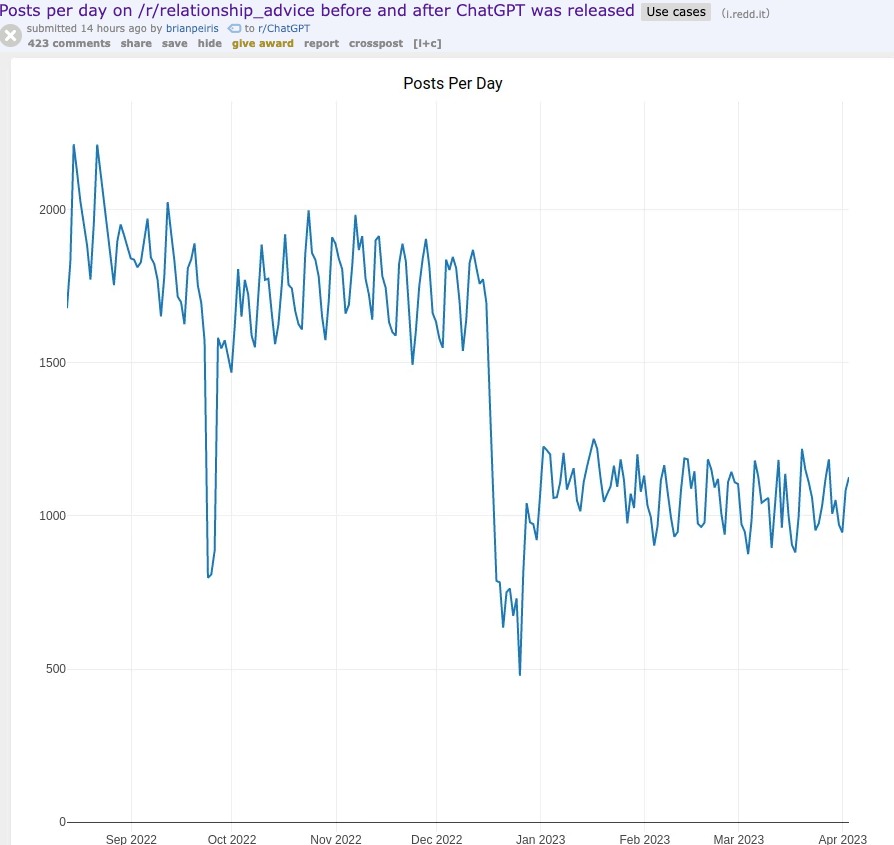

I’m not worried about generative AI taking my job because this isn’t the first time advancements in technology have done that.

My first gig in the industry was as a webmaster (God, I miss that job title) for an online store. I would manage listings and upload photos. Updating copy required fiddling with the HTML. 

My second job in the field was at a web design agency, building bespoke brochure websites for local restaurants, optometrists, and home goods stores. We used an in-house CMS and turned PSDs into webpages by hand.

My first job has been replaced by Shopify, and the second by WordPress and Squarespace. It used to take at least a part-time college student to run an online store, now, you can get one for $39/month. $149 themes replace dozens of billable agency hours.

## **Where did all these people go?** 

These jobs were “destroyed,” so what happened to the people who had them? They went to one of three places:

1.  **outside the platform -** Agencies move to other services, such as content, SEO, and managing ad spend.
    
2.  **inside the platform -** Building plugins, themes, and apps that leverage these new platforms at a greater scale.
    
3.  **above the platform -** Engineers move on to solving bigger problems. Building web and mobile applications replace some websites.
    

When jobs die, more take their place. Technology has replaced jobs several times over.

AI Isn’t going to ruin me financially. But I am confident that in 2-4 years, I won’t have my current job because it won’t exist in its current form.

## **AI isn’t going to change software development — it already has** 

I had a lightbulb moment with AI. I was about to assign a ticket to a junior developer when I realized that “Oh, ChatGPT could write the function that does this.” I still gave it to them, but that’s when I realized that ChatGPT has a place in my workflow. 

If you can break a piece of work into a small function that requires limited context, there’s a good chance ChatGPT can write it for you and write it faster than you can. 

[Post by Swizec Teller writing a book you’ll wanna read (@Swizec)](https://twitter.com/Swizec/status/1641519844213555200)

## **Knowing the tools** 

There is a skill to using these tools in work. I think the term “prompt engineering” is a little cringe, but it is a skill. Tech-savvy millennials have long known their biggest superpower was being better at Googling than 90% of people. Now we need to be better at prompting than 90% of people. 

Bonus points: if you write a good prompt for a function, you’ve also written the documentation for it. 

## **Final mile work** 

Why do companies still employ so many web developers when so many tools & open-source modules exist? The two reasons are **context** and **stitching.** Yes, there is a plugin that can make an [input form easily handle credit card numbers](https://nosir.github.io/cleave.js/) and add commas to large dollar amounts, but how does that fit into a larger-scale financial application? There are plenty of off-the-shelf solutions, but they either need to be tweaked, modified, or extended for particular use cases. 

The more greenfield your work, the more useful AI is at coding it. Right now, it’s great for piecing together demos and simple greenfield projects. The bigger your current application, the more difficult integrating ChatGPT into your workflow.

## **I, for one, welcome our robot overlords.**

ChatGPT isn’t always perfect. The generated code still needs to be tested, refined, and fit into a larger context. Sometimes it takes a few iterations with ChatGPT to get a workable solution. This isn’t a knock against it - so do humans. 

Sometimes the code will have bugs in it. So does code written by humans. Some people online are resistant to generative AI, putting all of their efforts into laughing at how stupid it can be and zero effort into thinking about how they prompt or what they say at all. A revolutionary tool comes out, and all you can do is be negative. Why?

The only explanation I can come up with is that being negative is simply easier.  

  
Personally, I’m excited to see what my work looks like in two years. And besides, if machines are doing all the boring work, we have no choice but to get more weird.

* * *

## A disturbing chart

*yeesh.*

##   
And finally, a moment of gratitude  
  

[Post by Visakan Veerasamy (@visakanv)](https://twitter.com/visakanv/status/1641721793160552448)
