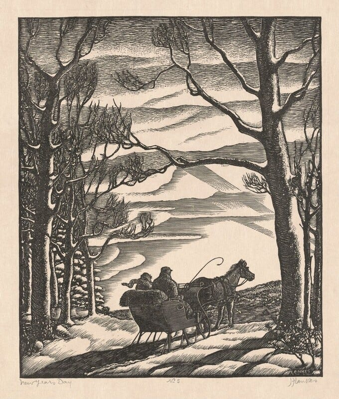
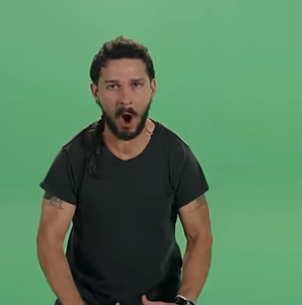

It’s that time of year. The final week, where the worst versions of ourselves plan for the better versions we’ll be next year. We crawl out of the pile of discarded wrapping paper and plates. The background drone of holiday films begins to fade. The time to lock in approaches.

We all know resolutions are a fantasy. Most fail to lead to permanent change. Resolutions feel like a burden, like an exam you’re going to fail instead of a book that shows you a new way of thinking. You hit the gym for a week or three, then start to miss. It becomes a stressor. You toss the resolution in a desk drawer and ignore it until Q4 reflection time.

Last year, I found a different approach: I didn’t go in with a New Year’s resolution. I went into 2025 with a **New Year’s strategy**.

A resolution is a statement of a goal. Strategy is a framework that shapes decisions. Resolutions are rigid, strategies are flexible. Resolutions are narrow. Strategy is holistic. Resolutions lack a system for dealing with changing contexts. A strategy helps you decide what you’re going to do, how to prioritize, and empowers you to make decisions with confidence.

## How to write a strategy

The word ‘Strategy’ conjures images of McKinsey consultants billing $600/hr to create slide decks. Decks with lots of charts. Charts that will do more harm than good. Strategy need not be highfalutin, and unlike McKinsey consultants, can deliver real value and change. Here’s a dead-simple summary of what I mean by strategy, riffing on the ‘kernel’ idea from ‘[Good Strategy / Bad Strategy](https://www.goodreads.com/book/show/11721966-good-strategy-bad-strategy).’ A strategy has four parts:

1.  **Goal** - What do you want to accomplish?
    
2.  **Diagnosis** - What’s wrong?
    
3.  **Guiding policy** - Your approach, what to do, what not to do.
    
4.  **Coherent Actions** - How can you put this into practice?
    

That’s it. It doesn’t need to be a huge document or grandiose idea. It could be a paragraph. It could be a *sentence.* *WWJD* is a complete strategy.

(Tech bros made that weird, too, by the way)

")

### An example

> Imagine you're driving from San Francisco to Seattle, and you want to get there in under 12 hours. That's your goal. For those unfamiliar with the West Coast geography, 12 hours is a theoretically doable timeframe but the variance can be high. It's possible to lose 2 hours if you pass Portland at the wrong time, and there are several other traffic bottlenecks.
> 
>   
> A possible strategy to achieve this somewhat optimistic goal would be to **use multiple drivers to enable continuous driving while optimizing around traffic patterns rather than absolute distance or speed.**
> 
>   
> The strategy isn't "take I-5" or "drive fast", it's a higher-level approach that introduces new possibilities (can drive straight through), adds constraints (need to coordinate schedules), and impacts other decisions that might be made (no need for a sleeping stop). It's a set of fundamental approaches which generate a cascade of tactical decisions: when to swap drivers, timing of departures to avoid city traffic, length of rest periods, etc.
> 
>   
> [Dan Pupius, You need to be more strategic - A primer on strategy for software engineers](https://writing.pupius.co.uk/you-need-to-be-more-strategic-dc473a2aa319)

At the start of the year, I declared 2025 my '[year of actionable thinking](/blog/my-leeroy-jenkins-year/)', and I crafted the 'Leeroy Jenkins Strategy':

1.  **Goal** - Spend less time overthinking, more time on execution
    
2.  **Diagnosis** - Too much time spent on planning and [infotainment](/blog/a-healthy-information-diet-is-more/).
    
3.  **General policies** - Be intentional about planning and research. All information should be actionable. Favor taking small next actions and focus on progress over perfection.
    
4.  **Coherent Actions** - See [Jenkins Strategems](/blog/jenkins-strategems/), [Just Push Buttons](/blog/just-push-buttons/)
    

At the beginning of the year, I was also moving from IC to engineering manager. I didn’t know what the job would entail. But having a strategy meant I could apply my original goal to novel areas. I could learn what questions to ask in meetings to drive decisions and keep us out of a planning bog.

### An anti-example

My stated goal of [publishing 10 posts in December](/blog/nanowrimo-style-challenge-trip-report/). I had a goal, but lacked a diagnosis. I hadn’t considered the amount of holiday planning and activities, the ‘get it in by Q4’ work push, the general crud, the persistent cough all parents of young children have in winter. The sun, despite all the negative feedback, continues to set at 4:47pm. How can I be expected to hustle when the sun can barely put in a full day’s work?

## 3 ways to keep yourself honest

Once you have a strategy, you have to ensure you put it into action. Wisdom is realizing this video is sincere:

[Watch on YouTube](https://www.youtube.com/watch?v=ZXsQAXx_ao0)

What helped me:

**Regular check-ins** - If you take away one thing from this post, let it be this: If you want to focus on a goal for the long term, set up a system to bring your attention to it regularly. Add a recurring task to your to-do list. Slap a sticky note on your bathroom mirror. Wear a charm or bracelet.

**Strategy-driven preparation** - What can you do *today* to enact your strategy in the future? Strategy can help you in the moment, but also beforehand, in planning and preparation. Map your route before you leave.

**The Focusing Question** - I’m a stan for Gary Keller’s [The One Thing](https://the1thing.com/book/). Though I’ll admit you can get 90% of the value by asking yourself the “Focusing Question”, both regularly and when you don’t know what to do next: “What’s the one thing I can do such that by doing it everything else will be easier or unnecessary?”

What do you want to accomplish next year? How could you write a strategy to achieve it?

Maybe I should make a WWSLaBD bracelet 🤔
