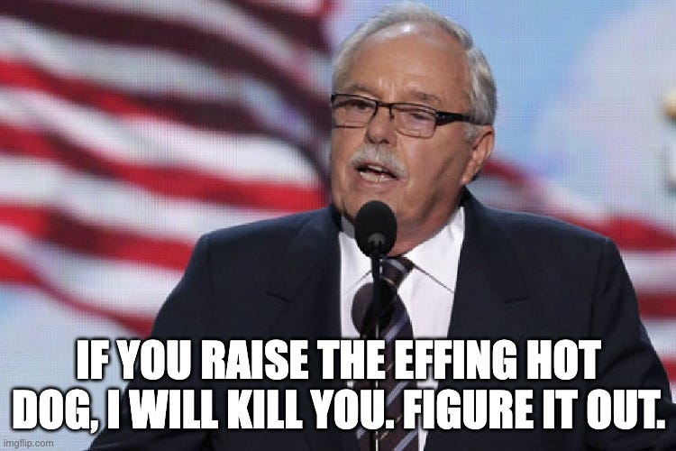
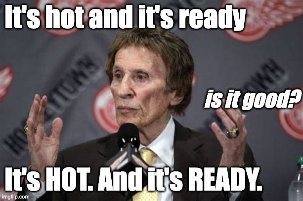
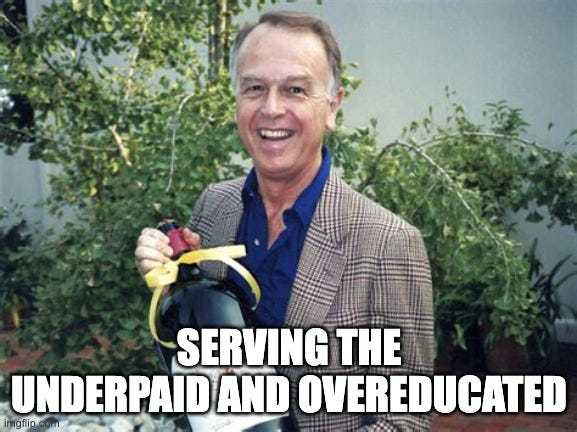

I admire three CEOs who all run their businesses in their own unique ways, but there is a common thread. If I ever leap into running my own company, I hope to be like them. Here’s what makes them exceptional, and here’s what they have in common:

## 1 - James Sinegal, Founder of Costco

Sinegal runs one of the most successful retail operations in the company. Does so selling products nearly at cost. Pushes suppliers to make packaging with less waste. Has a company minimum wage of $19.50. One threatened to kill a man over hot dog pricing.

## 2- Mike Illitch, founder of Little Caesars Pizza

He ran a local youth hockey league. Founded the [Little Ceasar's Love Kitchen](https://littlecaesars.com/en-us/love-kitchen/), a food-truck-based charity that provides free hot n' fresh pizza to the homeless and people in disaster areas. Paid Rosa Park's rent for a decade and didn't tell anyone. He knows he could charge you more than $5 for a pizza, but he chooses not to ensure low-income families always have access to a hot meal.

## 3 - “Trader” Joe Coulombe

Paid will above market wages. Invented almond butter. Includes [a treasure hunt game](https://www.apartmenttherapy.com/trader-joes-secret-game-37277304) in every store to keep your kids entertained. Makes it so you can grocery shop and still not have to cook.

## The common thread

Besides lacking the [dead eyes](https://mms.businesswire.com/media/20210407005251/en/869801/23/2017_BrianThompson_Hub[2].jpg) you see in many other CEOs, what do their business have in common?

They all pay their employees above-average wages. They all have a keystone value item. Because of these three men I can have a dinner of a hot dog, coke, pizza, and wine for $8.50. Hockey stick growth for my cholesterol for under ten bucks.

But what’s most interesting is that each of them **competed on price without sacrificing quality.** Costco does it on volume and a no-frills shopping experience. Little Caesar’s does it by keeping the menu lean. Joe achieves this by sourcing non-traditional products and packaging them under his brand.

Value for your customers. Generosity for your workers. Focusing on the essential.

That’s the kind of place I’d want to run.
