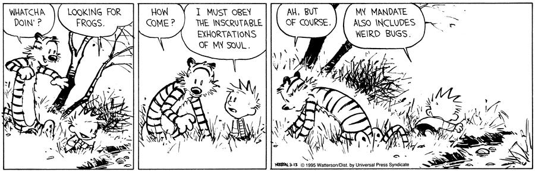

I hate the phrase “work-life balance.”

It’s both work-centric and work-negative. It assumes the default priority in your life is your 9-to-5, giving work equal billing with *literally everything else.* What are more effective ways to frame where work fits into our lives?

## 1

Work-life balance is off-balance. What people mean when they say “work-life balance” what they want is **work-life boundaries.**

You don’t want to be answering emails at 7 pm. You don’t want to hear screaming kids or yapping dogs when you’re trying to debug a PR. That’s fair.

It’s a challenge when working remotely, and you can’t escape to the office (or vice versa)

You can build boundaries around time or space to help. Have a dedicated office space; Let your family know when your focus hours are. In my office I have a ‘do not disturb’ door hanger, hotel-style. It lets my wife and kid know when I am heads down or on a Zoom call. I Walk the dog around the block at the start and end of every work day - a “commute” between work mode and life mode. He is still struggling to respect the door hanger.

But boundaries aren’t the only way.

## 2

Why must work be decoupled from life? What if work was something that enhanced your life rather than take away from it?

Hayao Miyazaki made *The Boy and the Heron* when he was in his 80s. He didn’t do it because he needed the money.

There’s work that interests you, that you are uniquely skilled to do, that you find compelling and enriching. Paul Millerd explores this idea in his book *[Good Work](https://pmillerd.com/goodwork/).* There are ways to find **work-life integration.**

Or maybe it could mean separating vocation (work you do because you are compelled by the [inscrutable exhortations of your soul](https://www.gocomics.com/calvinandhobbes/1995/03/13)) and occupation (work you do to pay the bills). This path is the most logical and fruitful for most I suspect, as it allows you to keep your art “pure” and your career optimized towards supporting you and your work.

I recognize that I do not contribute to world peace or solving hunger working in the financial services industry. I won’t pretend I enjoy it every day. But I find ways to make it work for me. I remind myself that our product helps people run their businesses with less friction. I find purpose in mentoring and coaching less experienced employees. My mandate also includes building and writing things that I’m proud of.[^1]

## 3

What about the life half of the equation? What an oversimplification of our strange and beautiful existence. It can be broken down further with **work-life decomposition**.

Instead of a binary, many others have thought of life as a collection of several facets. Models include:

-   John Maxwell’s [Daily Dozen](https://www.amazon.com/Today-Matters-Practices-Guarantee-Tomorrows/dp/1931722528)[^2]
    
-   Zig Ziglar’s [Wheel of Life](https://www.ziglar.com/articles/the-wheel-of-life/)[^3]
    
-   Tony Robbins’ [6 human needs](https://www.tonyrobbins.com/blog/do-you-need-to-feel-significant)[^4]
    
-   Martin Seligman’s [PERMA model](https://ppc.sas.upenn.edu/learn-more/perma-theory-well-being-and-perma-workshops)[^5]
    
-   The [5 Fs Framework](https://www.5-fs.com/)[^6]
    

Take your pick or roll your own. Instead of balancing two things, these all frame life as a prism of physical health, personal relationships, financial security, spiritual fulfillment, emotional well-being, personal growth, making an impact, and sparking joy.

## 4

You can’t draw clear lines between the different facets. Each segment feeds to the others. I’ll, for consistency’s sake, call this **work-life interdependence .**

Career impacts money. Health increases productivity. Your passion for your job directly influences how fun you are to hang out with after work.

The separation only comes when you want to zoom in on one to make optimizations or improvements. But even then, you can’t do so without considering how it would impact the others.

## Wrapping up

There are so many more interesting ways to frame how you prioritize your time and energy, set your intentions, and live your life. Thinking about “work-life” balance is limiting and guaranteed to make you off balance and bored.

[^1]: I recently heard of a practice called [job crafting](https://hbr.org/2020/03/what-job-crafting-looks-like), the art of tweaking your job better to suit your strengths, interests, and purspose.

[^2]: Attitude, priorities, health, family, thinking, commitment, finances, faith, relationships, generosity, values, growth

[^3]: Mental, spiritual, physical, family, financial, personal, career

[^4]: Certainty, variety, significance, connection, growth, contribution

[^5]: Positive emotion, engagement, relationships, meaning, accomplishment

[^6]: Faith, Family, Friends, Finances, Fitness
