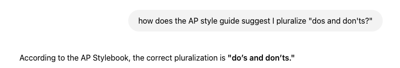

As someone passionate about both writing and AI, I often get asked, “How are you leveraging AI for writing?” and “As a writer, should I be scared of the oncoming AI slop apocalypse?” The answers are “intentionally” and “it depends” respectively.

AI is undeniably changing how people write. While some are excited by a future with less writing, I’m a little concered about a future with less thinking.

> It’s plausible that most people won’t need to write in the near future; we might even celebrate the triumph. But writing and arranging words is the process of careful thinking. By offloading it, will we not atrophy the muscles of thought? We’ll each gain the illusion of competence, without even being aware of our cognitive amputation. We might lose our personal sovereignty in an age where we need it the most. — Micheal Dean, *[Essay Writing as Personal Sovereignty](https://cosmosinstitute.substack.com/p/essay-writing-as-personal-sovereignty)*

The threat of technology reshaping our brains, permanently, is real. If you over 30 like me, you’ve noticed how you remember fewer phone numbers. You reach for the GPS every time you drive to Home Depot, even though you’ve lived here for almost six years, shouldn’t you know the way by now?

David Perell, creator of the now defunct [Write of Passage](https://writeofpassage.com/) course, holds a pessimistic view. He recently shared that he quit teaching the course because AI has made him bearing on online writing.  
  

However, I still think Gen AI has a place in the writing process. They are *language* models after all. I also disagree with Parell, I still think there is a ton of leverage and alpha in writing online. If I didn’t, we wouldn’t be here right now.

Here are my guiding principles for leveraging AI:

## DO: Use AI for research

[ChatGPT Deep research](https://openai.com/index/introducing-deep-research/) is the new Wikipedia page. A starting point, not an answer. They are tapas menus of resources to pick and choose from. A great first stop when you delve into a new topic.

## DON’T: Use AI for summarization

Summarizing isn’t just condensing information—it’s deciding what matters, how to structure it, and how to reframe it. Summarization is how you build retention and understanding. It’s a creative, intentional act. Delegating summarization is like sending an android to your CrossFit class.

## DO: Use AI as reference

> I urge my students to get a usage dictionary… To recognize that you need a usage dictionary, you have to be paying a level of attention to your own writing that very few people are doing… A usage dictionary is \[like\] a linguistic hard drive… For me the big trio is a big dictionary, a usage dictionary, a thesaurus — only because I cannot retain and move nimbly around in enough of the language not to need these extra sources.
> 
> As a teacher, about 90% of my job is getting the students to understand why they might need one. — David Foster Wallace, *[Quack This Way: David Foster Wallace & Bryan A. Garner Talk Language and Writing](https://archive.org/details/quackthiswaydavi0000unse)*

Writers have always relied on tools—there’s no shame in using them to improve your work. When I’m stuck on a word choice, I’ll ask ChatGPT or Claude to give me 5 options to fill in the blank. Sometimes it’s faster than reaching for the dead tree tool a whole 15 feet away.



## Don’t: Let AI strip your writing of personality

Don’t shove text through the AI mill and uncrtically publish what comes out the other side. Instead, use AI for suggestions. Pick the ones that work best or use them as inspiration to go in another direction. AI gives you options, you provide perspective and taste.

## Do: use AI as a line editor

AI won’t make creative word choices, but it can suggest clearer alternatives, like replacing “talk about things” with “communicate.” Here’s a prompt I’ve been experimenting with to do this:

```
Act as an experienced writer with a focus on improving the clarity and readability of text. You are responsible for reviewing a piece of text. Break down the sentences into simpler forms without losing the original meaning or nuance. Implement appropriate punctuation, streamline the language, and remove any unnecessary jargon or filler words. Ensure that the content adheres to a consistent style guide and retains its original purpose while becoming easier to read and comprehend.

Go section by section, and give me the original version, the revised version, and a list of changes made
```

## Don’t: Rely on AI as proofreader

AI cannot replace human feedback. It can fix a sentence, but it can’t tell you if it’ll resonate with someone. Writing is still for readers, and we need readers to help us figure out what’s interesting and what’s dull. What’s mind blowing and what’s confusing.

## AI is an assistant, not a replacement

AI cannot replicate personality, perspective or taste. It cannot build human connection or express a deeply held belief. It can only help humans do so. It can replace my thesaurus, but it can’t replace my mind or my soul.

To wit, if your paycheck is contingent on pumping out thoughtless, soulless content, then yeah, I’d be concerned.
