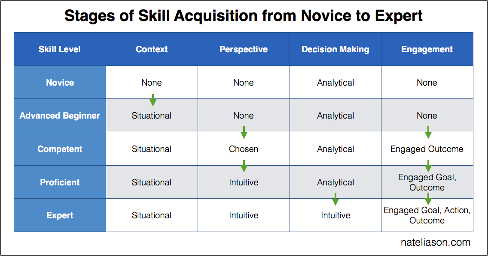
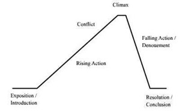
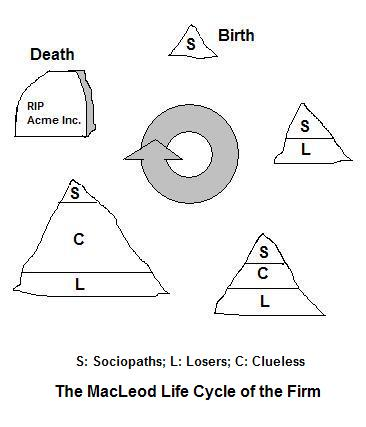
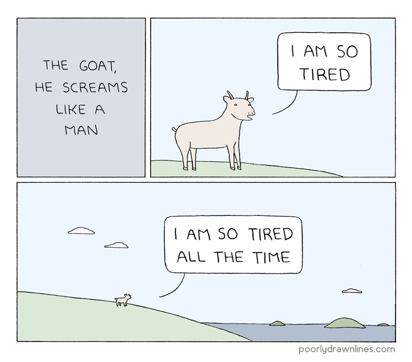

# Tufte Integration 

#: Extended markdown syntax to support Tufte-inspired layouts

## Brief

This is both a sandbox and documentation for integrating this site with [Tufte CSS](https://edwardtufte.github.io/tufte-css/) and Markdown. The syntax lives in `lib/tufte-markdown`, a markdown-it plugin built so it can become its own npm package.

## Implemented Features 

### Section organizations
content is automatically segmented into sections based on H2 tags. 

### Sidenotes 

One of the most distinctive features of Tufte’s style is his extensive use of sidenotes.[^1] If you add multiple sidenotes throughout your notes, then they will number themselves automatically.[^2] Sidenotes use standard footnote syntax:

```
Here is a claim.[^1]

[^1]: this is the side note syntax
```

For short notes, you can write the text inline.^[like this one] 

```
Here is a claim.^[this is the inline side note syntax]
```

[^1]: this is a sidenote

[^2]: this, for example, should show up as sidenote **number** 2. As you can see, you can nest markdown in these to style the texts

### Margin notes 

Margin notes are similar to sidenotes, but they don't have a number attached to them.[^margin-example] Any footnote whose label starts with `margin` becomes a margin note:

```
Here is a claim.[^margin-source]

[^margin-source]: this is the margin note syntax
```

[^margin-example]: but they still show up on the side of the page

### Epigraph Quotes
By default, blockquotes will be rendered as an epigraph. To add a citation, end the quote with a line that starts with `--`, `—`, or `- `:

> when you squeeze an orange, orange juice comes out. whenever you get squeezed, whatever comes out is what's inside of you
> -- Wayne W Dyer

```
> when you squeeze an orange, orange juice comes out.
> -- Wayne W Dyer
```

### Figures

An image on its own line becomes a figure, and its title becomes the caption.



```

```

Add `{.fullwidth}` to stretch a figure across the page, with the caption below it.

{.fullwidth}

```
{.fullwidth}
```

### Margin figures

Add `{.margin}` to put a small figure in the margin, beside the paragraph that follows it.

{.margin}

This paragraph sits next to the margin figure. On a phone, the figure hides behind a ⊕ toggle, the same way margin notes do.

```
{.margin}
```

### Image quilts

A `quilt` code block lays out a grid of images, each captioned with its title. Use `quilt fullwidth` to stretch it across the page.

```quilt



```

````
```quilt


```
````

### Page subtitles

Page subtitles can be created with the following syntax: 

```
#: this is a subtitle
```

## Future development
Tufte CSS features that aren't yet implemented, but on my to-do list: 

1. newthought paragraph start
2. iframe wrappers

## Resources
The plan is to use a combination of custom markdown parsing and shortcodes to implement as much of Tufte CSS as possible.

* [Tufte.css on Github](https://github.com/edwardtufte/tufte-css)
* [Customer Markdown components in 11ty](https://www.aleksandrhovhannisyan.com/blog/custom-markdown-components-in-11ty/)
* [11ty template shortcodes](https://www.11ty.dev/docs/shortcodes/)
* [Edward Tufte Books](https://www.edwardtufte.com/tufte/books_be) 
